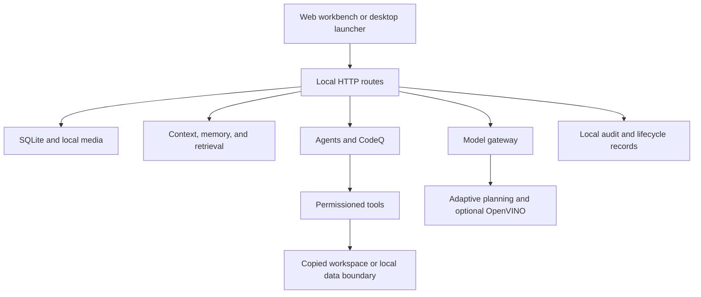
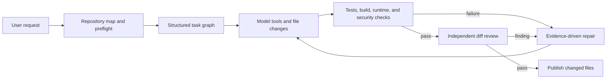

# OpenAgent Architecture and Design Notes

This is a working design record for OpenAgent. It describes what is in the
repository now and the boundaries that still matter when the project is run on
another machine. The source code, tests, and the more focused documents under
`docs/` take precedence if this note becomes stale.

The comparison work that informed this document was done as a clean-room
review of public behaviour and source structure. No source files, assets, or
documentation text from another project are part of OpenAgent.

## Current Shape

OpenAgent is a Python local service with a browser workbench and a native
Windows launcher. SQLite is the authoritative local store. Optional engines
and providers attach through explicit boundaries rather than being assumed at
startup.



The normal request path is:

1. A local client sends a request to the workbench API.
2. The route selects the relevant service and project scope.
3. The service reads only the context it needs from local storage.
4. A model, tool, workflow, or deterministic fallback does the work.
5. The result and any action evidence are stored locally.
6. External calls are allowed only through their explicit approval boundary.

## What Is Working Locally

- The stable workbench runs on `127.0.0.1:8765` through `openagent.workbench`.
- `openagent.server` remains a compatibility entry point while route handlers
  live under `openagent/routes/`.
- Chat supports local fallback behaviour plus configured Ollama, llama.cpp, and
  OpenAI-compatible providers. A provider record is not proof that its server
  or model is installed.
- Knowledge uses local text search, local vectors, source lineage, graph
  records, and optional FAISS/Chroma adapters. External research is a separate
  approved path.
- Agents share project context and have deterministic local fallbacks. Model-
  backed execution depends on the configured gateway and installed model.
- CodeQ inspects repositories, creates plans, edits a protected copy, runs
  local checks, records failures, retries bounded repairs, reviews the diff,
  and publishes verified changes back to the selected folder. The local copy
  and optional Docker path are boundaries for the application; they are not a
  replacement for a hardened operating-system sandbox.
- Scientific AI includes the heat-equation solver, Fourier/ridge surrogate,
  DeepONet path, engineering workflows, evidence fusion, and verification.
  FNO and PINN are labelled baselines in the scientific documentation.
- The shared runtime has typed requests and results, policy checks, traces,
  bounded output, an audited terminal adapter, and capability planning. The
  registry is intentionally small while CodeQ, workflow, browser, and provider
  tools keep their established contracts.
- MCP has durable server/tool configuration and a bounded stdio or HTTP
  JSON-RPC invocation path. Long-lived sessions, provider authentication, and
  broad protocol certification are not claimed here.

## Compute Boundary

The adaptive engine parses supported model metadata and produces separate
prefill/decode and device-placement plans. It can use an isolated OpenVINO
runtime when the required environment and model are present. CPU and Arc GPU
numeric probes have been checked locally; the Intel NPU is discovered on the
development machine but is not marked usable when its vendor compiler fails.

The engine reports this distinction in its status. It does not turn a device
inventory row into a performance claim, and it cannot make a dense 200B model
interactive on a laptop that cannot hold or stream its active weights.

## CodeQ Request Lifecycle



CodeQ stops with a failure or an attention state when the required compiler,
SDK, emulator, database, credential, or external service is unavailable. It
does not claim a production release from a source-only run. Pushes,
deployments, payments, DNS changes, app-store submissions, and other
irreversible actions remain explicit operations.

## Evidence

The supported full suite is run with:

```powershell
D:\openagent\.venv\Scripts\python.exe -m unittest discover -s tests -q
```

The repository also checks Python compilation, the browser JavaScript syntax,
route contracts, the desktop manifest, and the live workbench health endpoint.
The exact result belongs to the run that produced it; it should not be copied
into a future release note without running the checks again.

## Next Engineering Work

The remaining work is mostly depth and deployment proof:

- finish moving every domain handler behind the shared runtime contract;
- add long-lived MCP session and authentication fixtures;
- certify provider-specific mailbox and calendar behaviour with operator-owned
  credentials;
- add real image/VLM and scientific simulator integrations where the host has
  those tools installed;
- keep CodeQ validation evidence-based for new framework profiles and external SDKs;
- run clean-environment packaging, installer upgrade, multi-user, accessibility,
  browser, and crash-recovery checks in the target CI matrix.

These are concrete follow-up items, not hidden claims about the current build.
