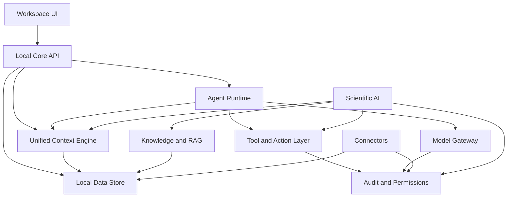

# OpenAgent Architecture

OpenAgent is a local-first AI workspace made of small, auditable layers. The repository includes the local core, model gateway, context and memory services, agents, tools, knowledge/RAG, research, CodeQ, scientific workflows, and the workspace UI. The sections below describe the current boundaries rather than a promise that every optional provider is installed.

## Layer Responsibilities

### Workspace UI

The user-facing surface for chats, projects, dashboards, agents, workflows, and memory. The current UI is a static local workspace served by the core.

### Local Core API

The local HTTP boundary for the platform. It remains self-hosted, explicit, and safe by default. `openagent.server` preserves the public entry point while the route package owns the domain handlers. The current API includes health, event ingestion, context, chat, model, agent, knowledge, workflow, CodeQ, research, voice, developer, and production-control routes.

### Unified Context Engine

Builds a living local context from events, documents, conversations, tasks, and actions. The current implementation builds snapshots from local events, conversations, documents, and project-scoped records. Retrieval is selective: a model call does not receive every historical record simply because it exists in the database.

### Local Data Store

Owns durable user data. The runtime uses SQLite because it is local, portable,
inspectable, and easy to back up. Vector indexes, graph records, and the local
encrypted vault are kept behind their own services while SQLite remains the
authoritative local store.

### Agent Runtime

Runs specialized agents over shared context. Built-in roles can use the model gateway, and deterministic local fallbacks keep basic plans available when no model server answers. Model-backed work still depends on the configured provider and its installed model.

### Tool and Action Layer

Executes the local file, terminal, browser, communication, and workflow paths present in the repository. The shared runtime provides typed requests, policy decisions, traces, bounded output, and an audited terminal adapter. CodeQ and workflow tools retain their established contracts while additional adapters are migrated behind the shared runtime.

### Model Gateway

Routes requests across the local provider, Ollama, llama.cpp, and OpenAI-compatible endpoints. The adaptive engine can add local OpenVINO and other capability-aware plans when the optional runtime is installed. Metadata for other backends is not the same as a working backend, so the gateway reports availability instead of assuming that CUDA, Metal, vLLM, TensorRT, or an NPU is usable.

### Knowledge and RAG

Ingests local documents and other supported records. The current path provides FTS search, local vectors, optional FAISS and Chroma adapters, graph records, reranking, source attribution, and memory consolidation. External web evidence requires the relevant research or connector path and its approval boundary.

### Connectors

Stores and processes email, calendar, chat, CRM, files, and external API records. Local fixtures and configured adapters are available in the core; live provider exchange is opt-in, credential-dependent, and scoped by permission.

### Audit and Permissions

Cross-cutting controls for secrets, approvals, tool execution, logs, rollback, and user-visible history.

### Scientific AI

The scientific layer is a vertical capability on top of the existing runtime.
Its planner selects typed local tools, its memory records assumptions and
measurements, and its verifier checks the result before a report is returned.
It does not create a separate model gateway or bypass the normal audit path.

## Data Boundary

OpenAgent's default boundary is the user's machine or self-hosted infrastructure. Data should not leave that boundary unless the user configures a provider and approves the action.

## Build Strategy

1. Keep the local core small and durable.
2. Add model and retrieval capabilities behind explicit interfaces.
3. Add actions only with permissions and audit logs.
4. Make advanced automation possible without weakening local ownership.
