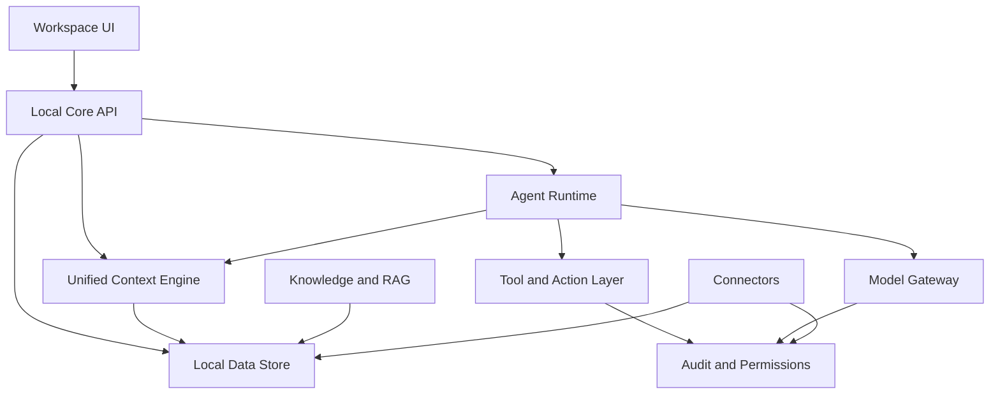

# OpenAgent Architecture

OpenAgent is a local-first AI operating system made of small, auditable layers. The first implementation in this repository focuses on the local core, context engine, storage, starter agents, and workspace UI.

## Layer Responsibilities

### Workspace UI

The user-facing surface for chats, projects, dashboards, agents, workflows, and memory. The current UI is a static local workspace served by the core.

### Local Core API

The local HTTP boundary for the platform. It should remain self-hosted, explicit, and safe by default. The current core exposes health, event ingestion, context, search, and agent-run endpoints.

### Unified Context Engine

Builds a living local context from events, documents, conversations, tasks, and actions. The current implementation creates a basic snapshot from local events and top terms.

### Local Data Store

Owns durable user data. The bootstrap uses SQLite because it is local, portable, inspectable, and easy to back up. Future versions can add vector indexes, graph storage, and encrypted vaults without replacing the core ownership model.

### Agent Runtime

Runs specialized agents over shared context. The starter agents are deterministic and local. Future agents should use the model gateway and permissioned tools rather than calling providers directly.

### Tool and Action Layer

Executes browser, desktop, file, API, communication, and workflow actions. Every action should be permissioned, auditable, and reversible where possible.

### Model Gateway

Routes requests across local, cloud, and hybrid models. It should support Ollama, llama.cpp, vLLM, OpenAI-compatible APIs, ONNX Runtime, TensorRT, and future providers through explicit configuration.

### Knowledge and RAG

Ingests documents, media, messages, notes, and websites. It should provide hybrid retrieval, vector retrieval, graph retrieval, reranking, source attribution, and memory consolidation.

### Connectors

Integrates email, calendar, chat, CRM, files, and external APIs. Connectors must be opt-in and scoped by permission.

### Audit and Permissions

Cross-cutting controls for secrets, approvals, tool execution, logs, rollback, and user-visible history.

## Data Boundary

OpenAgent's default boundary is the user's machine or self-hosted infrastructure. Data should not leave that boundary unless the user configures a provider and approves the action.

## Build Strategy

1. Keep the local core small and durable.
2. Add model and retrieval capabilities behind explicit interfaces.
3. Add actions only with permissions and audit logs.
4. Make advanced automation possible without weakening local ownership.

