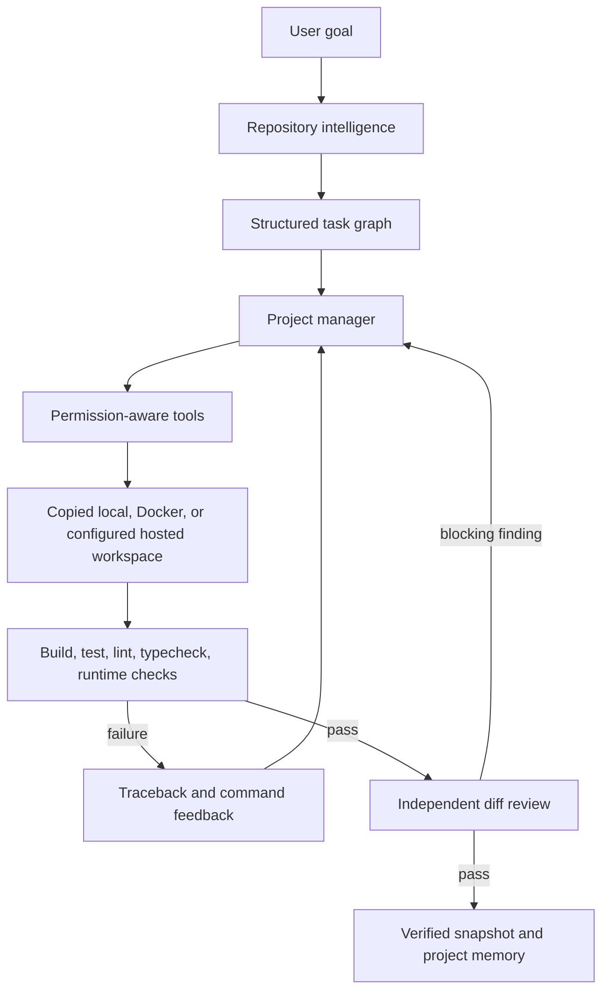

# Autonomous Software Engineering

CodeQ turns a software request into a controlled engineering run. It is a full-width primary workspace directly below **Chat** in the sidebar and works against a copied repository workspace. The original repository is not modified by autonomous tools. The `/api/codebase/*` namespace remains stable for integrations and older clients.

## How a run works



The controller does not treat a generated patch as success. A run reaches `completed` only after every task is complete, every enabled completion check exits successfully, the error-artifact scan passes, and the independent reviewer returns no critical or high finding. Validation and review failures create debugger tasks and return to implementation while the iteration budget remains. Reaching the iteration limit with unfinished work is a failure, never a successful completion.

## Repository intelligence

When a repository is opened, OpenAgent records:

- languages and file counts;
- framework and database hints;
- entry points, configuration files and test files;
- install, development, test, build, lint and typecheck commands;
- package dependencies and database-model declarations;
- Python and common source-code symbols;
- imports, dependency edges, Python call edges and route declarations;
- branch, commit and working-tree state;
- a bounded lexical context index.

Context selection ranks filenames and matching source regions. Large generated directories, virtual environments, dependency trees, caches and build output are excluded. This keeps model context focused without pretending that a large repository fits in one prompt.

## Workspaces and snapshots

Each codebase project has a workspace record containing its source path, sandbox backend, workspace path and agent branch. The local backend copies the project below the OpenAgent data directory. The Docker backend mounts that copied workspace into `/workspace`, disables container networking and applies CPU and memory limits. A hosted backend can be connected through `OPENAGENT_HOSTED_SANDBOX_COMMAND`; the adapter receives the versioned `openagent.sandbox.v1` JSON protocol over standard input and must return structured command evidence as JSON.

OpenAgent creates a snapshot before an autonomous run and another after successful verification. Snapshot extraction rejects paths that leave the restore directory. Run history, resume and snapshot restoration are available under **Run settings and history** in CodeQ.

The local backend is process isolation plus a strict filesystem boundary; it is not an operating-system security boundary. Use Docker or a separately hardened worker for untrusted repositories. This distinction is intentional and reflected in the UI.

## Tool policy

| Risk | Behaviour | Examples |
|---|---|---|
| 0 | Runs automatically | read files, search, Git status, diff and log |
| 1 | Runs only in the copied sandbox | file edits, managed processes, tests, builds, lint, typecheck and local browser inspection |
| 2 | Pauses for user approval | dependency installation, deletion, commits, checkout, reset, revert and external browser navigation |
| 3 | Never autonomous | Git push, deployment, database drops, DNS changes, email and purchases |

Commands run without shell interpolation. System administration executables are blocked. Recognised language and build tools run only inside the workspace. Managed development processes expose status and bounded logs and are stopped when a run finishes. Secrets are removed from the inherited process environment and token-like values are redacted from events and stored command output. Raw vault values are never placed in prompts or autonomous shell environments.

## Agents and communication

One project manager owns the loop. It can assign bounded tasks to architect, programmer, tester, debugger and reviewer roles. Architecture, coding/debugging and review roles can be routed to different models from the interface. The roles communicate through task records, tool results and structured findings rather than unrestricted conversations.

The reviewer receives the goal and Git diff, not the coder's reasoning. Findings use a stable shape:

```json
{
  "severity": "high",
  "file": "src/auth.ts",
  "line": 92,
  "issue": "Reset token expiry is not checked.",
  "evidence": "const payload = verifyToken(token)"
}
```

Critical and high findings block completion only when the cited file and exact evidence occur in the reviewed diff. This prevents an undersized local reviewer from turning an invented file or unsupported claim into a repair loop.

The number of active roles follows the task graph. OpenAgent does not start a fixed collection of agents for every request.

## Durable data

The local SQLite database stores codebase projects, workspaces, runs, tasks, tool calls, file-change hashes and patches, validation runs, lifecycle events, approvals, snapshots and project memories. Interrupted desktop runs are marked `interrupted` at startup and can be resumed.

Project memory records the detected stack, commands, preferences, recent run outcomes, current Git state and last successful validation. Repository state remains separate from conversation history so a resumed run does not depend on reconstructing facts from chat messages.

## IDE and browser evidence

CodeQ is a full-height IDE surface with a compact workspace title bar, hierarchical Explorer, closable multi-file tabs, breadcrumb, line-numbered code canvas, docked terminal, Git output, Copilot-style agent rail, and branch, workspace, cursor, encoding, and language status. **Open folder** launches the operating-system folder chooser. The selected repository is then copied into the configured OpenAgent data directory before tools can edit it. Unsaved buffers remain associated with their tabs while the user moves between files.

The Copilot rail keeps the request, task progress, live events, validation evidence, and approval state in one conversation-like feed. Run history, snapshots, model routing, and completion gates are available in the collapsed settings area instead of occupying the normal editing flow. Terminal, test, Git, and browser actions used before an autonomous request are attached to a durable interactive IDE session, so exploratory work remains traceable without forcing the user to start an agent run.

The `browser_inspect` tool opens a supplied HTTP application with Playwright, performs a bounded sequence of selector, role or test-id actions, captures page and JavaScript console errors, and stores a full-page screenshot below `.openagent/browser-artifacts`. It requires a complete HTTP URL; a missing URL is returned to the agent for repair instead of producing an external-navigation approval. Loopback navigation is sandbox risk level 1, while valid external navigation pauses for approval. Approval resolution is idempotent and queues long-running work outside the HTTP request, so reconnecting the interface cannot execute the same action twice. Rejecting an action returns the task to the agent to choose a local alternative.

For a small standalone web workspace, invalid model actions are replaced with bounded file operations that establish a semantic HTML, CSS, and JavaScript baseline. The normal artifact scan and independent review still decide completion. This recovery path lets lightweight local models create a usable first page without inventing shell or browser tools.

## Live events

The endpoint `GET /api/codebase/runs/{id}/events/stream` emits server-sent events. Event types include:

- `run.created`, `run.completed`, `run.failed` and `run.cancelled`;
- `repository.analysed` and `plan.created`;
- `agent.started`, `agent.thinking`, `agent.handoff`, `task.created`, `task.completed`, `task.continued` and `repair.requested`;
- `tool.started`, `tool.completed` and `tool.failed`;
- `command.stdout` and `command.stderr`;
- validation start/pass/fail, process lifecycle and browser-evidence events;
- `approval.required` and `approval.resolved`;
- snapshot and independent-review events.

The web workspace consumes the stream with authenticated `fetch` and falls back to the durable event endpoint if a stream is interrupted.

## API

Primary routes:

- `POST /api/codebase/projects`
- `POST /api/codebase/folder-picker`
- `GET /api/codebase/projects`
- `GET /api/codebase/projects/{id}/tree`
- `GET|POST /api/codebase/projects/{id}/file`
- `POST /api/codebase/projects/{id}/scan`
- `POST /api/codebase/projects/{id}/tools`
- `POST /api/codebase/runs`
- `GET /api/codebase/runs/{id}`
- `POST /api/codebase/runs/{id}/cancel`
- `POST /api/codebase/runs/{id}/resume`
- `GET /api/codebase/runs/{id}/events/stream`
- `POST /api/codebase/runs/{id}/tools`
- `POST /api/codebase/approvals/{id}/resolve`
- `POST /api/codebase/runs/{id}/snapshots/{snapshot_id}/restore`

With authentication enforcement enabled, reads require `codebase:read` and writes require `codebase:write`. Every action that crosses a risk boundary is persisted and auditable.

## Privacy boundary

Opening a repository is an explicit local read. Files are copied into the configured OpenAgent data directory. Local model routes keep selected code on the machine. Selecting an external model and enabling the external-model switch permits the selected repository context to leave the machine; the setting applies per run and is stored with the run record. Docker networking is disabled by default. Dependency installation requires approval because it may contact a package registry.
