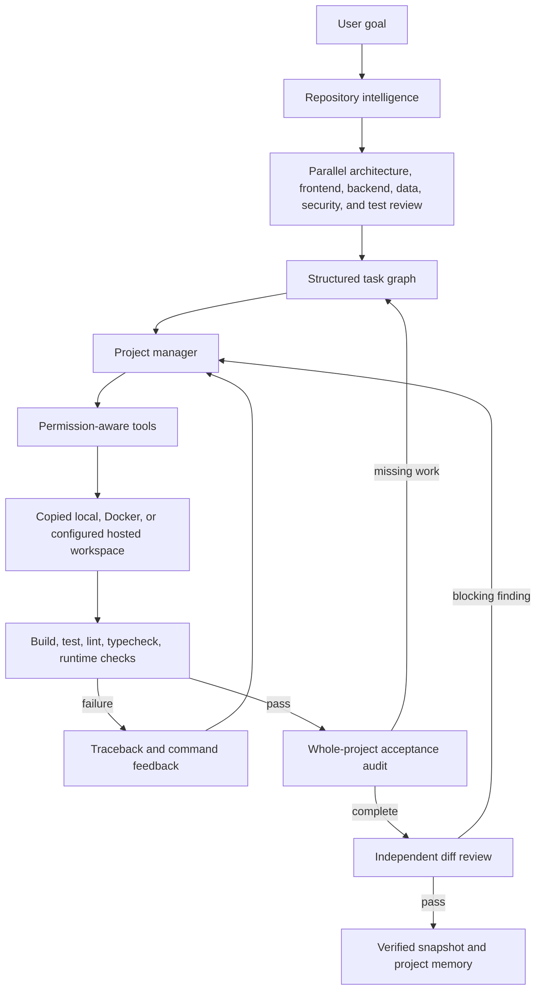
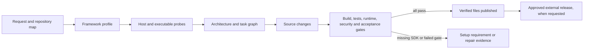

# Autonomous Software Engineering

CodeQ turns a software request into a controlled engineering run. It is a full-width primary workspace directly below **Chat** in the sidebar and works against a copied repository workspace. Autonomous tools do not touch the selected folder during implementation; verified changes are published there only after the completion gates pass. The `/api/codebase/*` namespace remains stable for integrations and older clients.

## How a run works



The controller does not treat a generated patch as success. A run reaches `completed` only after every task is complete, every enabled completion check exits successfully, the error-artifact scan passes, and the independent reviewer returns no critical or high finding. Validation and review failures create debugger tasks and return to implementation while the iteration budget remains.

Task progress comes from tool evidence as well as the model's `done` field. A successful file change can close an implementation task, and a successful test, build, inspection, or repository check can close a validation task. This matters for small local models that perform the requested action but forget to set `done: true`. Final validation and review still decide whether the run is complete. If a model produces no file change or validation result for three consecutive repair attempts, the run stops with a model-stall explanation instead of spending the remaining budget on the same read-only action.

The retry loop also detects no-progress command failures. An identical command may be retried once, but a second identical failure with no intervening repository change ends the run with the real command and error output. This prevents a blocked package registry, missing executable, or unchanged build failure from consuming the whole iteration budget while still allowing a debugger edit to reset the retry record.

## Planning greenfield and existing work

CodeQ uses the repository map and the request together. An existing application is inspected before changes are proposed; selected source regions, symbols, dependencies, routes, tests, and stored project commands become the working context. A new or effectively empty folder follows a bootstrap path that creates concrete artifacts first and validates them immediately. Empty directories do not make a workspace look like an established codebase.

The project-manager model plans both existing and greenfield work. If the user names a stack, that choice becomes part of the delivery contract. If no stack is named, the profile remains `model-selected`; CodeQ passes the product goal, repository map, project memory, and independent specialist reports to the manager instead of silently choosing React or Python. The resulting task graph is accepted only when it contains implementation and validation work. An empty or malformed model plan uses a stack-neutral deterministic plan so the run can continue through the normal model, tool, repair, and verification loop.

The project manager chooses the smallest useful set of roles for each run. A narrow function can stay with one programmer and one tester. A larger product can involve architecture, frontend, backend, database, security, testing, debugging, review, and documentation specialists. Independent specialists examine the request and repository concurrently and produce a shared architecture and acceptance contract. The project manager then creates the dependency graph from that contract.

Tasks without dependencies can generate their next action batches concurrently. File mutations are applied in a stable order. If two agents propose changes to the same path, the later decision is discarded and regenerated against the updated repository. This preserves parallel analysis and code generation without accepting last-writer-wins corruption. Parent task identifiers and dependencies remain durable, so a model can create focused sub-work instead of starting an unbounded agent conversation.

Planner output is normalized before execution. A dependency may use a task ID or the exact title of one uniquely named task; title references are converted to durable IDs. Duplicate, self-referential, cyclic, and nonexistent edges are recorded and removed. The same normalization runs when an older failed run is resumed and once more if execution reaches a graph with unfinished work but no runnable task. If the graph still cannot move, the run reports the blocked task IDs and their unresolved dependencies instead of returning a generic failure.

Lightweight local models occasionally use a correct tool with a different argument name, such as `query` instead of `symbol`. CodeQ normalizes a bounded set of these aliases before validation. It also catches narration masquerading as execution, including an `echo` or process launch that only says a file is being created. For small Python and standalone web requests, the controller replaces that action with file creation and focused tests. The replacement is visible as `model.action_replaced` in the run history.

## Repository intelligence

When a repository is opened, OpenAgent records:

- languages and file counts;
- framework and database hints;
- entry points, configuration files and test files;
- install, development, test, build, lint and typecheck commands;
- package dependencies and database-model declarations;
- Python and common source-code symbols;
- imports, dependency edges, Python call edges and route declarations;
- branch, commit and working-tree state;
- a bounded lexical context index.

Context selection ranks filenames and matching source regions. Large generated directories, virtual environments, dependency trees, caches and build output are excluded. This keeps model context focused without pretending that a large repository fits in one prompt.

## Workspaces and snapshots

Each codebase project has a workspace record containing its source path, sandbox backend, workspace path and agent branch. The local backend copies the project below the OpenAgent data directory. The Docker backend mounts that copied workspace into `/workspace`, disables container networking and applies CPU and memory limits. A hosted backend can be connected through `OPENAGENT_HOSTED_SANDBOX_COMMAND`; the adapter receives the versioned `openagent.sandbox.v1` JSON protocol over standard input and must return structured command evidence as JSON.

The folder selected by the user is the delivery target. CodeQ never edits it while a run is incomplete: tools operate in the protected working copy, snapshots preserve recovery points, and validation plus independent review run there. Once every gate passes, CodeQ copies only that run's changed files back to the selected folder. Existing destination files are backed up under `codebase-source-backups/<run-id>` before replacement. A failed, cancelled, or blocked run does not publish source changes.

OpenAgent creates a snapshot before an autonomous run and another after successful verification. Snapshot extraction rejects paths that leave the restore directory. Run history and snapshots remain durable in the local runtime and API without taking space from the main coding rail.

The local backend is process isolation plus a strict filesystem boundary; it is not an operating-system security boundary. Use Docker or a separately hardened worker for untrusted repositories. This distinction is intentional and reflected in the UI.

## Tool policy

| Risk | Behaviour | Examples |
|---|---|---|
| 0 | Runs automatically | read files, search, Git status, diff and log |
| 1 | Runs only in the copied sandbox | file edits, recognized dependency managers, managed processes, tests, builds, lint, typecheck and local browser inspection |
| 2 | Pauses for user approval | unrecognized executables, external browser navigation, and selected Git mutations |
| 3 | Never autonomous | Git push, deployment, database drops, DNS changes, email and purchases |

Commands run without shell interpolation. System administration executables are blocked. Recognised language and build tools run only inside the workspace. Managed development processes expose status and bounded logs and are stopped when a run finishes. Secrets are removed from the inherited process environment and token-like values are redacted from events and stored command output. Raw vault values are never placed in prompts or autonomous shell environments.

## Agents and communication

One project manager owns the loop. It can assign bounded tasks to architect, frontend, backend, database, programmer, tester, debugger, security, reviewer, and documentation roles. Each role can use the run's default model or a role-specific model policy. The roles communicate through task records, tool results, repository state, and structured findings rather than unrestricted conversations.

The reviewer receives the goal and Git diff, not the coder's reasoning. Findings use a stable shape:

```json
{
  "severity": "high",
  "file": "src/auth.ts",
  "line": 92,
  "issue": "Reset token expiry is not checked.",
  "evidence": "const payload = verifyToken(token)"
}
```

Critical and high findings block completion only when the cited file and exact evidence occur in the reviewed diff. This prevents an undersized local reviewer from turning an invented file or unsupported claim into a repair loop.

The number of active roles follows the task graph. OpenAgent does not start a fixed collection of agents for every request.

## Durable data

The local SQLite database stores codebase projects, workspaces, runs, tasks, tool calls, file-change hashes and patches, validation runs, lifecycle events, approvals, snapshots and project memories. Interrupted desktop runs are marked `interrupted` at startup and can be resumed.

Project memory records the detected stack, commands, preferences, recent run outcomes, current Git state and last successful validation. Repository state remains separate from conversation history so a resumed run does not depend on reconstructing facts from chat messages.

## IDE and browser evidence

CodeQ is a full-height IDE surface with a compact workspace title bar, hierarchical Explorer, closable multi-file tabs, breadcrumb, line-numbered code canvas, docked terminal, Git output, agent rail, and branch, workspace, cursor, encoding, and language status. **Open folder** launches the operating-system folder chooser directly. Explorer controls create files and folders, rename or move the selected path, and delete it after confirmation. These explicit IDE operations keep the copied workspace and selected folder synchronized; protected metadata, dependency, environment, cache, and build directories cannot be changed through the Explorer. Unsaved buffers remain associated with their tabs while the user moves between files.

The CodeQ rail keeps the request, task progress, live events, validation evidence, and recovery state in one conversation-like feed. Previous requests can be copied or returned to the editor. **Send** and **Stop** use the same compact icon position, and a connection interruption is reconciled against durable run history before the interface reports that a run failed to start. Progress appears as an unboxed vertical stepper covering planning, file operations, commands, repair and verification. It reports observable activity rather than exposing private model reasoning. Provider routing, specialist models, iteration budget, and completion gates are inferred automatically from the request and repository. Terminal, test, Git, and browser actions used before an autonomous request are attached to a durable interactive IDE session, so exploratory work remains traceable without forcing the user to start an agent run.

An autonomous run receives a task-sized controller budget from 24 to 200 iterations and may create as many as 100 structured tasks. These are ceilings rather than a fixed amount of work; CodeQ stops as soon as implementation, validation, and independent review pass.

The `browser_inspect` tool opens a supplied loopback HTTP application with Playwright, performs a bounded sequence of selector, role or test-id actions, captures page and JavaScript console errors, and stores a full-page screenshot below `.openagent/browser-artifacts`. It requires a complete HTTP URL; a missing URL is returned to the agent for repair. Loopback navigation is automatic. External navigation is outside the default private boundary, so the controller receives repair feedback and chooses a local alternative instead of stopping for repeated approval.

CodeQ classifies a new request by product type, language, and framework before it creates the task graph. The profile covers browser applications, services, command-line tools, libraries, desktop and mobile applications, games, and data projects across the repository-native stack or an explicitly requested stack. New projects receive foundation, implementation, test, and validation tasks; existing projects continue to use repository-aware planning. Structural delivery contracts prevent a React request becoming one HTML file, a Rust request completing without `Cargo.toml`, or a Go service completing without a module and entrypoint.

Small malformed-model recovery remains available where a deterministic result is honest: standalone browser pages, Vite/React sign-in work, focused Python functions, and compact Django sites. These adapters are not the primary coding path. The model receives each task first; an adapter is selected only when the response is missing, invalid, or does not create the framework artifacts required by that task. Every other project stays in the general model-tool-repair loop. Narration-only implementation steps and validation steps without executable evidence are rejected and retried instead of being marked complete. Completion commands are rediscovered after greenfield files are created, so generated test and build scripts become real gates once their toolchain and dependencies are present.

The controller and file tools are language-neutral. Current structural contracts recognize React, Next.js, Vue, Svelte, Angular, Django, FastAPI, Flask, Node, Go, Rust, Tauri, .NET, Spring, Flutter, React Native, native Android and iOS, Electron, Solidity, Rails, Laravel, Phoenix, Godot, Unity, Unreal, CMake, and Zig projects. A different stack can still be planned and edited through the general path, but CodeQ reports missing executables or unavailable dependencies as real validation failures; it does not claim a build passed when the required toolchain is absent.

## Framework and environment preflight

CodeQ separates source generation, local validation, and external release work. Before specialists propose an architecture, the preflight classifies the requested stack, checks the current host, resolves required executables from `PATH`, and records platform or provider requirements. The result is included in the architecture contract and emitted as `environment.preflight.completed` so the IDE can show the selected stack and toolchain state while work is running.



The catalog covers browser and server frameworks, native desktop and mobile stacks, C/C++, Rust, Go, Zig, JVM and .NET applications, Flutter, game engines, and Solidity projects. Repository scanning recognizes their common manifests and source extensions, then discovers native validation commands such as `cargo test`, `go test`, `forge test`, `mix test`, `flutter test`, and `zig build test` where the project provides enough structure.

Preflight does not claim that unavailable host software has been installed. Xcode cannot be supplied by a Windows run, an Android build still needs the Android SDK, Unreal and Unity need their editors and target modules, firmware needs physical hardware, and Kubernetes or enterprise integrations need their real environments. CodeQ can prepare source, manifests, tests, and deployment definitions in the protected workspace; certification remains pending until the corresponding compiler, SDK, emulator, database, cluster, device, or provider is available and the requested gates pass.

Model selection follows the same evidence rule. The project manager and relevant specialists receive the repository context and preflight, while implementation, debugging, security review, and acceptance review can use role-specific model policies. A response is never accepted merely because a model says the work is complete. Concrete file changes, executable checks, whole-project acceptance review, and independent diff review determine completion.

Production deployment, cloud mutations, app-store submission, payment configuration, DNS changes, pushes, and secret-bearing provider setup remain outside unattended execution. They require explicit approval and real credentials delivered through the secret boundary; secrets are not copied into prompts or persisted tool output.

## CodeQ generator SDK

The same contracts used by the desktop service are available as a Python SDK. This is the supported extension point for a framework, compiler, internal platform, or domain-specific project type that is not part of the built-in catalog.

```python
from openagent.codebase import (
    CodeQSDK,
    DeclarativeFrameworkAdapter,
    GeneratorRegistry,
)
from openagent.codebase.frameworks import FrameworkSpec

registry = GeneratorRegistry()
registry.register(DeclarativeFrameworkAdapter(
    FrameworkSpec(
        id="acme-runtime",
        label="Acme Runtime",
        languages=("acme",),
        manifests=("acme.toml",),
        required_tools=(("acmec",),),
        external_requirements=("Acme target simulator or device",),
    ),
    keywords=("acme runtime",),
    artifacts={
        "all": ["acme.toml"],
        "any_suffix": [".acme"],
        "minimum_files": 3,
    },
    commands={"test": "acmec test", "build": "acmec build"},
))

contract = CodeQSDK(registry).prepare("Build an Acme Runtime service")
```

An adapter provides detection, framework metadata, artifact requirements, validation commands, and preflight behavior. Advanced adapters may implement the `FrameworkAdapter` protocol directly. Installed packages can publish adapters through the `openagent.codeq.frameworks` entry-point group; discovery errors are isolated in `GeneratorRegistry.plugin_errors` rather than preventing OpenAgent from starting.

The returned generation contract contains:

- repository and request profile;
- framework and artifact contract;
- host, compiler, SDK and external-environment preflight;
- validation commands and mandatory gates;
- role-routed model capability requirements;
- explicit acceptance criteria;
- environment preparation steps that distinguish local setup from approved external work.

Command-line access uses the installed `openagent-codeq` command:

```powershell
openagent-codeq catalog
openagent-codeq inspect D:\work\my-project
openagent-codeq preflight "Build a Rust command-line package" --repository D:\work\my-project --accept "cargo test passes"
```

The CLI emits JSON so it can be used by IDE extensions, build systems, and orchestration services. It creates contracts and repository maps; autonomous editing remains owned by the CodeQ service so task history, approvals, snapshots, and source publication stay durable and auditable.

Static-site requests carry an explicit page-count contract. For example, a request for four static pages must leave four linked HTML documents plus their shared assets in the selected folder. CodeQ treats `static` as a plain browser project rather than silently substituting React, checks the requested page count during artifact validation, and publishes only after that check passes. Managed preview or dependency processes may report a running state without an exit code; the controller waits for real completion evidence instead of interpreting that state as a command failure.

Named frameworks are never routed through the plain-page recovery path. A Django request is planned and validated as Django, including `manage.py`, project configuration, application routes, templates, static assets and dependency metadata. The built-in Django bootstrap covers small greenfield sites when a local coding model returns unusable actions; requested page counts and names remain part of the artifact contract, and the normal model-driven loop continues to handle larger framework work.

For a request that adds a page with sample or dummy content, CodeQ keeps the recovery path idempotent. Preparation, implementation, and validation tasks inspect the same protected workspace and reuse one generated page artifact. A retry therefore repairs or validates that page instead of creating a growing sequence of placeholder files.

Framework detection tolerates a tightly bounded spelling error in a known framework name. This is intended for prompts such as `djnaog` where the surrounding request clearly asks for a Django backend; it does not guess a stack from unrelated prose. Django is treated as an integrated server framework, so a full-stack delivery does not need an artificial `backend/` directory to prove that a backend exists. The small-site recovery path also follows an explicitly requested frontend toolkit. A Bootstrap request receives Bootstrap navigation and assets, while a jQuery request receives jQuery behavior. `index` is normalized to the home route, and named pages such as Careers remain in the generated route and template contract.

Before a generated Django project can pass, CodeQ creates `.venv` inside the protected workspace, installs the generated `requirements.txt` there, and runs both `manage.py check` and `manage.py test`. The environment is excluded from source publishing; the selected folder receives the dependency manifest and application source. A package download or Django check failure blocks completion with its real command output.

Routine reads, edits, tests, builds, local managed processes, and loopback browser checks run automatically inside the copied workspace. Publishing verified file changes to the explicitly selected folder is part of successful completion; external URLs, pushes, deployments, purchases, DNS changes, and production database operations remain outside autonomous scope. This separation lets ordinary engineering work continue unattended without giving a model unrestricted control of the host machine.

## Live events

The endpoint `GET /api/codebase/runs/{id}/events/stream` emits server-sent events. Event types include:

- `run.created`, `run.completed`, `run.failed` and `run.cancelled`;
- `repository.analysed`, parallel-specialist lifecycle events, `plan.model.accepted`, `plan.fallback.selected`, and `plan.created`;
- `agent.started`, `agent.thinking`, `agent.handoff`, `task.created`, `task.completed`, `task.continued`, `plan.dependencies_repaired` and `repair.requested`;
- `tool.started`, `tool.completed` and `tool.failed`;
- `command.stdout` and `command.stderr`;
- validation start/pass/fail, process lifecycle and browser-evidence events;
- `approval.required` and `approval.resolved`;
- whole-project acceptance-audit, snapshot, source-publish, and independent-review events.

The web workspace consumes the stream with authenticated `fetch` and falls back to the durable event endpoint if a stream is interrupted.

## API

Primary routes:

- `POST /api/codebase/projects`
- `POST /api/codebase/folder-picker`
- `GET /api/codebase/frameworks`
- `POST /api/codebase/preflight`
- `GET /api/codebase/projects`
- `GET /api/codebase/projects/{id}/tree`
- `GET|POST /api/codebase/projects/{id}/file`
- `POST /api/codebase/projects/{id}/paths`
- `POST /api/codebase/projects/{id}/scan`
- `POST /api/codebase/projects/{id}/tools`
- `POST /api/codebase/runs`
- `GET /api/codebase/runs/{id}`
- `POST /api/codebase/runs/{id}/cancel`
- `POST /api/codebase/runs/{id}/resume`
- `GET /api/codebase/runs/{id}/events/stream`
- `POST /api/codebase/runs/{id}/tools`
- `POST /api/codebase/approvals/{id}/resolve`
- `POST /api/codebase/runs/{id}/snapshots/{snapshot_id}/restore`

With authentication enforcement enabled, reads require `codebase:read` and writes require `codebase:write`. Every action that crosses a risk boundary is persisted and auditable.

## Privacy boundary

Opening a repository is an explicit local read. Files are copied into the configured OpenAgent data directory. Local model routes keep selected code on the machine. Selecting an external model and enabling the external-model switch permits the selected repository context to leave the machine; the setting applies per run and is stored with the run record. Docker networking is disabled by default. Dependency installation requires approval because it may contact a package registry.
