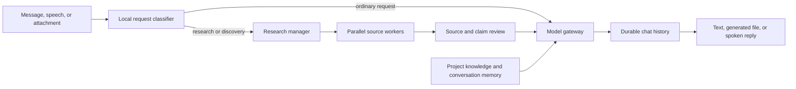

# Chat, Memory, Voice, and Research

Chat is the main conversational surface in OpenAgent. Ordinary model replies, source-backed research, local knowledge retrieval, document generation, attachments, and voice conversations all return to the same durable conversation record.

## Request flow

The classifier sends requests for current papers, product options, literature reviews, comparisons, and other discovery work through the research lifecycle. That lifecycle searches local evidence first. Public sources are contacted only for a request that clearly requires current external information. Results include source links and are stored as ordinary chat turns, so a follow-up can refer to the report without switching modules.

## Conversation memory

OpenAgent uses two complementary scopes:

- The active conversation supplies the latest 40 messages in chronological order. A bounded query selects the newest records before restoring their original order, so long chats do not fall back to their earliest turns.
- Project memory retrieves relevant user messages and knowledge events from other conversations in the same project. It is intended for stable preferences, named facts, and follow-up references. Results from unrelated projects are excluded.

Project memory is retrieval, not a promise that every old sentence is always included. Specific facts should be written clearly, and sensitive work should use a separate project when it must not influence other conversations.

## Attachments

The attachment button accepts common text, office, PDF, and image formats. The local media pipeline stores the asset, extracts available text and metadata, and adds readable evidence to the project knowledge index. The current model receives a bounded attachment summary with the message.

PDF and office extraction depend on the installed document extras. Image files receive local metadata and any observations produced by the configured vision analyzer. OpenAgent reports extraction limitations instead of describing image content it did not inspect.

## Voice conversations

Pressing the microphone in Chat opens voice mode. The interface shows listening, transcribing, thinking, and speaking states. Speech is submitted to the selected local STT engine, the transcript becomes a normal user turn, and the response is read aloud with the system speech engine. After playback, voice mode listens for the next turn until **End voice conversation** is pressed.

Because every voice turn is a chat message, the complete exchange appears in conversation history and uses the same project memory as typed messages.

## Conversation organization

The history rail shows active chats. The overflow button opens a fixed action menu for pin, archive, unarchive, and delete, avoiding nested menus inside the scrolling list. **Archived** switches the rail to archived-only results; **Back to chats** restores the active list.

## Privacy boundary

Attachments, transcripts, chat history, and local retrieval remain in the configured data directory. Selecting an external provider permits the bounded prompt context to leave the machine for that request. Current web research sends the research query to public source endpoints; it does not upload local attachments as search requests.
