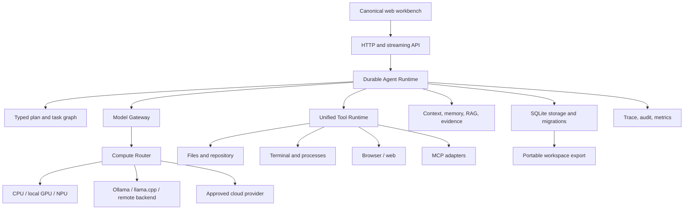

# OpenAgent Clean-Room Comparison and Architecture Plan

Date: 2026-08-14

Repositories reviewed:

- Mine: `D:\openagent`, commit `215024b` (`Fix CodeQ framework runs and runtime UI`)
- Reference: `D:\openagent-reference-analysis`, commit `e8dd8da` (`fix: resolve symlinks before placing the audit directory next to the binary`)

The reference repository was checked out separately for analysis. No source file, asset, documentation text, or implementation detail from it is part of this project. The comparison below records product ideas and observable contracts only, then proposes implementations that fit OpenAgent's existing Python, SQLite, local-first architecture.

The reference code could not be compiled in this environment because Go is not installed. Reference classifications therefore come from source inspection, tests present in the checkout, configuration, and call paths. They are not claims that the reference's current build passed here.

## 1. Executive Summary

OpenAgent is already a broad local AI workspace rather than a thin chat client. Its strongest foundations are the Python package, the local HTTP workbench, SQLite persistence, explicit provider boundaries, scientific tooling, adaptive execution work, research lifecycle, durable jobs, and the new CodeQ generator contract. The reference project is stronger in operational product breadth: a single self-contained binary, a mature admin surface, a large model-provider catalog, a configurable tool registry, browser/computer tools, MCP execution, richer tenancy-oriented controls, and a more complete installation story.

The correct response is not to imitate the reference. OpenAgent should become a Python-native, local-first AI computing platform with four stable contracts:

1. `ModelGateway` for provider and compute selection.
2. A unified `ToolRuntime` for schemas, permissions, approvals, execution, cancellation, retries, and audit.
3. A durable `AgentRuntime` for plans, delegated work, checkpoints, and resumable state.
4. A packaging/runtime contract that serves the same web workbench from local desktop, headless server, Docker, and Colab.

The immediate architectural risk is not lack of features. It is duplication: CodeQ has its own tools and sandbox, `safe_terminal.py` is another execution surface, workflows have their own action policy, MCP currently stores configuration rather than executing a live protocol connection, and model/provider routing is separate from compute backend selection. These should be joined through stable interfaces without removing their existing public APIs.

The recommended first milestone is a compatibility-preserving tool and execution contract. It should wrap existing CodeQ tools, `SafeTerminal`, browser runtime, MCP metadata, workflow actions, and worker jobs. It must be completed before adding more model providers or UI surfaces because every new capability will otherwise create another isolated path.

### Current implementation checkpoint

The first part of that milestone is now present in the source tree. `openagent/tools/runtime/` defines the shared tool schema, request/result envelope, registry, policy, execution context, audit hook, and SafeTerminal adapter. `openagent/compute_router.py` provides a capability-aware planning layer over the existing `ModelGateway` and adaptive-engine health. The local workbench exposes both through `/api/tools/runtime`, `/api/tools/runtime/execute`, `/api/compute/status`, and `/api/compute/plan`.

MCP registration remains a durable configuration operation, and a registered tool can now use the explicit `/api/mcp/tools/{id}/invoke` path for a bounded stdio or HTTP JSON-RPC call. Approval, schema checks, output limits, connection events, and audit records are part of that path. This is not full long-lived MCP session coverage; SSE reconnection, provider authentication, and broader protocol fixtures remain separate work.

The Developer surface now shows the shared runtime and its current capability evidence. The new tests exercise a SafeTerminal call, an approval-required external tool, a local-only compute plan, and a fake stdio MCP server. These additions are intentionally additive: existing service methods and URLs remain available.

The module-health sweep now runs independent local probes in a bounded worker
pool and uses compute readiness rather than forcing a full hardware discovery
on every dashboard refresh. Detailed device evidence remains on the compute
status endpoint. This keeps the health view responsive without changing what a
provider or accelerator is allowed to claim.

## 2. My OpenAgent - Verified Current Architecture

### Entry points and process model

The packaging contract in `pyproject.toml` exposes:

- `openagent` -> `openagent.__main__:main`
- `openagent-desktop` -> `openagent.desktop:main`
- `openagent-workbench` -> `openagent.workbench:main`
- `openagent-hard-check` -> `openagent.hard_check:main`
- `openagent-worker` -> `openagent.worker:main`
- `openagent-production-proof` -> `openagent.production_proof:main`
- `openagent-codeq` -> `openagent.codebase.cli:main`

`openagent/__main__.py` dispatches to `server.run_server`. `openagent/server.py` is now a compatibility facade over `openagent.routes.runtime`; this preserves imports while route work moves into domain modules. `openagent/workbench.py` owns the stable desktop workbench port, currently `8765`, and serves the canonical files in `web/`. `openagent/desktop.py` adds the app-style launcher and installation/runtime discovery around that server.

The real request path is:

```text
CLI or desktop launcher
  -> routes.runtime / domain route module
  -> dependency bundle and service
  -> OpenAgentStore + provider/tool service
  -> JSON, stream, or persisted job result
  -> web/app.js workbench
```

### Persistence

`openagent/storage.py:OpenAgentStore` is the durable center. It initializes SQLite tables for context events, agent runs, conversations, chat messages, audit events, workflows, workflow runs, job queues, attempts, leases, dead letters, and migrations. Additional modules add their own tables through `initialize()` methods. This is practical for local-first operation and has migration/status tests, but the system still has a large number of service-owned schema extensions rather than one explicitly versioned domain migration package.

### Model and compute layer

`openagent/model_gateway.py` defines the `ModelProvider` protocol and concrete providers for local fallback, Ollama, llama.cpp, OpenVINO Direct, and OpenAI-compatible endpoints. `ModelGateway.complete`, `stream_complete`, and `complete_vision` implement provider selection, local-first route order, external approval, streaming, fallback, and vision routing. `openagent/core_runtime.py` chooses CPU-conscious model profiles, request budgets, and adaptive quantization recommendations. `openagent/adaptive_engine/` contains IR, frontends, compiler, backends, device runtime, KV memory, scheduler, autotuning, and worker modules.

The current evidence supports a strong local routing foundation, not a universal hardware compiler. CUDA, Metal, Level Zero, vLLM, and direct NPU execution are not all present as working backends in this checkout. The engine must report capability and fallback status honestly.

### Agent layer

`openagent/agents.py` provides built-in local agent roles and `openagent/multi_agent.py` provides delegation, parallel execution, verification, and approval-related orchestration. `openagent/assistant.py` owns personal-assistant workflows. `openagent/codebase/service.py:CodebaseService` is the most complete autonomous software-engineering path: repository map, model-driven task planning, specialist roles, tool actions, iteration, validation, review, snapshots, and publishing verified changes back to the selected source folder.

The CodeQ path is real and tested, but `service.py` remains a large domain service with deterministic compatibility fallbacks for certain request families. The new `openagent/codebase/sdk.py` adds a registry and framework adapter contract; it does not by itself make every language or platform generator available.

### Knowledge, memory, and research

- `openagent/knowledge.py:KnowledgeEngine` ingests text/files, chunks documents, stores entities/relationships/tags, performs lexical, semantic, hybrid, graph, synthesis, compression, and replay operations.
- `openagent/semantic_memory.py:SemanticMemoryManager` stores memories, versions, vectors, rerank runs, and graph snapshots.
- `openagent/advanced_rag.py:AdvancedRAGEngine` adds query variants, lane fusion, diversity selection, conflict detection, token packing, cache, confidence metrics, and grounded prompts.
- `openagent/vector_store.py` supplies the vector adapter boundary; optional FAISS/Chroma support is declared in the `rag` extra.
- `openagent/research.py:ResearchEngine` plans, analyzes, synthesizes, streams model output, and identifies queries needing current sources.
- `openagent/research_lifecycle.py:ResearchLifecycle` persists sessions, jobs, checkpoints, sources, source graphs, cancellation, retries, branching, archive/delete, and event streaming.

This is one of OpenAgent's clearest advantages. The main gap is retrieval and citation quality when external sources are involved: source acquisition, claim extraction, evidence entailment, and provider-specific web search need a single typed evidence model.

### Tools and execution

`openagent/codebase/tools.py` owns CodeQ filesystem, shell, Git, test, process, browser, and repository actions. `openagent/codebase/sandbox.py:SandboxManager` supports copied local workspaces, optional Docker/hosted backends, snapshots, restore, process tracking, and allowlisted environment variables. `openagent/safe_terminal.py:SafeTerminal` is a separate local command runner with output persistence. `openagent/tools/browser.py:BrowserRuntime` provides optional Playwright navigation, actions, screenshots, console error capture, local-only default policy, and explicit approval for external navigation.

`openagent/mcp_runtime.py:MCPRuntime` persists MCP servers, tools, permissions, and connection events. Its documented runtime is a registry/configuration boundary; it does not yet provide a full live MCP client executor equivalent to the reference's `mcp/model.go` call path.

### Automation and operations

`openagent/workflows.py:WorkflowEngine` supports definitions, conditions, parallel/triggered steps, schedules, file actions, agent actions, network gates, rollback records, visual layouts, and a background worker. `openagent/worker.py:WorkerRuntime` leases jobs, retries, dead-letters, reports progress, and dispatches research, workflows, model jobs, knowledge ingestion, scraping, calendar, communication, and fine-tuning work. `openagent/production_runtime.py:ProductionRuntime` adds queue jobs, audit anchors, vector indexes, connector adapters, encryption envelopes, OIDC/JWKS validation, app/agent packages, automation, device sync, and sandboxed plugin records.

### Security and identity

`openagent/auth.py` implements local accounts, PBKDF2 passwords, bearer sessions, scoped API tokens, and TOTP. `openagent/enterprise_identity.py`, `openagent/enterprise.py`, `openagent/security_privacy.py`, and route enforcement add enterprise records, security policies, secrets, retention, sandbox profiles, and authorization. This is meaningful local security infrastructure, but it is not yet a complete passkey/WebAuthn/federated identity product, and a single owner-scoping policy must be enforced consistently across every domain table.

### Packaging and UI

The package has no base dependencies and groups optional features in `pyproject.toml` as `voice`, `rag`, `science`, `media`, `security`, `browser`, `office`, and `full`. Web files are included through `tool.setuptools.data-files`. The current build succeeds and the source tree contains the UI, but a clean-environment wheel smoke test from a directory outside the repository remains a P0 proof requirement.

The canonical UI is `web/index.html`, `web/app.js`, and `web/styles.css`, served by the local HTTP runtime and opened by the desktop workbench. The UI is broad and operational, but its large client file and repeated module surfaces create regression risk as new product areas are added.

## 3. Reference OpenAgent - Verified Current Architecture

The reference checkout has 692 files and is primarily Go 1.25 with a React/Yarn frontend. `main.go` initializes flags, database adapter and tables, site endpoints, authz, proxy, cleanup workers, message retry workers, filters, and Beego. It defaults to port `14000`, stops an old instance, starts optional local OCR cleanup, and launches the browser when double-clicked.

### Backend and distribution

The reference is designed as a compiled single binary. `embed.go`, `embedsupport/`, and the Go embed/configuration files package frontend and static assets with the binary. `Dockerfile`, `docker-compose.yml`, release configuration, installer scripts, and the README's prebuilt binaries support a simpler first-run distribution than the current Python source/data-files path.

### Model/provider layer

The `model/` directory contains many provider implementations, including OpenAI-compatible and named adapters for Anthropic, Gemini, Bedrock, Cohere, Grok, Moonshot, Baichuan, and others. `model/mcp.go` wraps model tool calls and loops over returned tool calls. Provider implementation breadth is materially larger than ours, but breadth also increases maintenance, credential, pricing, and certification burden.

### Tool and agent layer

`tool/tool.go` defines a `Tool` interface with `BuiltinTools()`. `tool/builtin_tool.go` defines the registry and execution surface. Concrete tools include web search/fetch, shell, local file read/write/move, browser navigation/click/evaluate/screenshot, Browser Use, Windows UI automation, office files, image search, video download, and time. `object/merge_agent_tools.go` merges configured tools and wraps them with snapshot behavior before placing them in an MCP tool set.

`model/mcp.go` parses model tool calls, emits tool-start events, executes built-in or remote MCP tools, captures images and structured responses, records audit events, and continues the model loop. This is a strong reference pattern for a unified continuation loop.

The reference source contains task objects, task analysis, sessions, snapshots, tool policies, records, and frontend pages. It has a coding-agent skill document, but the source inspected here does not prove a dedicated repository-mapping, multi-file coding loop equivalent to CodeQ. The strongest verified coding-related capabilities are tool execution, local file operations, shell sessions, snapshots, task management, and skills.

### Security, tenancy, and operations

`guard/guard.go` and `guard/casbin_guard.go` define request/role/policy interfaces and Casbin-backed decisions. `routers/authz_filter.go`, `auth/`, and Casdoor integration enforce identity and authorization. `object/` supports SQLite through modernc and database adapter selection for other stores. `audit/audit.go` appends sanitized JSONL session records. `controllers/prometheus.go`, usage objects, activity pages, and admin screens provide visible operations data.

### Workflow, skills, and UI

`bpmn/bpmn.go` parses and compares workflow paths, `pipe/` and related controllers support integrations, schedules and webhooks, and `skills/` contains installable skill packages. The React frontend contains chat, tool management, tool policies, tasks, snapshots, providers, vector stores, usage, visitor/record views, server/store administration, MCP widgets, and multilingual settings.

The reference project is operationally mature in breadth, but its monolithic application and wide integration surface are not a reason to copy its shape. OpenAgent should take the contracts and user-visible strengths while keeping a smaller Python core and explicit optional dependencies.

## 4. Feature-by-Feature Comparison

Status legend: `A` fully implemented and tested in the inspected code, `B` implemented but lightly tested or limited in scope, `C` partial, `D` broken/unverified, `E` placeholder/mock, `F` documented but unsupported by the inspected path, `G` absent.

| Capability | My OpenAgent | Reference OpenAgent | Evidence in Mine | Evidence in Reference | Gap | Priority |
|---|---|---|---|---|---|---|
| Local model routing | A | A | `model_gateway.py:ModelGateway` | `model/`, provider objects | Reference has more providers; ours has stronger local privacy defaults | P1 |
| Ollama | A | A | `OllamaProvider` | Ollama provider adapter | Comparable | P0 |
| llama.cpp | A | B | `LlamaCppProvider` | compatible model/provider paths | Certify health/model discovery | P1 |
| OpenAI-compatible | A | A | `OpenAICompatibleProvider` | multiple compatible adapters | Comparable | P1 |
| Anthropic/Gemini/OpenRouter/etc. | C | A | external-compatible path, no complete native catalog | named `model/` providers | Add provider plugins, not core bloat | P1 |
| Hardware-aware routing | C | C | `core_runtime.py`, `adaptive_engine/` | provider selection and system info | Join model gateway to compute router | P1 |
| CUDA/Metal/Intel/NPU direct backends | C | C | planning/frontends/backend contracts | no universal direct runtime proved | Need capability-certified backend adapters | P2 |
| Remote GPU and cloud model execution | C | B | connector/production foundations | server/Docker/config providers | Add remote runtime contract and health evidence | P1 |
| Colab | C | G | `openagent/runtimes/colab.py` launcher | no equivalent runtime | Add secure exposure and persistence, without a fork | P1 |
| Model lifecycle/downloads | B | B | `local_ai.py`, worker model jobs | provider/model CRUD | Resume/checksum/probe certification | P1 |
| Single agent | A | A | `agents.py` | chat/model path | Comparable | P0 |
| Multi-agent delegation | A | C | `multi_agent.py` | no equally explicit source-level runtime found | Make durable and event-streamed | P1 |
| Task decomposition/planning | B | B | CodeQ planner and agent planner | task objects/analysis | Typed plan schema and model fallback | P1 |
| Resumable agent state | B | B | SQLite runs, jobs, CodeQ snapshots | sessions and snapshots | Unified run state and resume API | P1 |
| Human approvals | A | A | route/service policy and audit | tool policy/auth filters | Unify all tool approvals | P0 |
| Tool registry | C | A | CodeQ tools and MCP registry are separate | `tool/builtin_tool.go` | Create `ToolRuntime` registry | P0 |
| Tool schemas/results | B | A | per-tool normalized dictionaries | builtin tool interface and MCP protocol | Typed schema validation/result envelope | P0 |
| Filesystem tools | A | A | `codebase/tools.py`, documents | `tool/local_file.go` | Comparable; align shared policy | P0 |
| Shell/terminal | B | A | `safe_terminal.py`, CodeQ tools | `tool/shell.go` persistent sessions | Add unified sessions/cancellation | P0 |
| Browser navigation/actions | B | A | Playwright `BrowserRuntime` | `tool/browser.go` | Add structured page evidence and durable sessions | P1 |
| Computer/desktop automation | C | A/B | production proof/desktop paths | `tool/windows_uia.go`, Browser Use | Add optional Windows-only adapter | P2 |
| Web search/fetch | B | A | research/scraper/external research | `tool/web_search.go`, `web_fetch.go` | Use shared source/evidence model | P1 |
| MCP configuration | B | A | `mcp_runtime.py` records tools/permissions | `mcp/client.go`, `model/mcp.go` execution | Implement protocol client with boundary checks | P0 |
| Sandboxing | B | B | local copy, Docker/hosted contract | local file/shell policies and snapshots | Enforce process/container isolation, not only copied workspaces | P0 |
| Timeout/cancellation/retry | A | B | worker/job and lifecycle APIs | shell context/session handling | Add common execution context | P0 |
| Git/snapshots/rollback | B | B | CodeQ sandbox/snapshots/publish | `object/snapshot.go`, snapshot tools | Add branch/diff contract to all coding runs | P1 |
| RAG ingestion/search | A | A | `knowledge.py`, `advanced_rag.py` | embedding/vector and object paths | Improve source-backed claims | P1 |
| Vector backend choice | B | B | sqlite/FAISS/Chroma optional adapter | pluggable embedding/vector stores | Define backend health/capability contract | P1 |
| Conversation memory | A | A | storage/chat/context/semantic memory | chat/session objects | Comparable; ours is more local-first | P0 |
| Workflow builder | B | A | `workflows.py` visual model and actions | `bpmn/`, React workflow pages | Add typed workflow execution events | P1 |
| Durable schedules/queues | A | B | `storage.py`, `worker.py`, scheduler | task/pipe/schedule paths | Comparable, verify soak/recovery | P0 |
| Office artifacts | B | A | optional office/media dependencies | office tools and PPT workers | Add import/export quality tests | P2 |
| Scientific workflows | A | G | `openagent/science/` | no equivalent domain | Core differentiator | P2 |
| PhD/research workspace | B | G | `phd_*`, research lifecycle | no equivalent domain | Keep as vertical on shared evidence model | P2 |
| Authentication | B | A | local accounts, sessions, TOTP, scopes | Casdoor/OIDC/SAML/LDAP paths | Add passkeys/federation adapters | P1 |
| Roles/multi-tenancy | B | A/B | owner scoping and enterprise records | Casbin/Casdoor/object owners | Complete owner map and isolation tests | P0 |
| Audit/observability | B | A | SQLite audit, events, production anchors | JSONL audit, usage/activity/Prometheus | Add trace graph and metrics schema | P1 |
| Admin UI | C | A | workbench operational panels | extensive React admin pages | Build focused operator surfaces | P2 |
| Desktop | A | A | `desktop.py`, `workbench.py`, stable 8765 | native binary/browser launcher | Preserve 8765 and add install smoke | P0 |
| PyPI/GitHub install | B | G | `pyproject.toml`, built wheel/entry points | release binaries and Docker | clean wheel smoke and resource API | P0 |
| Docker/Kubernetes | B | B | deployment files and production runtime | Docker/compose/release files | certify same web app and persistence | P2 |

## 5. What My Project Already Does Better

### Python-native extension and scientific computing

OpenAgent can use Python's scientific ecosystem directly through `science/`, optional NumPy/SciPy/SymPy/Pint dependencies, reproducible solvers, engineering optimization, materials discovery, and scientific verification. The reference does not expose a comparable scientific vertical. This should become a product advantage through reproducible reports, verifiable equations, units, datasets, and experiment records rather than generic claims of scientific intelligence.

### Local-first compute and privacy boundary

`ModelGateway.route_order`, provider `local` flags, `allow_external`, local storage, and explicit route policies form a coherent privacy story. The reference has authorization and provider configuration, but OpenAgent's default product direction is clearer: local is normal, external is a named boundary crossing.

### Adaptive execution direction

The `adaptive_engine` packages contain more forward-looking compiler and runtime concepts than a conventional assistant: IR, memory tiers, KV strategies, scheduling, autotuning, device runtime, and hardware probes. The competitive advantage is not claiming a novel compiler prematurely; it is shipping honest capability discovery, reproducible benchmarks, and backend certification that can improve plan selection over time.

### Durable local workspace

OpenAgent has SQLite-backed chat, memory, research, jobs, workflow, model, security, PhD, and CodeQ state. The same data directory can move between local runtimes more easily than a service tied to a remote database. A documented backup/export format can make laptop-to-Colab-to-server mobility a real differentiator.

### CodeQ's evidence-based completion contract

`CodebaseService._validate`, `_review`, `_publish_verified_changes`, and `sdk.GenerationContract` make an important distinction: model output is not completion. Artifacts, tests, runtime checks, review, source publishing, and explicit acceptance criteria must produce evidence. The reference has the tools needed for coding work, but this verified generation contract is a stronger foundation for an independent coding product.

## 6. What the Reference Project Does Better

The reference has a more mature operational shell: one binary, embedded assets, installer scripts, large provider catalog, admin CRUD pages, tool policies, sessions, snapshots, usage pages, Prometheus hooks, and Casdoor/Casbin integration. Users care because the first run is easier to understand, provider setup is broad, and operators can inspect system activity without assembling many optional components.

It also has a more unified live tool continuation path in `model/mcp.go`: model tool calls are normalized, tool-start events are streamed, built-in or remote MCP tools execute, results and images are attached, failures are recorded, and the model continues. OpenAgent should independently implement this contract using its own Python types and existing model gateway, not copy the Go code.

Reference-specific gaps remain. Its README claims broad coding-agent support, but the inspected source has a coding-agent skill document and strong tools/snapshots rather than a clearly separate repository-intelligence agent service. Its build could not be run here because Go is unavailable. The report therefore treats it as stronger in tool breadth and operations, not as proof that every advertised workflow is production-complete.

## 7. Features We Should Not Copy or Pursue

- Do not copy the reference's Go package layout, names, frontend components, assets, translations, or implementation patterns.
- Do not make OpenAgent a single monolith simply to match the single-binary distribution. Preserve Python module boundaries and offer a packaged launcher.
- Do not add every named provider to the base install. Use provider adapters and optional extras; provider certification is more valuable than a long unchecked list.
- Do not add blockchain, carrier, or integration domains merely because they exist in the reference. Pursue them only when they support OpenAgent's workspace, automation, research, or communication goals.
- Do not make external browser/computer automation default. Credentials, navigation, downloads, and form submission need explicit policies.
- Do not claim a secure sandbox from `python -I` or a copied workspace alone. Describe the current boundary accurately and add container/process controls before using stronger wording.
- Do not create separate desktop, PyPI, and Colab UIs. One web workbench with runtime capability discovery is the correct product boundary.

## 8. Clean-Room Features Worth Independently Implementing

### Unified tool runtime

Build `openagent/tools/runtime/` around `ToolSpec`, `ToolRequest`, `ToolDecision`, `ToolResult`, `ExecutionContext`, `PermissionPolicy`, `ToolRegistry`, and `ToolExecutor`. Register existing CodeQ tools, browser runtime, SafeTerminal, workflow actions, HTTP/search, and later MCP adapters through this interface.

### Live MCP executor

Keep `MCPRuntime`'s persistence tables and routes. Add an optional `MCPClient` adapter with stdio/SSE/streamable HTTP support, schema validation, connection timeout, external-network approval, result size limits, cancellation, and audit events.

### Evidence-backed research

Keep `ResearchEngine` and `ResearchLifecycle`. Add `EvidenceDocument`, `EvidencePassage`, `Claim`, `Citation`, and `VerificationResult` records so web pages, papers, local documents, and computation outputs share one source identity and can be cited consistently.

### Provider certification and compute router

Keep `ModelGateway` methods and provider IDs. Add a `ComputeRouter` that asks each backend for capabilities, probes availability, selects a model/backend under privacy/latency/memory constraints, and returns a traceable decision. Provider adapters should declare their own health and tool/vision/stream capabilities.

### Repository intelligence and CodeQ SDK

Keep `RepositoryIntelligence`, `CodebaseService`, `SandboxManager`, and `GenerationContract`. Split context retrieval, planning, execution, validation, review, and publishing behind services. Add new adapters via the SDK registry rather than adding request-specific fallbacks to the main service.

## 9. Critical Architectural Problems in My Current Project

1. Tool execution is split across CodeQ, `SafeTerminal`, workflow actions, browser runtime, MCP configuration, and production automation. There is no single schema, cancellation, permission, or trace contract.
2. `CodebaseService` is too large. It owns orchestration, compatibility fallbacks, model prompting, validation, browser repair, artifact generation, publishing, and framework-specific code templates. It is tested, but difficult to extend safely.
3. `ModelGateway` is a good provider boundary but not yet a compute boundary. Hardware planning is in adaptive-engine modules without one typed request/plan/result contract connecting every model call to hardware execution.
4. MCP is persisted and permissioned but not a complete live protocol runtime in the Python project.
5. Colab launch starts a local server and reports hardware, but it deliberately does not expose a secure browser URL, manage Drive persistence, install/select a CUDA backend, or manage notebook lifecycle beyond the local thread.
6. Packaging currently uses `setuptools.data-files` for web assets. The wheel build succeeds, but installed-from-outside-repository asset loading needs a clean environment test using `importlib.resources` or a verified install manifest.
7. Owner scoping is not uniformly proven for every domain table. The existing auth and multi-user tests are useful, but a per-table ownership inventory is still needed.
8. Observability is rich in events and audits but not yet a unified trace tree joining request, model, tool, permission, process, retry, file change, validation, and final result.
9. Feature breadth has produced a large static web client and many service-owned route contracts. Domain extraction and UI capability descriptors should be completed before another major feature wave.

## 10. Proposed Target Architecture



The design keeps current public entry points and services, but introduces contracts at the seams. Each runtime (desktop, local CLI, Docker, Colab, remote server) creates the same dependency bundle and serves the same UI. Optional components advertise capabilities rather than being silently assumed.

## 11. Unified Tool Runtime Design

Proposed modules:

```text
openagent/tools/runtime/
    __init__.py
    schema.py       ToolSpec, ToolRequest, ToolResult, ToolError
    context.py      ExecutionContext, cancellation, trace IDs
    registry.py     registration and capability discovery
    policy.py       risk classes, permissions, approval decisions
    executor.py     timeout, retry, cancellation, result limits
    adapters.py     CodeQ, SafeTerminal, browser, workflow, MCP bridges
    filesystem.py   workspace path and write policy
    shell.py        process session and stream adapter
    mcp.py          live optional MCP protocol adapter
```

Execution contract:

```text
agent request
  -> schema validation
  -> policy decision
  -> approval or automatic allowance
  -> sandbox/workspace binding
  -> execution with deadline and cancellation token
  -> structured result and bounded output
  -> trace/audit/metrics
  -> agent continuation
```

Required fields include tool ID/version, input schema hash, risk class, project/workspace, owner, network policy, allowed paths, deadline, attempt number, approval ID, trace/span IDs, stdout/stderr/artifacts, and redacted error information. Existing tool functions remain callable through compatibility adapters until migration is complete.

## 12. Coding Agent Design

The CodeQ architecture should be split into:

```text
openagent/codebase/
    repository.py  map, symbols, imports, commands, artifacts
    context.py     lexical/symbol/dependency selection
    planning.py    typed plan and dependency repair
    execution.py   task scheduler and tool calls
    validation.py  build/test/lint/type/runtime/browser gates
    review.py      independent diff review
    publishing.py  verified source-folder publication
    memory.py      project preferences and repository state
    service.py     backward-compatible facade
```

The existing service already implements much of this behavior. The refactor should move code in small steps and keep `CodebaseService` as the public facade. The model receives a bounded repository context, not the entire tree. Every run records source commit/branch, workspace ID, snapshot, plan, tool calls, file hashes, validation commands, failures, repairs, review findings, and publish result.

The model-driven path should remain framework-agnostic. A request for Rust, Java, Swift, C++, Unreal, Kubernetes, firmware, or a custom DSL should resolve through a framework adapter and preflight. If the SDK/toolchain is missing, CodeQ should produce a setup plan and stop at that gate; it must not invent a successful build.

Completion requires all configured gates:

- artifact contract satisfied;
- requested tests/build/lint/type checks pass;
- runtime or target evidence exists where applicable;
- independent review passes or is explicitly marked for human review;
- dangerous external actions remain approved and recorded;
- verified changes publish only to the selected source folder.

## 13. Model/Compute Router Design

Preserve `ModelGateway.complete`, `stream_complete`, `complete_vision`, and provider IDs. Add a separate interface:

```python
class ComputeBackend(Protocol):
    id: str
    def capabilities(self) -> dict[str, object]: ...
    def health(self) -> dict[str, object]: ...
    def run(self, request: ModelRequest) -> ModelResult: ...
```

`ComputeRouter` should score candidates on privacy, model capability, context size, tool/vision/stream support, CPU/RAM/VRAM/NPU availability, measured latency, price, and user preference. It should return both the selected backend and rejected candidates with reasons. This is more useful than hiding failures behind a generic fallback.

Backends should be added in this order:

1. existing local fallback, Ollama, llama.cpp, OpenVINO;
2. remote OpenAI-compatible and approved cloud providers;
3. Transformers CPU/CUDA optional adapter;
4. vLLM remote/server adapter;
5. Intel/DirectML/Metal adapters only after capability probes and numerical/performance tests exist.

The adaptive engine should compile or select execution plans for backends that actually exist. It should not claim direct GPU/NPU use solely because a device is detected.

## 14. PyPI Packaging Design

Target contracts:

```text
pip install openagent
openagent
pip install "openagent[desktop]"
openagent-desktop
pip install "openagent[colab]"
from openagent.colab import launch
pip install git+https://github.com/awais-akhtar/OpenAgent.git
```

Keep the base package dependency-light. Add actual extras rather than promises:

- `desktop`: only packages needed for the optional app shell;
- `local`: local inference helpers that are not needed for the HTTP core;
- `gpu`: explicitly chosen CUDA/OpenVINO/accelerator packages with platform markers;
- `rag`: FAISS/Chroma;
- `browser`: Playwright plus documented browser installation;
- `science`: NumPy/SciPy/SymPy/Pint;
- `media`: image/PDF/report libraries;
- `office`: DOCX/PPTX/XLSX;
- `colab`: notebook/runtime helpers;
- `full`: composition of supported extras.

The next packaging change should move UI/resource resolution behind `importlib.resources` with a source-tree fallback for development. Then build a wheel, install it into a clean temporary environment, change the working directory outside the repository, and verify `openagent`, `openagent-workbench`, HTTP health, and `/` asset loading. Keep `pyproject.toml` entry point names unchanged.

## 15. Colab/GPU Runtime Design

`openagent/runtimes/colab.py` is a good dependency-light start, but the complete contract needs:

- detect Colab and GPU/VRAM;
- select a notebook-safe backend based on installed packages;
- use `/content` or an explicitly mounted Drive directory;
- expose a secure authenticated URL through an approved user-selected tunnel, never silently create a public endpoint;
- report the URL, token/auth mode, port, process/thread, model/backend, and shutdown handle;
- persist logs and model cache location;
- support `launch()`, `health()`, `stop()`, and `mount_drive()` without Windows paths;
- keep the same `web/` workbench and route contracts.

The Colab module should not import CUDA or notebook packages at base import time. Tests should use fake hardware and fake tunnel adapters.

## 16. Desktop Compatibility Plan

Keep `openagent-desktop`, `openagent-workbench`, port `8765`, the stable local data directory, and the existing workbench URL. Add an explicit runtime manifest containing version, UI build token, data directory, PID/port, source or installed package, and shutdown state. The desktop launcher should stop or reuse only its own recorded process and should not kill unrelated ports.

Migration steps:

1. add install/runtime manifest checks;
2. add clean installed-wheel launch test;
3. keep legacy CLI flags and environment names;
4. add a single-instance lock for `8765`;
5. expose optional accelerator status without requiring it;
6. preserve the current web UI as the desktop surface.

## 17. Web Compatibility Plan

The existing `web/` app remains canonical. New backend contracts should ship with route-level tests and small UI adapters. Avoid another dashboard card for every backend fact; expose capability-driven controls where an action is possible and keep raw diagnostics in a dedicated operator view.

For streaming operations, standardize on Server-Sent Events for long-running research, CodeQ, worker, and model operations unless bidirectional control requires WebSocket. Every stream should carry `run_id`, sequence, event type, timestamp, status, and resumable cursor. The client should reconnect without duplicating events.

## 18. Persistence/Migration Plan

Keep SQLite first-class. Introduce a storage protocol only around database location, backup/export, transaction/session, and migration status; do not force PostgreSQL into local installations. Use versioned migrations with a single registry and domain ownership. Every table must document owner/project scope and deletion/retention rules.

Portable export should be a manifest plus SQLite data and media blobs:

```text
openagent-export/
    manifest.json
    workspace.sqlite3
    media/
    models-manifest.json
    checksums.json
```

Imports should validate schema version, checksums, path safety, and owner remapping before replacing or merging data. This supports laptop -> Colab -> remote -> laptop without requiring an external database.

## 19. Security Model

Use explicit levels:

```text
READ_ONLY
WORKSPACE_WRITE
SHELL_SAFE
NETWORK
PACKAGE_INSTALL
HOST_ACCESS
DANGEROUS
```

Every tool request is evaluated against owner, project, workspace, path allowlist, network mode, command policy, approval state, and deployment mode. Secrets are referenced by name and injected only into the child process when a policy permits it; their values must not enter model context or trace payloads.

Specific controls:

- filesystem: resolved path must remain inside workspace or explicit allowlist;
- shell: argv execution by default, safe command catalog, timeout, process-group cancellation, bounded output;
- package install: approval, lockfile capture, checksum, isolated environment;
- browser: local-only default, domain approval, credential-profile isolation, download path boundary;
- MCP: server allowlist, transport timeout, schema validation, result limits, tool-level approval;
- repositories: ignore generated/dependency directories, do not execute repository code before policy review;
- Git: branch/snapshot before writes, explicit approval for push, reset, checkout, and destructive operations;
- external research: SSRF checks, redirects revalidated, citation/source provenance;
- multi-user: owner column and authorization test for every mutable table.

## 20. Observability Model

Add a `Trace` and `Span` contract over existing audit/events:

```text
request
  -> agent.run
    -> model.call
    -> tool.call
      -> permission.decision
      -> process.run
    -> validation
    -> review
  -> result
```

Each span should record IDs, actor, project, backend, provider/model, start/end, token counts where available, latency, retry number, outcome, redacted error, and artifact references. Store full local detail in SQLite; export only explicitly selected redacted summaries. Add Prometheus-compatible counters only as an optional server integration.

## 21. Testing/CI Plan

Existing OpenAgent evidence is strong: the current full suite ran with 432 tests passing and one optional skip, the package built, and two browser E2E tests passed. Preserve that suite.

Add these gates:

### Compatibility

- `python -m openagent --help` and `openagent --help`;
- `openagent-desktop --status-json`;
- `openagent-workbench --status-json`;
- `build_http_server` health and static assets;
- SQLite migration idempotence and legacy data load;
- route contract inventory;
- Ollama/llama.cpp mocked provider behavior;
- CodeQ run publish and source-folder integrity.

### Packaging

- build sdist and wheel;
- install wheel into a clean venv outside the source directory;
- run all entry points from that directory;
- request `/`, `/api/health`, and one CodeQ preflight;
- verify web assets are from the installed package, not the checkout;
- test GitHub URL installation in a network-enabled CI job.

### Runtime/security

- tool schema fuzzing;
- path traversal and symlink tests;
- command policy and timeout/cancellation tests;
- MCP result and transport failure tests;
- external approval tests;
- prompt-injection fixtures for documents/web pages;
- multi-user isolation for every route family;
- crash/restart/retry/lease recovery;
- queue soak tests.

### Cross-platform

Use supported Python versions on Windows, Linux, and macOS. Keep GPU, browser, office, science, and desktop jobs optional or matrix-specific. Add a headless Colab contract test with fake notebook/GPU/tunnel adapters.

## 22. P0/P1/P2/P3 Roadmap

### P0 - Foundations and correctness

#### P0.1 Unified tool contract

- Objective: one schema/policy/executor/audit path for every tool.
- Current evidence: `codebase/tools.py`, `safe_terminal.py`, `workflows.py`, `tools/browser.py`, and `mcp_runtime.py` are separate.
- Files: add `openagent/tools/runtime/{schema,context,registry,policy,executor,adapters}.py`; adapt `codebase/tools.py`, `safe_terminal.py`, `mcp_runtime.py`.
- API: `ToolSpec`, `ToolRequest`, `ToolResult`, `ToolRuntime.execute()`.
- Compatibility: existing methods delegate to the runtime; no route removal.
- Dependencies: base Python only.
- Tests: schemas, risk policy, timeout, cancellation, path, network, audit, adapter parity.
- Security: centralize allowlists and approval IDs.
- Difficulty/benefit: medium/high; removes the largest duplication risk.
- Order: first.

#### P0.2 Clean wheel installation

- Objective: make `pip install openagent` independent of a Git checkout.
- Evidence: build passes; web uses `setuptools.data-files`; clean outside-repo launch is not yet proven.
- Files: `pyproject.toml`, `openagent/config.py`, `openagent/workbench.py`, new `tests/test_installed_wheel.py`.
- API: `web_root()` through `importlib.resources` with development fallback.
- Compatibility: preserve source-tree paths and entry points.
- Tests: clean venv wheel smoke.
- Security: prevent loading UI from an untrusted current directory.
- Difficulty/benefit: medium/high.
- Order: second.

#### P0.3 Ownership inventory

- Objective: prove every mutable domain record is scoped by owner/project.
- Evidence: auth and selected module tests exist; not every module has an explicit map.
- Files: `storage.py`, all domain managers and route modules, new `docs/OWNERSHIP_MATRIX.md`.
- API: common owner filter helper and authorization decision.
- Compatibility: legacy ownerless rows get an explicit local owner migration.
- Tests: adversarial two-user route matrix.
- Security: prevents cross-user data exposure.
- Difficulty/benefit: medium/very high.
- Order: parallel with P0.1.

#### P0.4 Trace envelope

- Objective: join existing events, audits, jobs, model calls, tool calls, and file changes.
- Evidence: all exist but use different payload shapes.
- Files: `models.py`, `storage.py`, `model_gateway.py`, CodeQ service, worker, routes.
- API: `TraceContext`, `Span`, `TraceStore`.
- Tests: nested spans, retry correlation, redaction.
- Security: secret redaction before persistence.
- Difficulty/benefit: medium/high.
- Order: after tool contract.

### P1 - Core competitive capabilities

#### P1.1 Live MCP runtime

Implement stdio/SSE/streamable HTTP adapters behind the new tool contract. Keep registration and permissions in `mcp_runtime.py`, add connection lifecycle, health, schema, cancellation, and result limits. Test with local fake MCP servers and denied external servers.

#### P1.2 Evidence-backed research

Extend `research.py`, `research_lifecycle.py`, `knowledge.py`, and `advanced_rag.py` with typed source/claim/citation records, source snapshots, citation verification, and current-source approval. Test unsupported claims and conflicting sources.

#### P1.3 Durable CodeQ split

Extract repository context, planning, execution, validation, review, and publishing from `codebase/service.py` while preserving its facade and SDK registry. Add model-independent contract tests for any adapter.

#### P1.4 Compute router

Add backend capabilities/health/probe interfaces and connect them to `ModelGateway`. Preserve local-first and `allow_external`. Add measured latency and memory budgets, not speculative hardware claims.

#### P1.5 Colab runtime

Complete `runtimes/colab.py` with explicit persistence, optional Drive adapter, backend selection, authenticated exposure adapter, lifecycle, logs, and health. No automatic public tunnel.

#### P1.6 Packaging and install CI

Add wheel-from-outside tests, GitHub install tests, Windows/Linux/macOS matrices, and optional dependency import tests.

### P2 - Differentiators

- Scientific evidence workspace: integrate equations, units, simulations, papers, materials data, and CodeQ execution traces.
- Portable workspace bundles across desktop, Colab, and remote runtimes.
- Hardware certification/cookbook: publish measured backend/model profiles and plan caches.
- Project-aware repository memory and semantic code context for CodeQ.
- Multi-model supervisory runs with explicit roles and evidence, not opaque agent chatter.
- Operator analytics that show useful latency, queue, model, and tool health rather than repeated status text.

### P3 - Scale, enterprise, and polish

- WebAuthn/passkeys and federation adapters.
- PostgreSQL server deployment while keeping SQLite local-first.
- team administration and tenant quotas;
- signed plugins and package dependency scanning;
- provider certification suites for Gmail/Microsoft and additional model vendors;
- full desktop/browser QA, accessibility, fuzzing, upgrade/uninstall proof;
- optional marketplace and community package signing.

## 23. File-by-File Change Map

| Existing file/module | Keep | Extend | Do not do | Tests |
|---|---|---|---|---|
| `openagent/model_gateway.py` | provider IDs, complete/stream/vision, local boundary | compute backend selection, capability and trace metadata | replace the provider API | provider route/fallback/vision tests |
| `openagent/core_runtime.py` | CPU-safe profiles and budgets | feed real hardware probe results into router | claim performance without measurement | profile and latency decision tests |
| `openagent/adaptive_engine/` | IR/compiler/memory abstractions | backend certification and router adapter | invent another execution engine | differential and benchmark tests |
| `openagent/storage.py` | SQLite, migrations, jobs, sessions | trace/export/ownership helpers | mandatory external DB | migration/export/isolation tests |
| `openagent/routes/runtime.py` | current route behavior | domain extraction, SSE cursor contract | breaking path or envelope changes | route contract tests |
| `openagent/server.py` | compatibility imports | no new domain logic | remove facade | import and startup tests |
| `openagent/codebase/service.py` | public facade and current behavior | delegate to split services | rewrite wholesale | existing 100+ CodeQ tests plus contract tests |
| `openagent/codebase/sdk.py` | adapter registry and generation contract | versioning and capability diagnostics | hard-code every new framework in service | adapter/plugin tests |
| `openagent/codebase/tools.py` | existing actions and source publication | runtime adapter | bypass policy | tool parity/security tests |
| `openagent/codebase/sandbox.py` | local copy/snapshot, Docker contract | backend interface and process isolation | call a copied workspace a secure sandbox | snapshot/escape tests |
| `openagent/safe_terminal.py` | command policy and persisted output | unified executor adapter | expose host shell by default | timeout/cancellation tests |
| `openagent/mcp_runtime.py` | registration and permission tables | live MCP adapter | silently launch untrusted servers | fake protocol/approval tests |
| `openagent/knowledge.py` | ingestion, graph, hybrid search | evidence and citation IDs | duplicate another RAG engine | source/claim tests |
| `openagent/research.py` and lifecycle | planning, streaming, durable state | evidence pipeline and resume cursor | hide missing external sources | current-source/cancel/retry tests |
| `openagent/workflows.py` and `worker.py` | triggers, rollback, leases, retries | tool runtime and trace integration | run network actions without policy | queue/soak/rollback tests |
| `openagent/auth.py` and enterprise modules | local accounts/scopes/TOTP | WebAuthn/federation adapters | weaken local default | auth adversarial tests |
| `openagent/colab.py` and `runtimes/` | local notebook launcher | persistence/backend/exposure adapters | create public tunnels silently | fake runtime tests |
| `openagent/workbench.py`, `desktop.py`, `web/` | one UI and stable `8765` | capability-driven operator views | create another UI edition | installed runtime/browser tests |
| `pyproject.toml` | entry point names and optional tiers | resource API, extra grouping, CI metadata | make GPU/base dependencies mandatory | clean wheel tests |

## 24. Features Where We Can Exceed the Reference Project

1. A Python-native scientific and engineering workspace with executable, unit-checked, source-backed reports.
2. A single portable workspace that moves between laptop CPU, local accelerator, Colab GPU, and approved remote runtime.
3. Evidence-based CodeQ completion that refuses to declare success without artifacts, validation, runtime evidence, review, and acceptance criteria.
4. Hardware-aware local routing that optimizes for privacy, memory, latency, and measured capability instead of provider name alone.
5. A smaller, clearer permission model shared by chat, research, tools, workflows, CodeQ, browser, and MCP.
6. Local-first memory and RAG with explicit source lineage, claim verification, and portable exports.
7. A capability-driven UI that shows the user what is actually available on the current machine and what setup is needed.

These are target advantages, not current completed claims. Each needs the milestones above and measurable evidence.

## 25. Risks and Tradeoffs

- More providers increase maintenance and credential risk; prefer adapters and certification.
- A unified tool runtime can create a central bottleneck; keep adapters small and preserve direct service APIs during migration.
- Docker/hosted sandboxes improve isolation but reduce Windows simplicity; keep local workspace mode explicit and accurately named.
- SQLite is excellent locally but has concurrency limits for large teams; add a server storage adapter later, not as a base dependency.
- Colab tunnels introduce a network exposure risk; require user-selected/authenticated exposure and show the boundary in the UI.
- More durable traces increase disk use and can leak secrets; redact, cap, and offer retention controls.
- Splitting `CodebaseService` can break behavior if done in one rewrite; use facade-preserving extraction with characterization tests.
- Hardware acceleration is platform-specific; capability probes and differential tests are mandatory before enabling a backend.
- A universal framework generator is necessarily conditional on compilers, SDKs, credentials, and target infrastructure. The product should make those prerequisites visible and actionable, not pretend to remove them.

## 26. Recommended First Implementation Milestone

Milestone 1 should be called **Portable, Verified Runtime Foundation**.

Scope:

1. unified tool schema/policy/executor around existing CodeQ and SafeTerminal actions;
2. trace envelope across one chat call, one tool call, one CodeQ run, and one worker job;
3. clean wheel installation from outside the source tree;
4. ownership matrix and adversarial isolation tests for currently exposed mutable records;
5. live MCP client adapter behind an optional extra, with a local fake server test;
6. capability endpoint that reports model, tool, runtime, and package-resource availability;
7. preserve the canonical web workbench and port `8765`.

This milestone creates the platform seams needed for provider expansion, Colab, stronger research, and CodeQ framework growth. It does not require a UI rewrite or a new database.

## 27. Exact Definition of Done for Milestone 1

The milestone is complete only when all of the following are true:

- `python -m openagent`, `openagent`, `openagent-desktop`, `openagent-workbench`, `openagent-worker`, `openagent-hard-check`, and `openagent-codeq` retain their current contracts;
- the existing Python suite remains green, with no unreviewed test deletions;
- Playwright desktop tests pass against the canonical workbench;
- `python -m build` creates sdist and wheel;
- the wheel installs into a clean virtual environment outside `D:\openagent`;
- the installed environment serves `/`, `/api/health`, and `/api/codebase/preflight` without reading the checkout;
- a user-defined acceptance criterion reaches `GenerationContract` and is enforced by CodeQ completion;
- one filesystem write, one shell/test run, one browser action, one workflow action, and one MCP action all pass through the common tool contract;
- denied network, denied path, missing approval, timeout, cancellation, malformed schema, and oversized result cases are tested;
- every persisted record touched by the milestone has an owner/project rule and a two-user isolation test;
- trace IDs connect request, model, tool, policy, execution, result, and audit records;
- no secret value appears in model context, tool result, trace, or error payload;
- the desktop launcher has one stable `8765` instance and does not create old-port copies;
- documentation explains installation, optional dependencies, runtime boundaries, extension points, and known prerequisites in plain language;
- the final release report lists measured evidence and unresolved setup requirements separately from implemented behavior.
