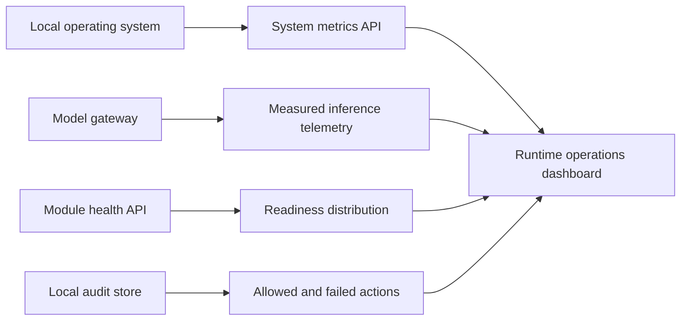

# Dashboard Control Surface

The dashboard is the local runtime control surface for OpenAgent. It favors
measured state over feature descriptions and does not invent samples when a
provider or subsystem has not reported data.

## Architecture

## How It Works

The browser samples CPU and memory from the local metrics endpoint every five
seconds and keeps a short rolling history in memory. Sampling can be paused,
and the resource chart can show either the latest twelve samples or the current
browser session. Resource pressure is the highest measured CPU, memory, or disk
utilization. It is an operational indicator, not a prediction.

Model response, first-token latency, and request throughput appear only after
the inference runtime has measured completed requests. Throughput is calculated
from those event timestamps as completed requests in the preceding minute. It
is not a token-per-second estimate. Provider drilldowns distinguish local and
external routes, readiness, and registered models without treating configured
external access as active.

Module health is summarized as ready, degraded, or failed. Audit failures are
classified separately from active incidents. A failure is shown as current
only when it is unresolved and occurred within the last fifteen minutes. A
newer successful action with the same action and resource resolves it; older or
resolved failures remain available under history and never appear in the
active incident rail.

## Controls and drilldowns

- **Pause live** stops the five-second dashboard refresh without stopping the
  OpenAgent runtime.
- **Short / Session** changes the visible resource-history window.
- **Provider filters** focus the routing list on ready, local, or external
  providers. Readiness details expose the measured counts behind the summary.
- **Current / History** separates recent unresolved incidents from historical
  failures while preserving the complete loaded audit window.

All controls are native buttons or disclosure elements with accessible labels,
pressed states, and keyboard focus behavior. The layout compacts to one column
on narrow screens without hiding measured status.

The dashboard reads local APIs at the same origin. It does not add telemetry,
contact an analytics service, or persist chart history outside the configured
OpenAgent data directory.
