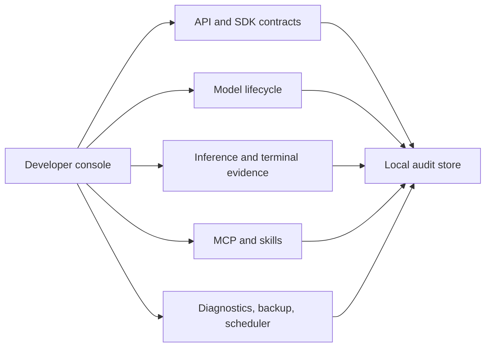

# Developer Platform and Extensibility

Stage 8 is implemented as a local-first developer platform layer.

The Developer screen is an operations console rather than a feature gallery. It keeps source ingestion, API and SDK inspection, local diagnostics and backups, model lifecycle controls, measured inference, MCP servers, audited terminal runs, scheduler state, and skill packaging in one place. Personal notes, gallery demonstrations, canned bridge writes, test-image generation, and simulated OAuth callbacks are not shown in this console; their APIs remain available to the modules that own them.



## Implemented Features

- GraphQL-style read API
- Webhook registry and delivery logs
- Local API key records with hashed secrets
- Plugin manifest registry
- Tool creation and invocation framework
- Tool approval checks for permissioned tools
- MCP manifest and server configuration records
- Extension package catalog
- Generated Python SDK artifact
- Agent, workflow, and plugin SDK starter helpers
- Local integration hub for pairing, diagnostics, backups, preferences, and safe local checks

## APIs

GraphQL-style query API:

```bash
POST /api/graphql
POST /api/developer/graphql
GET /api/developer/schema
```

Developer status and API keys:

```bash
GET /api/developer/status
GET /api/developer/api-keys
POST /api/developer/api-keys
POST /api/developer/api-keys/verify
```

Webhooks:

```bash
GET /api/developer/webhooks
POST /api/developer/webhooks
POST /api/developer/webhooks/dispatch
GET /api/developer/webhook-deliveries
```

Plugins, tools, MCP, extensions, and SDKs:

```bash
GET /api/developer/plugins
POST /api/developer/plugins
GET /api/developer/tools
POST /api/developer/tools
POST /api/developer/tools/invoke
GET /api/developer/mcp
GET /api/developer/mcp/servers
POST /api/developer/mcp/servers
GET /api/developer/extensions
POST /api/developer/extensions
GET /api/developer/sdk
POST /api/developer/sdk
```

Local operations and integration hub:

```bash
GET /api/integrations/status
GET /api/integrations/parity
GET /api/integrations/pairing-codes
POST /api/integrations/pairing-codes
POST /api/integrations/pairing-codes/redeem
GET /api/integrations/preferences
POST /api/integrations/preferences
GET /api/integrations/diagnostics
POST /api/integrations/diagnostics
GET /api/integrations/backups
POST /api/integrations/backups
GET /api/integrations/safe-shell
POST /api/integrations/safe-shell
```

Personal OS local app surface:

```bash
GET /api/personal-os/status
GET /api/personal-os/presets
POST /api/personal-os/presets
GET /api/personal-os/signatures
POST /api/personal-os/signatures
GET /api/personal-os/drafts
POST /api/personal-os/drafts
GET /api/personal-os/drafts/{draft_id}/versions
GET /api/personal-os/notes
POST /api/personal-os/notes
GET /api/personal-os/gallery
POST /api/personal-os/gallery
POST /api/personal-os/gallery/favorite
GET /api/personal-os/compare
POST /api/personal-os/compare/start
POST /api/personal-os/compare/vote
GET /api/personal-os/export
POST /api/personal-os/import
```

## GraphQL Example

```bash
curl -X POST http://127.0.0.1:8765/api/graphql \
  -H "Content-Type: application/json" \
  -d "{\"query\":\"{ health developerStatus tools }\"}"
```

The GraphQL-style endpoint is intentionally read-only in Stage 8. It exposes selected local records and does not call external services.

## Webhook Safety

Webhook targets may use `log://local`, `http://`, or `https://`.

- `log://local` writes a local delivery record.
- HTTP and HTTPS delivery is blocked by default.
- Callers must pass `allow_network=true` to dispatch to HTTP or HTTPS targets.

## SDK Artifacts

`POST /api/developer/sdk` with `{"language":"python"}` generates a local SDK artifact with:

- `openagent_client.py`
- `agent_sdk.py`
- `workflow_sdk.py`
- `plugin_sdk.py`
- `README.md`

The generated files use the Python standard library and do not include telemetry.

## Trust Boundary

Stage 8 stores developer configuration in the same local SQLite database as the rest of OpenAgent. API key secrets are returned only once and stored as hashes. Plugin, MCP, and extension records are manifests and configuration records. Pairing codes are hashed, expire automatically, and are shown in plaintext only once. Diagnostics read local status providers only. Safe local checks use fixed command keys with `shell=False`; arbitrary shell strings are rejected. Personal OS records are project/owner-scoped SQLite rows with local audit events. Stage 12 adds local SDK package publishing records, webhook retry queue jobs, and sandboxed plugin execution records; signed package distribution is a deployment-specific release choice.
