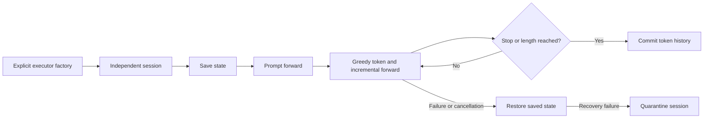

# Native Execution Sessions

`NativeExecutionService` coordinates an explicitly supplied executor. It does
not select a provider, download weights, compile a library or certify a model
family. The factory must create a fresh mutable model session on every call.
Immutable model weights may be shared by the factory.



Executors provide `forward`, `snapshot`, `restore` and `reset`; `close` is
optional. Forward accepts token IDs and returns a NumPy logit matrix with shape
`[input tokens, vocabulary]`. The coordinator checks that shape and finite
values before using the last row for deterministic greedy sampling.
Executors with durable snapshots may also provide `release_snapshot`; the
coordinator releases those references after commit or successful rollback.

`ExecutionLimits` defines vocabulary, context capacity, request token limit,
session count, and `prefill_chunk_tokens` (512 by default). Prompt chunks are
appended sequentially within the same request transaction. The chunk size must
fit the executor's per-call limit; the full prompt must fit its context capacity.
The coordinator does not remove native kernel limits or impose a process RSS
limit. It feeds every generated token back into the executor, keeping cached
state and committed history on the same prefix.

```python
from openagent.adaptive_engine import NativeExecutionService, ExecutionLimits

service = NativeExecutionService(
    factory=create_configured_executor,
    limits=ExecutionLimits(vocabulary=256, context=512, max_new_tokens=64),
)
session_id = service.open_session()
result = service.generate(session_id, [1, 4, 2], max_new_tokens=16,
                          stop_ids=(3,))
service.close_session(session_id)
```

`create_configured_executor` is an application-owned factory, not a hidden
default. It supplies the correct tensors, native library and model configuration.
Each session is serialized, and reentrant mutation through the service is
rejected. A cancellation object provides `is_set`, typically through a
`threading.Event`.

`create_k3_execution_service` connects a `K3ExecutionPayload` to this coordinator.
It takes a `K3Libraries` inventory and an explicit per-executor memory budget.
Library paths are checked before session construction. Packed expert execution
requires an MXFP4 library. An injected expert provider remains caller-owned and
must stay open until its sessions close. A provider carried by the prepared
payload is used directly; a different explicit provider is rejected. The helper deliberately uses the
equation executor's non-certified admission path; it does not assert unchanged
publisher numerical behavior. The budget is per executor, not a process-wide
bound across multiple sessions.

The factory wraps a borrowed packed-expert provider in a shared lease gate.
Independent model sessions keep their own recurrent and attention state, while
selected expert mappings are acquired one at a time. The default wait deadline
is 30 seconds; timeout remains a request failure and uses the existing rollback
path. The gate does not impose a native kernel deadline or make leased arrays
safe after their context exits.

```text
Session A --+
            +--> shared lease gate --> selected expert mapping --> release
Session B --+
```

`SerializedExpertProvider(provider, lease_timeout_seconds=...)` is available
from `openagent.adaptive_engine.shared_expert_provider`. For multiple services
sharing one underlying provider, pass the same gate rather than constructing
separate wrappers. Provider destruction remains the caller's responsibility;
the gate never closes the underlying provider. Nested same-thread leases are
rejected before waiting. This coordination code has not been executed yet.

`create_v41_execution_service` provides the corresponding explicit equation-schema
factory. It freezes the supplied tensor, Engram-head, and token-map inventories;
each session constructs its own native executor and mutable cache state. Numerical
weights are copied by that executor. External table and expert providers remain
caller-owned. This factory does not translate publisher V4.1 checkpoint names or
assert publisher numerical equivalence.

`create_publisher_v41_execution_service` is a separate publisher-shaped
factory. It takes a `V41ExecutionPayload`, an explicit native library and an
application-supplied arithmetic factory. Each session gets a fresh decoder and
arithmetic facade; shutdown attempts to close both. The arithmetic facade must
implement the decoder's quantized projection, cache roundtrip, BF16 boundary and
Engram lookup contracts. Supplying only dequantized tensors does not satisfy
those contracts. This helper does not create a missing backend or provide
numerical certification. Providers borrowed by the arithmetic facade remain
caller-owned unless its implementation explicitly states otherwise.

The concrete CPU facade is `NativePublisherV41Arithmetic`. It takes the prepared
payload, explicit composition and MXFP4 library paths, and either the publisher
tokenizer or an explicit compressed token map. It implements its documented
scalar accumulation and BF16/quantization boundaries; it is not a claim of
unchanged publisher kernel parity. Consult the [V4.1 guide](ENGINE_V41_EXECUTION.md)
for its remaining storage and model-coverage limits.

```python
from openagent.adaptive_engine import (
    NativePublisherV41Arithmetic, create_publisher_v41_execution_service,
)

def arithmetic_factory():
    return NativePublisherV41Arithmetic(
        prepared, execution_library=composition_library,
        mxfp4_library=packed_library, fp8_library=fp8_library,
        tokenizer=tokenizer,
        max_bytes=arithmetic_budget,
    )

service = create_publisher_v41_execution_service(
    prepared, arithmetic_factory, library=composition_library,
    runtime_max_bytes=session_budget,
)
```

The payload, tokenizer, paths and budgets in this example are supplied by the
application. Libraries must already be built. No execution of this example is
recorded in the current code-only pass.

An optional `on_event` callback receives provisional prefill and token events with
`committed=False`. They are not a completion signal. The returned
`GenerationResult` identifies the committed tokens, context length and stop
reason. Callback exceptions and cancellation restore the request's original
model snapshot. If restoring fails, the session is quarantined and cannot be
used for another request; close it to release its resources.

This code was added in the implementation-only pass. Execution, concurrency
and numerical checks have not been run for this module yet.

`service.close()` stops admission of new sessions and attempts to release every
idle executor. It does not wait while holding registry locks or interrupt a
native computation. Active requests and failed cleanup remain registered;
the method reports incomplete cleanup so the caller can cancel requests and
retry. A factory already in progress cannot publish a session after shutdown
starts. The caller must retain any borrowed providers until cleanup finishes.
