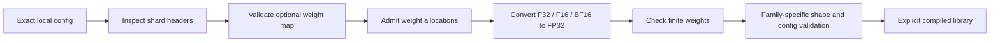

# Native Text Checkpoints

The native text checkpoint loader connects local SafeTensors files to the
compiled GLM-MoE-DSA, GLM5-next text, Qwen3.5 text, Qwen4 text, DeepSeek V4 and
Inkling text and Mixtral decoders. It also exposes the experimentally validated Kimi Linear
subset. It does not download
weights, reinterpret a multimodal wrapper as a text model, or select a Python
model when a compiled library fails.



## Load A Decoder

```python
from openagent.adaptive_engine import load_native_text_decoder

decoder = load_native_text_decoder(
    "D:/models/qwen4-text",
    model_type="qwen4_exp_text",
    library="D:/build/native_qwen4.dll",
    max_weight_bytes=2 * 1024**3,
    max_bytes=512 * 1024**2,
)
result = decoder.forward([2, 7, 4])
```

The configuration must already match the decoder's supported exact contract.
The loader does not fill in an absent layer schedule or infer missing model
semantics. Family constructors validate names, shapes, geometry and unsupported
options before execution. A local library must expose the selected family's
own ABI; the OLMoE Segment library cannot replace it.

`max_weight_bytes` admits two FP32 copies of the weights and the largest source
conversion before reading payloads. It does not bound total process memory:
KV state, inference scratch, metadata and runtime allocations are separate.
`max_bytes` is passed to the native family constructor for its own admission
checks.

`context_tokens` sets GLM5-next's `max_tokens`, DeepSeek V4's `max_context`, or
Kimi Linear's `capacity`. Kimi Linear requires this argument explicitly; the
other two default to their documented bounded constructor limits. Other
families take their capacity from their exact configuration and reject this
override. Input shapes and output types differ by decoder; consult the family
document rather than treating these classes as an interchangeable chat API.

## File Contracts

The directory contains `config.json` and one or more `.safetensors` shards.
When `model.safetensors.index.json` exists, its `weight_map` must match every
tensor and shard filename exactly. Duplicate tensor names, nonlocal shard
paths, escaping symlinks, mismatched identities, quantized source metadata and
nonfinite weights are rejected. F32, F16 and BF16 are the accepted source
dtypes. DeepSeek V4 additionally admits exact I64 `tid2eid` routing tables;
integer tensors cannot masquerade as floating weights. The weight budget counts
their eight-byte elements separately. The numerical runtime is resident FP32,
not packed streaming.

Loader tests cover conversion, indexed shards, budget rejection before
payload reads, exact dispatch and malformed input. These tests establish the
loader contract, including duplicate JSON fields and a simulated escaping
path resolution. Optional integration tests write sharded tiny GLM-MoE-DSA,
GLM5-next text, Inkling text and DeepSeek V4 checkpoints, load their compiled
decoders and compare full and chunked logits with official model oracles. The V4
tests cover ReLU experts and tied embeddings as well as preserving I64 hash
routing tables. The Kimi fused-schema loader test compares full/chunked logits
and expanded MLA, recurrent and convolution states with its pinned vendor
oracle. Broader decoder evidence is documented separately.
These tests do not establish compatibility with every checkpoint published for
a family.

Configuration, index and shard files are read through pinned handles. The shard
inventory is collected once and each header is parsed once. File identity is
checked on opening and size/modification metadata is checked before returning
weights. Tests cover substitution during opening, a late shard addition and
in-place modification detection. A checkpoint publisher must still provide an
immutable, coherent directory: these checks are not a filesystem snapshot and
cannot certify consistency against a hostile writer that can restore metadata.

## Capability Inventory

`python -m openagent.adaptive_engine.family_conformance` reports the registered
resident text constructors and their contract boundaries in
`resident_text_contracts`. These entries describe selected text paths, not
full-family certification. The registry report keeps visual wrappers, legacy
identities and upstream ABI compatibility separate. Kimi Linear remains marked
experimental for complete release compatibility; its bounded fused-schema path
now has pinned independent vendor-oracle tests.
`native_resident_text_decoder_families` lists the bounded text paths independently
of range support; token-history replay is not a native range interface.
