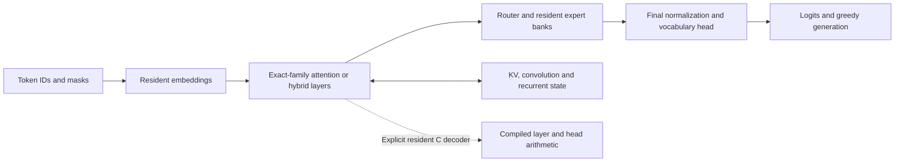
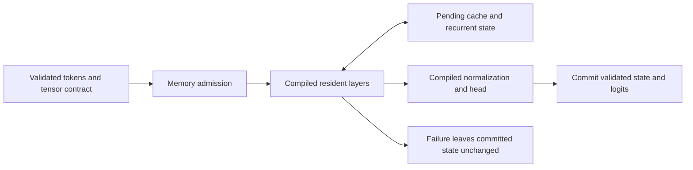
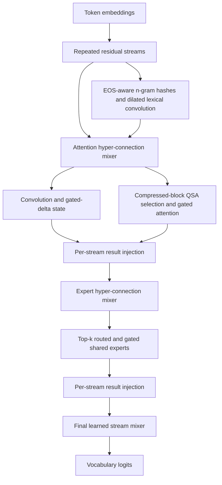

# Independent Decoder Math And Compiled Primitives

This is bounded numerical progress, not completion of all native model families.
Existing library family allowlists and complete streamed-decoder gates are
unchanged. The independent decoders and explicit compiled loaders live under
`openagent.adaptive_engine`; compiled libraries are supplied by the caller.
No reference/Colibri implementation was copied, translated, bundled or imported.
Transformers is a separate optional test oracle, never production decoder code.

## Execution Path



## Exact Coverage

| Decoder | Exact identity | Implementation | Native range execution |
| --- | --- | --- | --- |
| `native_mixtral.IndependentMixtralDecoder` | `mixtral` | `numpy` | `False` |
| `independent_qwen35.IndependentQwen35TextDecoder` | `qwen3_5_moe_text` | `numpy` | `False` |
| Qwen decoder with explicit `CompiledGatedDeltaKernel` | `qwen3_5_moe_text` | `numpy+c-gated-delta-step` | `False` |
| `native_qwen35.NativeQwen35TextDecoder` | `qwen3_5_moe_text` | compiled resident C arithmetic | `True` |
| `independent_glm_dsa.IndependentGlmDsaDecoder` | `glm_moe_dsa` | independent NumPy equations | `False` |
| `native_glm_dsa.NativeGlmDsaDecoder` | `glm_moe_dsa` | compiled resident C arithmetic | `True` |
| `independent_qwen4.IndependentQwen4TextDecoder` | `qwen4_exp_text` | NumPy; optional compiled hyper-connection and delta kernels | `False` |
| `native_qwen4.NativeQwen4TextDecoder` | `qwen4_exp_text` | compiled resident C arithmetic, mixed linear/QSA/PLE | `True` |

Modules are under `openagent.adaptive_engine`. A `native*` filename does not
establish compiled model execution. Status reports expose the implementation and
`native_range_execution` distinction. No unsupported identity is aliased.

Mixtral implements pre/post RMSNorm, bias-free grouped-query causal attention,
split-half RoPE, optional sliding-window masking, normalized softmax top-k routing,
and independent SiLU(gate)*up/down expert arithmetic. Batched prefill, chunked
continuation, explicit padding masks/positions, KV reset and greedy generation
are supported. The resident checkpoint contract uses exact `w1/w2/w3` names.
The local loader accepts unsharded unquantized SafeTensors, including tied heads.
Experts are resident; this does not add streaming, eviction or a memory bound.

Qwen3.5 text is a separate exact-family implementation, not Qwen3Next renamed.
It implements the explicit hybrid layer schedule, causal depthwise convolution
and history, L2-normalized query/key vectors, grouped value heads, gated-delta
recurrence, gated output RMSNorm, gated full attention with per-head Q/K offset
RMSNorm and partial RoPE, packed gate/up expert banks, and gated shared experts.
It accepts validated in-memory FP32-compatible tensors, not a multimodal wrapper.
Default RoPE only; text positions are 2D. Vision/video positions and scaled RoPE
are unsupported. Normalization offset weights and ordinary gated-norm weights
are distinct. Widths, tensor names, finiteness and packed-bank orientation are
validated. No checkpoint directory loader is provided for Qwen yet.

The independently written C kernel `native_mixtral_delta.c` evaluates one gated
delta transition, in key-by-value orientation:

```text
S_decay = decay * S
error = v - k^T S_decay
S_new = S_decay + k outer (beta * error)
output = q^T S_new
```

The explicit ctypes loader requires a caller-built shared library and contiguous
FP32 buffers. It never compiles, downloads or falls back silently. The C kernel
checks finite inputs, scalar gate bounds, size overflow and allocation failure,
then commits state/output only after the full update validates. The arithmetic
uses FP32 state and double dot accumulation. It is a real compiled primitive,
not a callback-based range executor. Other Qwen arithmetic remains NumPy.

## Numerical Evidence

Local CPU oracle: Transformers 4.57.6 for Mixtral; isolated Transformers 5.16.1
for exact Qwen3.5 text. No model weights are downloaded: tiny random checkpoints
are independently instantiated, then tensor values are supplied to each decoder.
The new isolated packages live in `.tmp-native-decoder-oracle`; existing environments
are not upgraded. MSVC build tools compile C tests with `/W4 /WX /O2 /fp:precise`.

- Mixtral: 3 differential tests plus an oracle-independent packed-bank rejection
  regression, logits, all hidden states, attention, router logits, selected
  experts/weights, full/cached decoding, padding positions, sliding windows,
  retained KV suffix, greedy IDs, tied/unsharded loading, reset and corruption.
- Qwen3.5: 3 tests, mixed linear/full/linear layers, logits, all hidden states,
  full-attention probabilities/masks, routed choices/weights, padded prefill and
  continuation, greedy IDs, exact convolution/recurrent/KV states and rejection.
- Compiled delta: 2 tests, multi-step independent recurrence, invalid-input
  atomicity, actual Qwen3.5 prefill/cached oracle and recurrent-state comparisons.

Decoder tolerances are at most `atol=4e-6, rtol=5e-5` on the tested tiny fixtures.
These original independent-decoder checks do not certify large checkpoints, long contexts, throughput, GPU execution,
quantization, memory pressure, tie ordering parity or all configuration variants.
Stable low-index router ties are defined locally; Torch tie parity is unproven.
Mixtral's oracle base model is used for cached diagnostic tests because the
library's auxiliary-loss path fails with full-history masks on cached chunks.
Sliding attention/cache comparisons align the library's retained suffix.

```powershell
.\.accelerator-venv\Scripts\python.exe -m unittest discover -s tests -p test_native_mixtral.py -v
$env:PYTHONPATH='D:\openagent\.tmp-native-decoder-oracle'
.\.accelerator-venv\Scripts\python.exe -m unittest discover -s tests -p test_native_mixtral_qwen35.py -v
.\.accelerator-venv\Scripts\python.exe -m unittest discover -s tests -p test_native_mixtral_delta.py -v
```

Mixtral fixtures check the exact per-expert `block_sparse_moe` ModuleList
`w1/w2/w3` tensor names and shapes before constructing the independent decoder.
Incompatible oracles such as Transformers 5.16.1 fused `mlp.experts` banks skip
with an explicit version/contract diagnostic. They are never converted or aliased;
the oracle-independent rejection regression still runs in that environment.
Without the exact newer oracle, Qwen differential tests skip explicitly. A skip
is not numerical evidence. Compiler absence also skips compiled tests explicitly.

## Remaining Blockers

The following reflects exact 5.16.1 config/causal-model mapping probes, not native
support. Official documentation now exists for several formerly unavailable
classes; the 4.57.6 environment's earlier absence is not a current global claim.

| Exact identities | Observed oracle availability and outstanding implementation |
| --- | --- |
| `glm_moe_dsa` | Independent NumPy and compiled resident C decoders now implement compressed latent attention/cache, sparse indexer selection and grouped correction routing. Streaming experts, production checkpoint loading and broad configuration certification remain outstanding. |
| `glm5_next`, `glm5_next_text` | Bounded resident C text decoding and conditional-generation oracle comparisons exist; see ENGINE_NATIVE_GLM5_NEXT.md. The full visual wrapper, masks, rotary variants and packed streaming remain unsupported. |
| `glm5_moe`, registry `glm` | Former absent; latter maps to older dense GlmForCausalLM. Neither aliases GLM5 DSA. Exact registry/checkpoint equivalence remains unresolved. |
| `inkling_mm_model`, `inkling` | Resident C execution exists for the separate `inkling_text` identity; see ENGINE_NATIVE_INKLING.md. Multimodal and legacy wrappers remain unsupported. |
| `kimi_k3`, `kimi_linear` | Bounded Kimi Linear decoding has checksum-pinned fused-schema oracle tests; see ENGINE_NATIVE_KIMI.md. K3 has only a bounded AttnRes primitive, not a decoder; see ENGINE_NATIVE_KIMI_K3.md. These identities are not aliases. |
| `qwen3_5_moe` | A compiled depth-zero single-image wrapper fixture has official synthetic-oracle comparisons; see ENGINE_NATIVE_QWEN35_VISION.md. Pretrained vision blocks, general spatial positions, video and multimodal checkpoint loading remain unsupported. |
| `qwen4_exp`, `qwen4_exp_text` | Exact mixed linear/QSA/PLE text execution is implemented in independent NumPy and resident C. Multimodal ownership, scaled RoPE, packed scales and streaming remain unsupported. |
| `deepseek_v4` | Bounded resident C attention/indexing, low-rank output, hash/corrected routing and hyperconnections exist; see ENGINE_NATIVE_DEEPSEEK_V4.md. Optimized cache ownership, quantization, packed streaming and public-checkpoint validation remain outstanding. |
| `deepseek_v41`, `deepseek_v41_text` | A bounded C publication ownership primitive exists, not decoder arithmetic; see ENGINE_NATIVE_DEEPSEEK_V41.md. Compression, engrams, quantization and an exact runnable oracle remain outstanding. |

Remaining families need complete compiled range execution; the resident decoders
also need production checkpoint tests, expert eviction/reload and measured
peak-memory bounds before streamed native completion can be claimed. The
OLMoE C range backend is OLMoE-specific, with
mandatory Q/K normalization and no hybrid recurrent state; using it unchanged
for Mixtral or Qwen would be mathematically incorrect. A compiled gated-delta
step does not replace the full-attention, convolution, expert or output paths
with native range execution. The separate full resident C decoders listed above
do replace those arithmetic paths, but do not provide streamed expert execution.

## Resident C Decoder Recheck

The GLM decoder stores compressed latent, rotary and indexer keys rather than
expanded per-head KV projections. Its C entrypoints cover embedding lookup,
layer execution and the vocabulary head. The Qwen C decoder covers hybrid
convolution/recurrent state, full attention, routing, expert arithmetic and the
head. Python validates contracts and owns buffers; an explicit caller-built
library is required. Neither decoder silently falls back to NumPy math.



On 2026-10-02, 16 tests passed against the isolated Transformers 5.16.1 CPU
oracle: four compiled GLM tests, three independent GLM tests and nine compiled
Qwen tests. Checks include padded and chunked decoding, sparse selections,
compressed cache, grouped routing, greedy outputs, asymmetric geometry,
memory admission and late-failure atomicity. MSVC compiled the real C sources.
These tiny random fixtures are numerical evidence, not production-model quality,
streaming, throughput, GPU or complete family coverage certification.

```powershell
$env:PYTHONPATH='D:\openagent\.tmp-native-decoder-oracle'
.\.accelerator-venv\Scripts\python.exe -m unittest tests.test_native_glm_dsa tests.test_independent_glm_dsa tests.test_native_qwen35 -v
```

## Qwen4 Mixed Text Execution

`IndependentQwen4TextDecoder` accepts the exact `qwen4_exp_text` identity,
resident floating-point tensors and an explicit linear/QSA schedule, with
optional PLE on linear layers. It does not reinterpret Qwen4 as Qwen3.5. Each layer has two learned
hyper-connection mixers: group-normalize the residual streams with offset
weights, form low-rank SiLU/sigmoid mixing gates, average gated streams, then
inject the attention or expert result with learned per-stream gates. A final
learned mixer reduces the streams before the vocabulary head; there is no
Qwen3.5 final RMSNorm tensor.



The verified gated-delta equation is reused as a mathematical primitive with
Qwen4's own input and state, not through a coerced config or family alias.
`CompiledQwen4HyperKernel` runs grouped normalization, low-rank mixing and
injection-gate calculation in independently written C. It accepts a caller-built
library and never builds or downloads automatically. It stages outputs and
publishes them only after validation. The existing compiled delta kernel can
also be supplied. That independent decoder still runs other arithmetic in
NumPy, so its `native_range_execution` stays false.

`NativeQwen4TextDecoder` is a separate exact-family C execution path. Its
caller-built library runs embedding lookup, hyper-connections, projections,
convolution, recurrent updates, QSA indexing/selection, gated attention,
PLE hashing/embedding/normalization/dilated convolution, expert routing and
arithmetic, residual injection and vocabulary projection. Python owns buffers,
checks admission and commits pending state. It does not call Transformers or
fall back to NumPy model math. C primitives reuse in-house normalization and
matrix-vector helpers; Qwen4 layer composition is not a Qwen3.5 config alias.

```python
from openagent.adaptive_engine.independent_qwen4 import IndependentQwen4TextDecoder
from openagent.adaptive_engine.native_qwen4_hyper import CompiledQwen4HyperKernel
from openagent.adaptive_engine.native_qwen4 import NativeQwen4TextDecoder

kernel = CompiledQwen4HyperKernel("/absolute/path/qwen4-hyper-library")
decoder = IndependentQwen4TextDecoder(config, tensors, hyper_kernel=kernel)
result = decoder.forward([2, 7, 4])
continuation = decoder.forward([9])

native = NativeQwen4TextDecoder(config, tensors, library="/absolute/path/qwen4-library")
native_result = native.forward([2, 7, 4])
```

Build `native_qwen4.c` with the adjacent in-house `native_qwen35.c` and
`native_qwen4_hyper.c` files present; it includes their shared primitives.
From an MSVC developer terminal, a caller-controlled build is:

```powershell
cl /nologo /W4 /WX /O2 /fp:precise /LD openagent\adaptive_engine\native_qwen4.c /link /OUT:qwen4.dll
```

The loader checks private ABI version 1 and bounded C geometry before execution.
This is an OpenAgent interface, not an upstream Segment/Edge ABI. The tests
compile the actual source in a temporary directory with these warning settings.

Ten exact-oracle tests run with isolated Transformers 5.16.1 and real MSVC
builds. They compare logits, all hidden states, routing choices/weights,
convolution and recurrent states, full/chunked/cached continuation, padding,
unnormalized routing and greedy token IDs. They also exercise mixed QSA token
selection/cache, EOS resets, PLE hash metadata and dilated convolution, sigmoid
delta output gates, compiled execution with NumPy arithmetic helpers disabled,
contract rejection, memory admission and late-head failure atomicity. The oracle's
all-linear cache cannot infer its sequence length, so tests supply positions
and mask mappings explicitly. Eager experts avoid the optional grouped matrix
kernel's alignment restriction. Neither change replaces oracle equations.

Multimodal wrappers, quantized tensors, scaled RoPE, non-SiLU hidden activations
and attention biases are explicitly unsupported. Positions must be bounded 2D
text positions. QSA queries with no visible keys are rejected rather than
publishing NaNs. Stable low-index router/indexer tie ordering is local; parity
with all Torch tie choices is not established. The compiled kernels also
enforce bounded geometry and allocation counts. The shared
[native text checkpoint loader](ENGINE_NATIVE_CHECKPOINTS.md) accepts local
Qwen4 text shards under its weight budget. Expert streaming/eviction,
persisted Qwen4 state and upstream ABI compatibility are not provided. The memory
admission estimate covers resident weights, pending/cache buffers and known
scratch/diagnostic arrays; it is not an OS peak-RSS measurement or streaming
memory bound. Tiny random fixtures do not certify public Qwen4 checkpoints,
long contexts, throughput or complete family/platform certification.

```powershell
$env:PYTHONPATH='D:\openagent\.tmp-native-decoder-oracle'
.\.accelerator-venv\Scripts\python.exe -m unittest tests.test_independent_qwen4 -v
```

## Primary Sources

- [Official Qwen3.5 MoE documentation](https://huggingface.co/docs/transformers/model_doc/qwen3_5_moe)
- [Official Qwen checkpoint configuration](https://huggingface.co/Qwen/Qwen3.5-35B-A3B/blob/main/config.json)
- [Gated Delta Networks paper, Equation 10](https://arxiv.org/abs/2412.06464)
- [Official GLM-MoE-DSA documentation](https://huggingface.co/docs/transformers/model_doc/glm_moe_dsa)
- [Official Qwen4 documentation](https://huggingface.co/docs/transformers/model_doc/qwen4_exp)
- [Official DeepSeek-V4 documentation](https://huggingface.co/docs/transformers/model_doc/deepseek_v4)
- [Official KimiLinear documentation](https://huggingface.co/docs/transformers/model_doc/kimi_linear)

These sources establish architecture or availability context, not correctness of
unimplemented identities. Production source contains no imported oracle code.
