# Native CED Equation Path

`NativeDeepSeekV41CED` executes a bounded dense FP32, single-head encoder/decoder
in original C code. It is an equation fixture, not a loader for published
DeepSeek checkpoints.

```mermaid
flowchart LR
    Tokens --> Encoder
    Encoder --> Final[Encoder final hidden states]
    Final --> KV[Decoder global KV and compression gates]
    KV --> Full[Full selection and candidate blocks]
    Full --> Reindex[Candidate-restricted reindex]
    Reindex --> Reuse[Shared selection reuse]
    Reuse --> Head[Normalization and vocabulary logits]
    Head --> Commit[Atomic history commit]
```

Local attention uses a causal window. Completed compression groups use
per-channel softmax pooling. Decoder global KV is projected from encoder final
states rather than decoder hidden states. Full, reindex and reuse modes have
explicit phase-local owners. Ties use ascending entry IDs.

Construct `DeepSeekV41CEDConfig`, supply the exact FP32 tensor inventory from
`ced_tensor_shapes`, and load a compiled `native_deepseek_v41_ced.c` library.
`forward` returns logits for the supplied tokens. `snapshot`, `restore`, and
`reset` manage model-identity-bound token history. Chunked calls replay committed
history; this is not a persistent-KV performance implementation.

`ced_fixture_document(config)` provides the explicit local configuration for
FP32 SafeTensors shards. `load_native_ced_fixture` checks the native ABI, complete
tensor metadata and memory admission before payload reads. The fixture marker
is `openagent_v41_dense_ced_fixture`; publisher model identifiers are rejected.

Tests compare logits with independent NumPy equations, check decoder KV source,
chunk equivalence, snapshots, and failure rollback. Native output is staged
before commit. Memory admission is conservative allocation accounting, not a
process RSS limit or a security sandbox.

This path excludes RoPE, MoE, mHC, Engram and quantized caches. The separate
[Engram](ENGINE_NATIVE_DEEPSEEK_V41_ENGRAM.md) and
[mHC](ENGINE_NATIVE_DEEPSEEK_V41_MHC.md) components are not automatically composed
into this decoder. Published checkpoint parity and accelerator performance
remain unverified.
