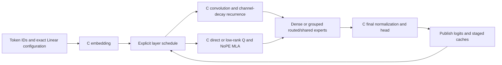

# Native Kimi Linear Text Execution

`NativeKimiLinearDecoder` runs bounded, batch-one FP32 text inference with
original C arithmetic. Python validates the configuration, schedules layers
and owns transactional buffers. The projected `NativeKimiKDA` primitive remains
usable separately. Production inference never imports the vendor oracle.



## Admitted Contracts

The identity must be `kimi_linear`. The legacy Linear layout uses explicit
one-based KDA/MLA layer lists and per-expert `w1/w2/w3` matrices. The separately
validated fused schema uses explicit `layer_types` and `mlp_layer_types`, fused
expert banks, optional low-rank Q and grouped routing. Layouts are validated
separately; callers cannot supply the internal normalized `tensor_layout` field.

In the fused schema, correction bias determines expert/group selection, while
selected weights come from the original sigmoid scores. Legacy score-view
behavior remains separate. Ambiguous grouped cutoff ties reject. NoPE MLA
scaling uses the complete query width. KDA includes causal convolution, Q/K
normalization, channel decay, rank-one state correction and output gating:

```text
D = diag(exp(log_decay)) S
r = beta (v - D^T k)
S' = D + k r^T
o = S'^T q
```

This is not Kimi K3 support. AttnRes, SiTU, latent-expert normalization and K3
mixer extensions are not Linear aliases. Masks, padding, batching, beam search,
rotary MLA, speculative/MTP layers, quantized weights, streamed experts and
accelerator execution are not implemented. Input is a nonempty 1-D integer
token sequence; output is `[tokens, vocabulary]` FP32 logits.

## State And Memory

Calls stage every recurrent, convolution and expanded MLA cache. Position and
caches commit only after the head succeeds. Invalid inputs, native failures,
nonfinite results, capacity violations and admission errors preserve committed
state. A reentrant lock serializes calls. Snapshots are detached copies; reset
clears state. Owned immutable weights and configuration resist caller mutation.

`max_bytes` admits numerical weights, caches, staging, output and conservative
native scratch, not complete process RSS. Metadata, DLL code, caller arrays and
allocator retention are separate. Local F32/F16/BF16 checkpoint conversion is
admitted before payload reads and requires an FP32 execution configuration.
Bounds include 4096 tokens per call, 65536 cache positions, 128 layers, 4096
hidden channels, 128 heads and 256 KDA channels. MLA query width is at most 512
and value width at most 256. The default 256 MiB budget does not fit the full
48B checkpoint; no production-size laptop execution is claimed.

## Build And Load

Imports do not compile libraries. Build for the Python process architecture:

```sh
cc -std=c99 -O2 -Wall -Wextra -Werror -shared -fPIC \
  openagent/adaptive_engine/native_kimi.c -lm -o kimi.so
```

Windows tests use MSVC `/W4 /WX /O2 /fp:precise /LD`. Direct C callers must
supply valid, correctly sized, disjoint buffers.

```python
from openagent.adaptive_engine import load_native_text_decoder

decoder = load_native_text_decoder(
    "local-kimi-linear-checkpoint", model_type="kimi_linear",
    library="build/kimi.dll", max_weight_bytes=512 * 1024**2,
    max_bytes=256 * 1024**2, context_tokens=96,
)
logits = decoder.forward([3, 7, 2])
next_logits = decoder.forward([int(logits[-1].argmax())])
```

Those budgets are examples, not checkpoint-fit recommendations. The loader
does not download weights, execute remote code or fall back to another model.

## Independent Verification

The oracle uses unchanged official Transformers Kimi Linear sources at revision
`6cd7ae39bdf89ece8cc11761293ed28a4b70b838`, checked by SHA-256 before execution.
These files stay in the isolated test environment, outside the application and
distributions. Setup is an explicit network operation; numerical tests never
download sources:

```powershell
.accelerator-venv/Scripts/python.exe -m tests.prepare_kimi_oracle .tmp-kimi-oracle
$env:KIMI_LINEAR_ORACLE_DIR='D:/openagent/.tmp-kimi-oracle'
$env:PYTHONPATH='D:/openagent/.tmp-native-decoder-oracle;D:/openagent'
.accelerator-venv/Scripts/python.exe -m unittest tests.test_native_kimi -v
```

The oracle requires Transformers 5.16.1 and Torch. Tests compare fused hybrid
full/cached logits, grouped routing, low-rank Q, recurrent/convolution/MLA state,
dense schedules and rollback. No-fallback tests disable both NumPy arithmetic
and oracle model arithmetic during native execution. Legacy equation tests are
separate from vendor-oracle evidence.

Short-logit tolerance is `atol=5e-6, rtol=4e-5`; cache tolerance is
`atol=4e-6, rtol=4e-5`. The amplified 67-token fixture has a separate
`atol=3e-5` bound: observed native/full-oracle maximum error was `2.527237e-5`,
while the oracle's own full/tokenwise difference was `1.1503696e-5`. These are
fixture measurements, not general error guarantees. Missing files cause an
explicit optional skip; the strict CI runner rejects every skip.

The bounded fused text path has independent numerical evidence. Complete
published-checkpoint compatibility, K3, accelerator execution, production-scale
quality and performance remain unverified or unsupported. See the
[cross-family inventory](ENGINE_PARITY.md).
