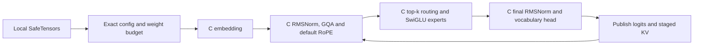

# Native Mixtral Text Execution

`NativeMixtralDecoder` runs resident FP32 Mixtral text arithmetic in a caller-built
C library. Python validates inputs, owns buffers and commits staged KV state.
The implementation does not delegate model arithmetic to Transformers or the
existing NumPy decoder. The official model is used separately by the tests.



## Configuration And Loading

The admitted identity is `mixtral`, with SiLU experts and default RoPE. Both
complete fused expert banks and complete per-expert checkpoint layouts are
accepted; partially mixed layouts are rejected. Tied embeddings must agree
with any supplied output head. A sliding window must be at least two tokens.
Window-one execution is rejected because the pinned oracle disagrees between
full and cached inference at that boundary.

Build `openagent/adaptive_engine/native_mixtral_decoder.c` as a shared library
using a compiler for the Python process architecture. The private ABI is version
1. Imports and loading never compile or download code.

```python
from openagent.adaptive_engine import load_native_text_decoder

decoder = load_native_text_decoder(
    "local-mixtral-checkpoint",
    model_type="mixtral",
    library="build/mixtral.dll",
    max_weight_bytes=24 * 1024**3,
    max_bytes=16 * 1024**3,
    context_tokens=512,
)
result = decoder.forward([1, 3, 5])
decoder.reset()
```

These budgets are examples, not a promise that a particular checkpoint fits.
Geometry is bounded, including hidden width at most 4096, head width at most
256 and context at most 65536 tokens. The weight-loading budget and decoder
transaction budget are separate, not a complete process-RSS bound. Weights,
old KV, staged KV, outputs and estimated C scratch are admitted before execution.

## State And Verification

Forward calls stage KV and publish it only after all layers and the vocabulary
head succeed. Invalid tokens, changed cached batch sizes, numerical failure and
capacity violations leave committed position and KV unchanged. `cache_snapshot`
returns copies. Calls are serialized by a per-decoder lock.

Native normalization rejects FP32 square/reduction overflow rather than claiming
oracle parity for those extreme values. Routing cutoff ties reject because
vendor top-k tie ordering is unspecified. Masks, explicit positions, scaled
RoPE, quantized weights, streamed experts and training are not implemented.

The compiled tests use the pinned Transformers 5.16.1 oracle with seeded tiny
models. They compare full, incremental and chunked logits, cached state, fused
and split expert layouts, tied embeddings and failure rollback. The local-shard
test also loads the model through the public checkpoint API. Tolerance is
`atol=4e-6, rtol=5e-5`. These results establish bounded CPU correctness, not
production-scale quality, speed, accelerator execution or upstream ABI parity.
