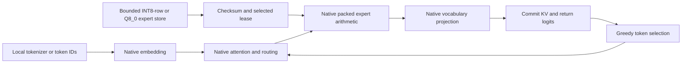

# Native OLMoE Operator

`openagent-native-olmoe` runs the leased INT8-row or Q8_0 OLMoE path explicitly. It
requires a local checkpoint, a hashed OpenAgent expert manifest and a compiled
`segment_executor` library. It does not download a model, build a library,
select an external provider or fall back to Python model arithmetic.



Python coordinates storage, allocation, transactions and greedy selection.
Transformer arithmetic runs in C. The command uses buffered expert storage;
it is not a C-owned disk runtime, network service or upstream-compatible ABI.

## Build And Run

Build the library as described in [native execution](ENGINE_NATIVE_SEGMENT_EXECUTION.md).
Its symbols are separate from the callback-based Segment bridge. Use an
absolute library path matching the Python process architecture.

```powershell
python -m openagent.adaptive_engine.native_olmoe_cli MODEL MANIFEST `
  --library D:\build\executor.dll --prompt "What is 2 plus 2?" `
  --max-tokens 4 --context-tokens 64 --cache-mib 256 `
  --resident-mib 2048 --transfer-mib 2048 --staging-mib 256
```

The prompt is raw text, not an automatically formatted chat turn. Text input
requires the checkpoint's local `tokenizer.json` and the optional `tokenizers`
package. `--token-ids '[1,3,5]'` bypasses text encoding. Token IDs are validated
against the checkpoint vocabulary before native loading.

Output is JSON with generated IDs, optional decoded text, implementation
identity, cache status and measured timing. Loading and first-token timing are
reported separately. Those measurements describe one run, not a guaranteed
latency or speedup. Ctrl+C exits with code 130 and unwinds resource ownership.

The resident limit applies separately to the range's dense weights and the
edge's embedding/head weights. Cache, transfer and staging limits are separate
budgets; none is a complete process-RSS limit. Prompt and continuation must fit
the selected context capacity. See the native execution document for allocation
accounting and transaction boundaries.

## Oracle Check

`--oracle oracle.json` accepts a nonempty `prompt_ids` list and a `full_ids`
list containing that exact prefix followed by a continuation. It runs the
entire recorded continuation without early EOS termination, reports `matched`
and exits with code 1 on a mismatch. The caller must obtain oracle values
independently; the command does not create its own expected output.

Four operator tests exercise actual compiled execution against the existing
independent NumPy model, malformed IDs, excessive context and a missing library.
There is no NumPy-forward fallback during the compiled execution test.

The local public OLMoE checkpoint also completed a separate leased-native
four-token smoke run matching the saved Transformers BF16 oracle:
`[19, 5043, 374, 18207]`. That run used all 16 layers, a 256 MiB expert cache
and 32-token capacity. It took 32.123 seconds including 3.020 seconds of loading.
This narrow check does not establish broad generation quality, long-context
correctness, other model-family support or a controlled performance comparison.
