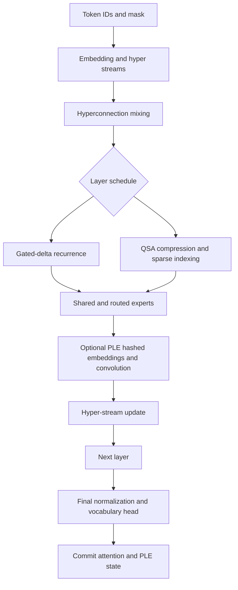

# Qwen4 Text Execution

`IndependentQwen4TextDecoder` implements the resident FP32 text equations in
NumPy. `NativeQwen4TextDecoder` runs transformer arithmetic in a caller-built
C library. Python owns buffers, validates configuration and publishes state
only after the full call succeeds.

## Supported Contract

The exact identity is `qwen4_exp_text`. Mixed linear/QSA schedules and PLE
are supported within the validated resident text configuration. Default 2D
text RoPE is supported; a visual wrapper, non-default rotary scaling,
quantized weights and streamed experts are not covered by this decoder.
Related Qwen3.5 delta and projection primitives are reused where their
equations agree. Model identity, tensor names, hyperconnections, QSA and PLE
remain Qwen4-specific.

Build `openagent/adaptive_engine/native_qwen4.c` as a shared C library. Keep
`native_qwen35.c` and `native_qwen4_hyper.c` beside it: they are included by the
translation unit. Pass that library explicitly to `NativeQwen4TextDecoder`.
Local files can be loaded through [native checkpoint loading](ENGINE_NATIVE_CHECKPOINTS.md).

## Numerical Evidence

`tests/test_independent_qwen4.py` compares tiny random-weight models against
the separately installed official Transformers 5.16.1 model. Coverage includes
cached/chunked execution, padding, router values, sparse attention, PLE hashing,
EOS handling, dilated convolution, sigmoid delta gates and greedy selection.
The compiled mixed QSA/PLE test disables NumPy normalization, softmax, delta,
expert and PLE arithmetic to detect a fallback. Late-head failure tests check
that committed state stays unchanged.

This is CPU numerical evidence for bounded test configurations, not a public
large-checkpoint benchmark, a throughput claim or complete multimodal support.
