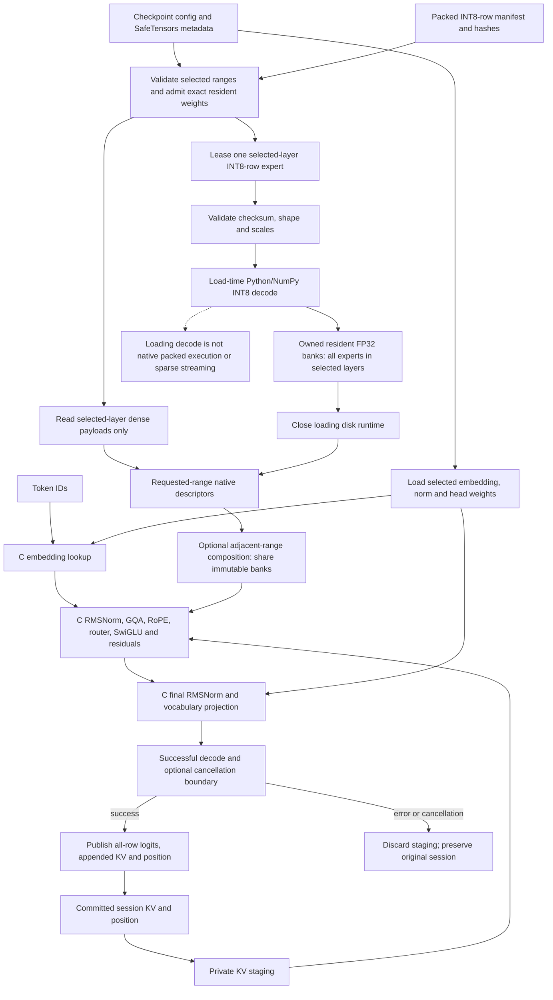
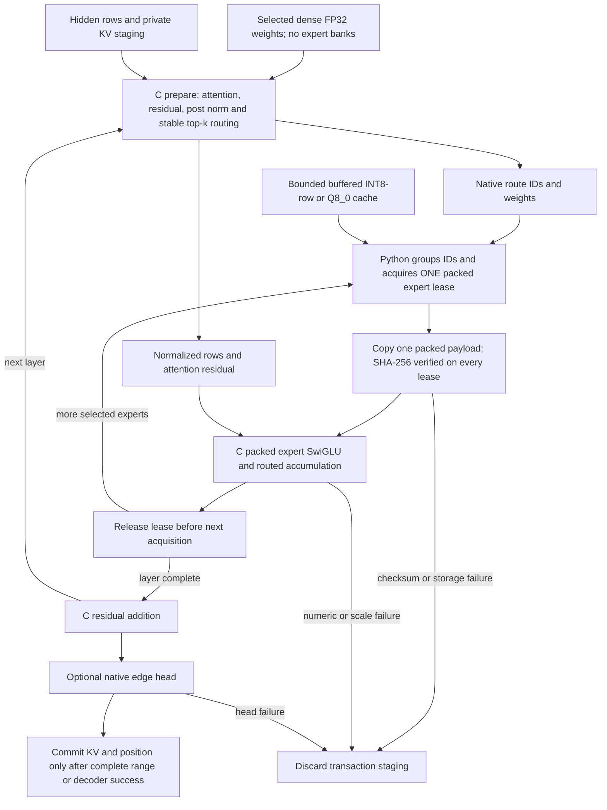

# Native Segment Execution

## Implemented Boundary

`openagent/adaptive_engine/native/segment_executor.{h,c}` implements synchronous,
callback-free CPU OLMoE FP32 range math. `native_segment_executor.py` loads an
explicitly compiled library and owns contiguous weight and KV buffers. It does
not compile, download, select a fallback, or run transformer arithmetic in
Python. NumPy is used for storage, shape validation, and finite-weight preflight.

The range executes input RMSNorm, Q/K/V projections, whole-projection Q/K
RMSNorm, split-half RoPE, causal grouped-query attention, output projection,
attention residual, post-attention RMSNorm, router softmax and stable top-k,
optional selected-probability normalization, resident expert SwiGLU, and expert
residual. Both prefill and incremental decode append KV. Separate native edge
entry points implement embedding lookup and RMSNorm plus the vocabulary head.

The resident FP32 path retains all experts in every selected layer, including
inactive experts. The separately named leased INT8-row/Q8_0 path below instead uses
bounded storage acquisition and native packed expert math, without decoded
resident expert banks. It is a phased C-math path coordinated by Python storage,
not a single native disk/generation runtime. No SIMD,
GPU, speedup, upstream ABI compatibility, or broad model certification is claimed.
Short public-checkpoint oracle checks are recorded below as limited evidence.
The existing `SegmentBridge` remains a callback lifecycle/transfer adapter;
adding this library does not turn its Python backend into native execution.

## C Contract

Use `oa_executor_version()` (version 1), not the bridge version symbol.
`oa_range_config` and `oa_range_layer` are naturally aligned C structs; do not
pack them. On the tested x64 ABI their sizes are 80 and 192 bytes; `oa_tensor`
is 16 bytes. `oa_tensor.count` and all other counts are elements, not bytes.
FP32 buffers are host-endian, tightly contiguous and row-major. Token IDs are
host-endian signed 64-bit values. There are no handles or retained pointers.

Let H = hidden, I = intermediate, E = experts, L = layers, A = attention heads,
K = KV heads, D = H/A, V = vocabulary size, T = context capacity, R = call rows,
and W = K*D. Required shapes are:

| Field | Exact Shape |
| --- | --- |
| input/output | [R,H] |
| input_norm/post_norm/q_norm | [H] |
| k_norm | [W] |
| q/o | [H,H] |
| k/v | [W,H] |
| router | [E,H] |
| gate/up | [E,I,H] |
| down | [E,H,I] |
| keys/values | [L,K,T,D] |
| embedding/head weights | [V,H] |
| head norm | [H] |
| embedding token IDs | [R] |
| head output | [R,V] |

All dimensions and R must be positive; D must be even; A must divide H; K must
divide A. `topk` is in [1,E], `normalize_topk` is 0 or 1, `reserved` is zero,
and epsilon/theta are positive finite doubles. `layer_count` must equal L.
Position is in [0,T], and R <= T-position. Each tensor descriptor must have the
exact element count, not a larger capacity. `output_count` and `cache_count`
are likewise exact. C can check flattened counts, not the caller's conceptual
axis layout; the Python adapter enforces all axes before flattening.

Raw callers must provide valid aligned storage for every stated count. Buffer
validity, actual allocation size, and non-overlap are caller obligations: the
ABI is not a pointer sandbox. All buffers, descriptors, config, and the position
pointer must be mutually non-overlapping and stay alive through the call. Do
not mutate weights, config or inputs concurrently. Serialize mutations of the
same session; disjoint sessions may execute concurrently. The C implementation
has no shared mutable registry. Python sessions retain their engine, which pins
owned weight copies and library lifetime; calls/reset/close share a session lock.
Do not modify the adapter's private ctypes descriptors or session arrays.

Status values reuse `segment_bridge.h`: OK=0, INVALID=1, VERSION=2, LIMIT=5.
Malformed inputs, nonfinite live inputs/weights/KV, and nonfinite computed
results fail. Size arithmetic overflow, context exhaustion, memory budgets and
allocation failure return LIMIT. No callback status is used. Tensor-limit
violations detected inside descriptor validation may return INVALID; callers
must not depend on INVALID-versus-LIMIT precedence for multiply invalid calls.

Range output, KV and position are unchanged on failure. Private staging is
discarded on late arithmetic failure; success publishes output and only newly
appended KV slots, then advances position. Only prefix KV is numerically live;
future slots may contain arbitrary values and are preserved. Edge calls also
preflight/stage so that failure leaves their output unchanged. This guarantee
requires callers to honor the storage/alias contract. There is no native
cancellation poll or C binary snapshot contract in version 1. Checkpoint wrappers
provide boundary cancellation and identity-bound in-memory and Python-owned
binary snapshots below.

## Numeric Class

`c-fp32-weights-double-dot-resident-experts-v1` is deliberately distinct from
`numpy-fp32-dense-int8-row-experts`. Weights, intermediates and output are FP32;
dot products, RMS sums/scales, attention weighting and transcendental math use
double precision followed by FP32 stores. Router scores and exponentials are
stored as FP32. Equal stored router probabilities select ascending expert ID.
Grouped heads map contiguously to their KV head. RoPE pairs the first half of
each head with the second half, using the absolute session position.

No bitwise NumPy or Transformers parity is promised. Near router ties and
underflow may change selected experts between numeric classes. Tests use
explicit tolerances and well-conditioned tiny fixtures. A snapshot from the
NumPy class must not be restored under this numeric identity without a separate
validated conversion and execution-identity contract.

The adapter is OLMoE-specific, not a generic decoder contract. Q/K norm cannot
be disabled by substituting all-ones weights: RMS normalization still changes
the values. There is no sliding window, attention bias, partial/scaled RoPE,
alternate normalization, or alternate activation. Mixtral and other model
families require independently specified/tested semantics, not relabeling this
backend. Packed payloads are not inputs to the resident range/decode entry points.
The leased phase entry points below accept INT8-row and explicit Q8_0.
INT4-row, Q4_0 and other packed formats are not supported by this leased engine.

## Memory Cost

`max_bytes` bounds **each** input/weight/output/KV tensor and the **aggregate C
scratch allocation per call**. It does not bound aggregate resident weights,
combined session KV, Python copies, concurrent calls, or process RSS.

Range resident weights occupy:

`4 * L * (3H + W + 2H*H + 2W*H + E*H + 3E*I*H)` bytes.

The array-registration range owns copies; loading from already-resident arrays temporarily
or persistently doubles those weights if the caller keeps the originals.
`NativeRange.status()` reports `resident_weight_bytes`, `expert_storage`, and
`sparse_streamed_experts=False`. Sessions report `kv_bytes`, comprising both
KV arrays: `8 * L * K * T * D` bytes. Each array individually must fit max_bytes.
The C range stages both entire KV arrays, even for one-token decode.

C scratch per range call is:

`4 * (R*H + 2L*K*T*D + 4H + 2W + T + E + 2I)` bytes.

Head scratch is `4 * (R*V + H)` bytes. Embedding has no C heap scratch but
validates the entire embedding bank each call. Array-facade edge methods
copy supplied banks per call; the checkpoint edge wrapper retains its banks.
These correctness-first scalar kernels are inappropriate to advertise as a
low-memory or high-throughput full-model runtime.

## Python Integration

The public construction path is:

```python
executor = NativeSegmentExecutor(explicit_library_path, max_bytes=budget)
engine = executor.create_range(layer_dicts, hidden=H, intermediate=I,
    experts=E, heads=A, kv_heads=K, topk=topk, capacity=T,
    epsilon=epsilon, theta=theta, normalize_topk=normalize_topk)
session = engine.create_session()
hidden = executor.embeddings(embedding_bank, int64_token_ids)
hidden = session.forward(hidden)
logits = executor.final_head(hidden, final_norm, head_bank, epsilon=epsilon)
```

Layer dicts must contain exactly the 12 names in `oa_range_layer`; all arrays
must have the exact shapes above and native FP32 dtype. Noncontiguous FP32
arrays are copied. Sessions provide forward, reset, position and idempotent
close. A `NativeRange` is in-memory array registration, not checkpoint loading.
Compose ranges using independent sessions and the same row chunks. Their
positions must remain synchronized by the orchestrator.

The exported checkpoint APIs below provide requested-layer loading, weight
admission, weight-bound snapshots and boundary cancellation. Native selection
is explicit; existing callback/NumPy paths retain their own execution identity.
Separate primitive calls still commit separately. Use the atomic decoder API
to include the final head and all composed ranges in one transaction.

## Build And Evidence

In an x64 MSVC developer terminal:

```powershell
cl /nologo /W4 /WX /O2 /fp:precise /LD openagent/adaptive_engine/native/segment_executor.c /link /OUT:segment_executor.dll
.venv/Scripts/python.exe -m unittest tests.test_native_segment_executor -v
```

The test suite uses MSVC on Windows even if clang/GCC is installed. It locates
installed VC tools via vswhere when cl is not on PATH. No compiler is downloaded;
unavailable tools skip, compilation errors fail. Linux/macOS use an installed C
compiler with warnings as errors. Building needs only segment_executor.c and
the existing header, not segment_bridge.c or segment_math.c.

The native test suites build with MSVC `/W4 /WX /O2 /fp:precise` on Windows.
Current verification counts and scope are summarized below.

Coverage includes GQA/MHA/MQA, even head dimensions 2/4/6, odd intermediate
width, stable router ties, both top-k normalization modes, multilayer prefill
and incremental decode, KV differential checks, chunking, split-range
composition, independent sessions/reset/close, edge math, malformed raw C
envelopes and every weight length, late second-layer expert overflow rollback,
nonfinite prefix handling, aggregate scratch limits and untouched future KV.

The real tiny-checkpoint chain compares native embedding/range/head logits and
KV against existing `OlmoeModel`. That model accepts packed experts rather than
FP32 manifests, so the test decodes its INT8-row payloads once into FP32 banks
before registering the native range. This is explicitly not a test of native
INT8 decoding/streaming. Logit tolerance is atol=3e-6, rtol=4e-5; KV tolerance
is atol=2e-6, rtol=3e-5. Native synthetic range tests independently use the
existing OLMoE attention implementation plus NumPy expert equations.

Existing independent adversarial tests exercise threading, buffer ownership
and retained-session lifetime under the documented caller-storage contract.
This does not establish safety for invalid pointers or overlapping storage.
The tiny-fixture tests do not establish large-checkpoint quality. Separate short
public-checkpoint checks against a saved Transformers BF16 oracle are recorded
below. Sanitizer, cross-platform performance, peak-RSS and machine-wide
certification remain unverified.

## Checkpoint Paths

`NativeOlmoeSegmentEngine` and `NativeOlmoeEdge` are exported from
`openagent.adaptive_engine`. The checkpoint engine accepts a manifest object or
JSON path, layer range, explicit library and mandatory resident weight budget:

```python
from contextlib import ExitStack
from openagent.adaptive_engine import NativeOlmoeSegmentEngine, NativeOlmoeEdge

with ExitStack() as resources:
    edge = resources.enter_context(NativeOlmoeEdge(
        model_directory, library_path, max_resident_bytes=edge_weight_budget))
    engine = resources.enter_context(NativeOlmoeSegmentEngine(
        model_directory, manifest, 0, number_of_layers, library_path,
        max_resident_bytes=range_weight_budget, context_tokens=context_capacity,
        max_bytes=scratch_budget))
    decoder = resources.enter_context(edge.create_session(engine))
    logits = decoder.forward([1, 2, 3])  # [rows,vocab], including prefill rows
    saved = decoder.snapshot_state()
    decoder.reset()
    decoder.restore_state(saved)
    next_logits = decoder.forward([4])
```

The loader reuses `OlmoeSegmentEngine` only for validated dense loading and
its selected-layer expert store. It never calls that loader's forward or expert
math. Complete checkpoint metadata is checked, but payload reads cover only
dense weights and packed experts in `[begin,end)`. For this resident conversion
loader, INT8-row is the only supported checkpoint manifest dtype. Packed experts are leased sequentially, hash/scale
validated, and decoded once into resident FP32 banks. Decoding multiplication
is Python/NumPy loading work, not native quantized inference. No full second
FP32 bank is created. The disk runtime closes before construction returns and
on conversion failures; no disk cache or lease remains during forward.

`NativeOlmoeEdge(..., mode="embedding" | "head" | "both")` reads only its
selected payloads: embedding bank, or final norm plus head bank, or all three.
It does not read layer/expert payloads. Unloaded operations fail explicitly.
Weights are retained and passed directly to C without per-call bank copies.

### Architecture



### Memory Admission

`max_resident_bytes` admits the exact aggregate final FP32 weights before payload
reads, expert-bank allocation or disk-runtime creation. One byte below the
required sum fails; equality succeeds. Each tensor must also fit `max_bytes`.
Metadata parsing precedes admission. This is not a peak-RSS or process-memory cap.

Let B be the largest selected FP32 tensor's byte size, P one expert's packed
size `3H*I + 4*(2I+H)`, and C=65536 elements. The conservative additional
loading byte/array allowance is:

`conversion_temporary_bound_bytes = 2B + 2P + 8*(2I+H) + 16C`.

This covers dense read/conversion or endian fingerprint conversion, packed cache
and a packed-byte copy, scale validation and bounded finite-check/ufunc buffers.
Optional `max_conversion_bytes` admits the allowance before loading. It is not
a measured allocator peak; Python objects, JSON/index metadata, bookkeeping,
allocator retention, page cache and library memory are excluded. Packed bytes
are copied before decoding so exception tracebacks cannot pin disk-owned array
exports during cleanup. Edge loading allowance is `2B + 16C` and has the same
optional admission parameter.

KV, call scratch, input/output copies, snapshots and other engines are additional
to weight admission. `status()` reports resident bytes (zero after close),
historical admitted bytes, loading allowance and `sparse_streamed_experts=False`.
Close requires live sessions to close first; close is idempotent.

## Atomic Decode And Composition

`oa_executor_decode` is an additive v1 C entry point that composes embedding,
range and head inside one transaction. It returns `[R,V]` logits. Head failure,
including finite-weight overflow after successful range math, preserves caller
output, KV and position. The same pointer-validity/alias contract applies.
Raw C receives layer descriptors, not model metadata, so it cannot infer full
model coverage. Checkpoint decoder creation enforces the full layer range and
matching edge/range configs; embedding-only or head-only edges are rejected.

Adjacent checkpoint ranges can be registered as one composed engine:

```python
composed = NativeOlmoeSegmentEngine.compose([first_range, second_range])
decoder = edge.create_session(composed)
logits = decoder.forward(token_ids)
decoder.close()
composed.close()
```

`compose` requires ordered adjacent ranges, matching checkpoint configs and
metadata fingerprints, and no duplicate source objects. It shares immutable
weights without copying banks or creating a disk runtime. It creates independent
KV sessions, pins the banks even if source engines close, and reports
`shares_resident_weights=True`. Reported held bytes may therefore count the same
physical allocation in several engines. Optional `max_resident_bytes`,
`max_bytes` and `context_tokens` bound the composed engine; default context
capacity is the smallest source capacity. Existing source-session KV is not
migrated. Composed execution identity binds constituent range identities and
partition order; it is distinct from independently loaded monolithic identity.
Use a full-range composition with `edge.create_session` for failure-atomic
multi-range plus head execution. Manually chaining separate range calls remains
non-atomic across those calls.

The C decode scratch peak is admitted before heap allocation, including nested
range/head primitive allocations. In FP32 elements, let N=R*H, Q=L*K*T*D,
O=R*V. Its outer staging is `2N + 2Q + O`; peak bytes are:

`4 * (2N + 2Q + O + max(N + 2Q + 4H + 2W + T + E + 2I, O + H))`.

This bounds native heap scratch, not caller-owned weights/output/KV or Python
storage. Decode uses the smaller edge/engine `max_bytes`. All arrays still
require individually bounded valid storage. There are no math callbacks.
Older v1 libraries without this optional symbol can run primitive ranges, but
decoder creation fails explicitly with a rebuild instruction, never a fallback.

### State And Cancellation

Range sessions provide in-memory `snapshot_metadata`, `snapshot_state` and
`restore_state` with format `openagent.native-olmoe-segment.v1`. Identity hashes
owned dense and decoded expert contents, shapes/names, numeric class, range and
execution config: dimensions, heads, epsilon, theta and routing settings.
Metadata also binds manifest fingerprint and per-session capacity. Changes to
selected weights reject restore even with unchanged checkpoint metadata;
unselected dense changes do not alter requested-range weight identity.

Decoder sessions use `openagent.native-olmoe-decoder.v1`, wrapping range state
plus `edge_execution_identity`. That identity hashes actual embedding, norm and
head contents and their relevant config. A decoder snapshot from different edge
weights is rejected before KV changes. Range-only snapshots are not decoder
snapshots. State owns active KV prefix copies; restore validates exact identity,
types, position, layer counts, FP32 shapes and finiteness before publication.
Do not mutate snapshot arrays concurrently with restore.

`max_snapshot_bytes` bounds new snapshot prefix arrays or restore's full KV
staging pair, not caller-held snapshots or total RSS; metadata and small bounded
validation buffers are additional. No pickle is used. The additive native-state
binary serializer below is Python-owned; existing NumPy OASEG snapshots are not
compatible with native snapshot identities.

Forward optionally accepts `cancelled=callable`. Polls occur before C execution
and after successful math, before publishing Python session state. Post-call
cancellation uses one extra Python-owned full KV pair (`session.kv_bytes`) in
addition to C staging. Cancellation or a throwing callback preserves the
original session. There is no poll inside C or prompt-interruption guarantee.
No cancellation argument avoids that extra KV pair. Reentrant callbacks cannot
forward, reset, close, snapshot or restore the active session. Boundary polling
is control logic, never delegated model arithmetic.

Decoder sessions pin their edge and range resources. Edge/engine close rejects
live sessions. Same-session calls serialize, including full token-to-logit
decode; returned order across racing threads is unspecified. Independent
session KV remains isolated.

## Verification Scope

Observed on Windows x64: **86 targeted tests passed** across executor,
adversarial, resident, leased, Q8, operator CLI, bridge and snapshot suites.
Native libraries were built by the suites using MSVC with warnings
as errors. Ruff passed for the native Python wrappers and focused test modules.

The suites include checkpoint loading, full and composed atomic decode, all-row
prefill and incremental logits against tiny `OlmoeModel`, both routing modes,
KV differential checks, requested payload reads/leases, exact weight and scratch
admission boundaries, disk cleanup, post-file-removal inference, selected edge
modes, weight-bound snapshots, capacity and malformed-state rejection,
pre/post cancellation/reentry, checksum/decode error cleanup, late head failure
rollback across all ranges, shared-weight lifetime and decoder concurrency.

Five existing independent adversarial tests cover eight-thread shared-session
serialization, eight disjoint sessions against native/numeric references,
registration ownership after source mutation, idempotent close and retained
session/library/weight lifetime. They test the caller-storage contract, not
invalid-pointer sandboxing. Additional native tests are implementation
regressions, not independent certification.

Run the focused native and existing segment suites:

```powershell
.venv/Scripts/python.exe -m unittest tests.test_native_segment_executor tests.test_native_segment_adversarial tests.test_native_olmoe_segments tests.test_native_leased_olmoe_segments tests.test_native_q8_segments tests.test_native_olmoe_cli tests.test_segment_abi tests.test_segment_snapshot
```

Remaining gaps: leased INT4/Q4_0 and other packed formats, C-owned binary
serialization, continuous generation-service orchestration, alternate decoder
semantics, broad public-checkpoint quality evaluation, and controlled
performance/RSS measurements. Leased composition and Python-owned native-state
binary snapshots are implemented below. The explicit local operator provides
tokenizer input and greedy generation, not a continuous serving runtime.
Residency and storage coordination remain explicit per backend; no machine-wide
certification or upstream binary compatibility is implied.

## Leased INT8-Row And Q8_0 Execution

`native_leased_olmoe_segments.py` provides `NativeLeasedOlmoeSegmentEngine`, a
separate opt-in backend for exact INT8-row or Q8_0 manifests. It retains
only the nine dense tensors per selected layer. Constructor admission excludes
expert banks because none are allocated or decoded. It creates a bounded
buffered expert store but reads **zero expert payloads** during construction.
Only experts selected by C routing are acquired during inference, at most one
active lease at a time. Each distinct selected expert is leased once per layer
call, regardless of the number of routed rows.

```python
from contextlib import ExitStack
from openagent.adaptive_engine import NativeOlmoeEdge
from openagent.adaptive_engine.native_leased_olmoe_segments import (
    NativeLeasedOlmoeSegmentEngine,
)

with ExitStack() as resources:
    edge = resources.enter_context(NativeOlmoeEdge(
        model_directory, library_path, max_resident_bytes=edge_weight_budget))
    engine = resources.enter_context(NativeLeasedOlmoeSegmentEngine(
        model_directory, manifest, 0, number_of_layers, library_path,
        max_resident_bytes=dense_weight_budget,
        expert_cache_bytes=largest_selected_payload,
        max_staging_bytes=transaction_budget))
    decoder = resources.enter_context(engine.create_decoder_session(edge))
    logits = decoder.forward([1, 2, 3])
    saved = decoder.snapshot_state()
    decoder.reset()
    decoder.restore_state(saved)
```

For hidden-row range use, `engine.create_session().forward(hidden)` has the same
shape contract as the resident checkpoint engine. Full token-to-logit use is
`engine.create_decoder_session(edge)`, requiring a complete matching range and
both edge weights. The resident `edge.create_session(engine)` factory rejects
leased engines; it does not reinterpret missing expert banks as resident math.
`NativeLeasedOlmoeSegmentEngine.compose` combines ordered adjacent leased ranges
into a single transaction with independent KV. Manually passing hidden rows
through separate sessions still leaves their transactions separate.

### Native Phases



All transformer arithmetic runs in C, without registered math callbacks:

| Entry Point | Responsibility |
| --- | --- |
| `oa_executor_prepare_layer` | RMSNorm, projections, GQA, RoPE, causal attention, attention residual, post norm, router softmax/top-k and weights |
| `oa_executor_swiglu_int8_row` | Standalone packed INT8-row expert on FP32 hidden rows |
| `oa_executor_apply_int8_row` | One leased expert's SwiGLU and weighted accumulation for rows selected by native routes |
| `oa_executor_swiglu_q8_0` | Direct Q8_0 block expert on FP32 hidden rows |
| `oa_executor_apply_q8_0` | Direct Q8_0 expert and routed accumulation, without decoded weight banks |
| `oa_executor_residual_f32` | Checked FP32 residual publication |

Prepare uses the existing range's attention helper, avoiding a Python reference
path. `config.layers` must be 1 and gate/up/down descriptors must be empty.
Input, attention residual and post-norm output are `[R,H]`; route IDs are
host-endian uint64 `[R,topk]` and route weights FP32 of the same shape. IDs and
weights have exact counts. Cache is `[K,T,D]`; position is an input and is not
advanced by prepare. Outputs and KV remain unchanged on prepare failure.

The INT8-row payload layout is exactly signed INT8 gate `[I,H]`, up `[I,H]`, down
`[H,I]`, followed by little-endian FP32 gate scales `[I]`, up scales `[I]`, down
scales `[H]`. Byte length is `3H*I + 4*(2I+H)`. Scales may be unaligned; C reads
them byte-safely and validates positivity/finiteness. C reads INT8 values
directly; it never materializes FP32 expert matrices. Working expert activation
is only `[I]`, plus a result row `[H]` for routed application. The public array
facade also exposes `NativeSegmentExecutor.packed_swiglu(hidden, payload,
intermediate=I)` for unweighted differential checks.

Apply requires unique expert IDs per row in `[0,E)`, finite weights in `[0,1]`,
exact `[R,topk]` route counts, and separate `[R,H]` accumulator input/output.
Unselected rows are copied intact. Malformed routes/payloads or late-row overflow
leave output unchanged. All phased calls inherit the raw pointer validity,
alignment, storage lifetime and non-alias obligations of the C contract.

Python only allocates buffers, groups native IDs in first-occurrence order,
acquires/releases storage, copies packed bytes, verifies hashes, dispatches C
phases and publishes successful state. It does not compute attention, router
probabilities, selected weights, SwiGLU or residual sums. There is no
`SparseExpertRuntime.execute_batch` or Python weight decoder in inference.

### Bounds, Identity And Transactions

Dense residency is exactly:

`4L * (3H + W + 2H*H + 2W*H + E*H)` bytes.

`max_resident_bytes` admits this sum before dense payload allocation. Packed
cache is separately bounded by mandatory `expert_cache_bytes`; one payload
must fit it and `max_bytes`. The store remains open for the engine lifetime,
unlike the resident loader's temporary store. Only buffered storage is supported
here; there is no prefetch, mmap, disk I/O inside C or native disk-runtime claim.
All engines keep files immutable while their stores are open.

One leased payload is copied into immutable bytes before SHA-256 verification,
and those **same verified bytes** are passed to C while the lease remains active.
This bounds the extra packed copy by one payload P and prevents a cached
previous verification from authorizing changed bytes. The entire manifest's
expected expert hashes bind snapshot identity, but unused experts are not
read/verified eagerly; selected experts are verified every acquisition.

`max_staging_bytes` admits a conservative explicit Python+C transaction
allocation estimate before KV copies or expert leases. Let N=R*H,
Q=T*K*D (one layer cache), U=R*topk and P=packed payload size. The range estimate
is `8L*Q + 28N + 12U + P + max(prepare_bytes, apply_bytes)`, where:

- `prepare_bytes = 4*(2N + 2Q + 3H + 2W + T + E + U) + 8U`.
- `apply_bytes = 4*(N + I + H)`.

Full decoder adds the conservative allowance `4*(2N + 2R*V + H) + 16R` for edge
buffers/head scratch and token vectors. This is explicit array/heap admission,
not measured peak RSS. Persistent dense weights/KV, packed cache, Python
objects, allocator retention, OS page cache and library memory are separate.
Each C phase additionally bounds its own buffers and aggregate C allocations
with `max_bytes`. `staging_required(rows, capacity, vocab=...)` reports the
estimate. Dense loading conversion allowance remains separate from inference.

Status explicitly reports `dense_resident_weights=True`,
`range_resident_weights=False`, `resident_expert_weight_bytes=0`, bounded packed
cache bytes and `sparse_streamed_experts=True`. This describes selected on-demand
packed storage, not a zero-residency cache or a decoded full-bank backend.

Numeric class is `c-fp32-dense-double-dot-native-int8-row-leased-v1`, separate
from resident decoded-bank and NumPy classes. Dense/attention math uses the
shared C helper. Expert dot products accumulate in double, row scales are
applied natively, intermediate results are stored as FP32. Routed accumulator
group order follows the first occurrence of expert IDs in the native table.
Different scale application/accumulation rounding can change near-tie routes;
no bitwise or external Transformers parity is promised.

Range calls stage the whole KV range and publish only after every layer, lease,
checksum and native arithmetic succeeds. Full leased decoder also delays commit
until the native head succeeds. Cancellation is checked at transaction
boundaries, before each layer and expert lease, and before the head, with the
same reentry guards and state-bound snapshots as the native
checkpoint APIs. Cache contents may change on failed execution, but KV, position
and caller-visible outputs do not commit. This transaction spans several C
phase calls controlled by Python; it is not `oa_executor_decode` or a single
C-owned continuation state machine.

Leased tests include odd/unaligned packed layouts against NumPy, malformed C
envelopes/routes/scales, late-row overflow, full/split checkpoint ranges and
all-row decoder logits, native-only math with Python math paths disabled,
no constructor expert reads, selected-only one-at-a-time leases, exact admission,
late-layer storage/checksum failure rollback, every-lease hash checks, snapshot
hash/numeric-class binding, cancellation, native-head rollback and lease cleanup.
These are bounded tiny-model correctness tests, not performance certification.
