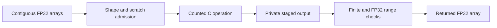

# Dynamic Native Tensor Operations

`NativeTensorOps` provides original CPU C kernels for FP32 normalization,
sigmoid, SiTU activation, attention residual mixing and split-half rotary
positions. Geometry is checked through element counts and byte admission,
rather than the fixed dimensions used by the earlier equation fixtures.



The private ABI is version 1. It requires four-byte binary32 floats and truthful
accessible allocations. C cannot determine a foreign pointer's actual allocation
length. Inputs must remain stable while a native call is active.

Operations return new NumPy arrays; numerical evaluation takes place in C.
Accumulations and transcendental functions use double precision before storing
FP32 results. This is a specified arithmetic contract, not a claim of BF16,
FLA, GPU or publisher numerical parity.

- `normalize(x, gain, epsilon=...)` applies RMS normalization on the last axis.
- `sigmoid(x)` uses a sign-stable sigmoid expression.
- `situ(gate, up, beta=..., linear_beta=...)` evaluates bounded gate/up activation.
- `attnres(values, gain, query, epsilon=...)` normalizes block keys, scores them
  with the supplied query, and mixes the original residual values.
- `rotate(x, positions, rotary=..., theta=...)` rotates trailing channels in
  split-half layout, with one explicit uint64 absolute position per row.

SiTU is defined here as
`beta*tanh(gate/beta)*sigmoid(gate)*linear_beta*tanh(up/linear_beta)`.
Rotary positions exceeding exact double integer representation are rejected.
The caller selects the correct position and rotary convention for its model.

Compile `native_tensor_ops.c` into an explicitly supplied shared library, either
separately or alongside the model kernels. On Windows with MSVC configured:

```powershell
cl /W4 /WX /O2 /fp:strict /LD openagent/adaptive_engine/native_tensor_ops.c /link /OUT:native-tensor-ops.dll
```

Load it with `NativeTensorOps("native-tensor-ops.dll", max_scratch_bytes=...)`.
The module does not build libraries, download assets or select devices.
`close()` waits for active operations and releases the library handle.

Scratch admission covers native staging, including residual score storage.
Borrowed inputs, returned arrays, Python objects and allocator metadata are
separate; this is not a process RSS limit. Failed C operations do not publish
partial results. The Python wrapper rejects ndarray subclasses and unaligned
or non-contiguous inputs.

This module was written in a source-only implementation update. Compilation,
boundary checks, concurrency and numerical comparisons remain unexecuted.
