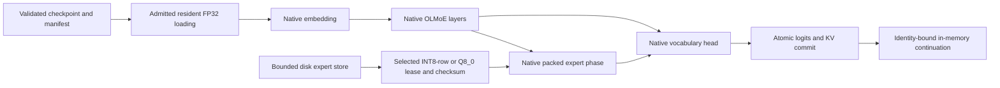

# Engine Implementation Boundaries

The comparison target is the reviewed Colibri revision
`ce370e87d7b623d7759b52ec2007d75fc5b0e87e`. This inventory describes execution
contracts, not a percentage or a claim of upstream binary compatibility.
OpenAgent uses its own manifest, state and execution interfaces. Reference
implementations are not imported into the runtime.

## Model Families

| Exact identity | OpenAgent execution | Outstanding work |
| --- | --- | --- |
| `olmoe` | Independent streamed NumPy decoder; compiled resident FP32 ranges and leased packed INT8-row/Q8_0 C phases, native embedding and head | Additional native packed formats, broader checkpoint evidence and upstream transport compatibility |
| `qwen3_5_moe_text` | Independent NumPy decoder and explicit compiled resident FP32 decoder with local sharded loading | Packed streaming and production-scale validation |
| `qwen3_5_moe` | Bounded depth 0-4 vision blocks, single-merged-image C fixture, exact-wrapper local loader and cached text continuation | General pretrained geometry, spatial positions, raw-image processing, video and full multimodal checkpoint support |
| `glm_moe_dsa` | Independent NumPy baseline and compiled resident FP32 decoder with compressed latent state, sparse indexing, default/static YaRN RoPE and tested local sharded loading | Other scaled/partial rotary contracts, packed streaming and production-scale validation |
| `glm5_next_text` | Bounded resident C NoPE text execution with KDA, KPool, mHC, dense/MoE layers and transactional caches | Masks, rotary variants, packed streaming, visual wrapper and broad checkpoint validation |
| `glm5_next`, `glm5_moe`, registry `glm` | Not accepted as native decoders | Full visual wrapper and independently specified exact identities; old dense `glm` is not an alias |
| `inkling_text` | Resident NumPy/C text execution with full/sliding attention, convolution state and dense/MoE layers | Window-one oracle inconsistency, cutoff ties, masks, multimodal wrapper, packed streaming and broad checkpoint validation |
| `inkling_mm_model`, `inkling` | Not accepted as native decoders | Complete multimodal and exact legacy-identity contracts; `inkling_text` is not an alias |
| `kimi_linear` | Bounded NumPy/C token-to-logit execution with KDA/MLA, grouped experts, low-rank Q and pinned fused-schema vendor-oracle tests | Complete published-checkpoint compatibility, broader geometry, packed streaming and production-scale validation |
| `kimi_k3` | Bounded dense MLA vendor comparison; explicit native hybrid KDA/MLA, latent/shared experts and transactional caches checked against independent equations | Unchanged full-hybrid vendor parity, published checkpoints, multimodal inputs and MXFP4 execution |
| `qwen4_exp_text` | Independent NumPy and compiled resident FP32 text decoder with linear/QSA attention, PLE and local sharded loading | Packed streaming, non-default RoPE and production-scale validation |
| `qwen4_exp` | No visual-wrapper implementation | Complete visual/text wrapper ownership and multimodal contracts |
| `deepseek_v4` | Bounded resident NumPy/C sliding/CSA/HCA, mHC and hash/corrected-routing decoder; transactional token-history replay | Optimized compressed KV ownership, ambiguous cutoff ties, quantized execution, packed streaming and production-scale validation |
| `deepseek_v41`, `deepseek_v41_text` | Bounded ownership/projection primitives, hierarchical index equation module and explicit local E2M1/E4M3 codec; not accepted as native decoders | Complete cross-layer decoder, Engram, exact publisher indexing/quantization layout and numerical oracle |
| `mixtral` | Bounded resident C text decoder, GQA/default RoPE, sliding attention and fused/split expert layouts | Masks, scaled RoPE, packed streaming, broader geometry and production-scale validation |

Mixtral's independent NumPy and resident C decoders are separate paths, not
substitutes for these identities. The seven Transformers-based adapters are library execution,
not independent native implementations. See [family details](ENGINE_NATIVE_FAMILIES.md)
and [decoder equations and oracle scope](ENGINE_NATIVE_DECODERS.md).

## Packed Formats

The reference's documented execution-format set is distinct from GGML's block
format enum. Adding Q4/Q5/Q8 block formats does not by itself complete the
reference's grouped, lattice or floating-block paths.

| Reference format category | OpenAgent boundary |
| --- | --- |
| FP32 and row INT8 | Executable expert contracts; NumPy and optional compiled CPU paths |
| Row INT4 | Independent row contract and compiled nibble reductions; no upstream byte-parity claim |
| Row INT2 | Owned signed row bit stream, scalar/compiled CPU kernels and OLMoE conversion/gateway integration |
| Grouped INT4 | Owned signed nibble stream with fixed group-64 manifest identity, scalar/compiled CPU kernels and OLMoE integration |
| Grouped INT3 | Owned signed row bit stream with fixed group-64 scales, scalar/compiled CPU kernels and OLMoE integration |
| E8/IQ3 lattice with transformed activations | Standalone caller-defined E8 codebook, hashed transform contract and scalar/compiled CPU kernels; no persisted model integration or upstream IQ3 byte compatibility |
| MXFP4 with UE8M0 scales | Owned E2M1/UE8M0 row-group codec, scalar/compiled CPU kernels and OLMoE integration; no reference container compatibility claim |
| Block E4M3 FP8 with declared scale encoding | Owned E4M3FN block128/FP32-scale contract, reference/compiled CPU kernels and OLMoE conversion/gateway integration; other scale encodings are rejected |

Q4_0, Q4_1, Q5_0, Q5_1, Q8_0 and Q8_1 are additional independently specified CPU
formats. Their synthetic byte, arithmetic and integration tests are described
in their respective documents. No GPU packed-format certification or general
model-quality claim follows from those tests.

## Segment And Edge Execution

Additional bounded native components are documented separately:
[CED token-to-logit equations](ENGINE_NATIVE_DEEPSEEK_V41_CED.md),
[Engram lookup and gating](ENGINE_NATIVE_DEEPSEEK_V41_ENGRAM.md), and
[single-pass mHC](ENGINE_NATIVE_DEEPSEEK_V41_MHC.md).
These do not establish a composed publisher-compatible decoder.
[Kimi K3 checkpoint inspection](ENGINE_NATIVE_KIMI_K3_VENDOR_CHECKPOINT.md)
reads metadata and reports unsupported contracts without loading tensor payloads.
It is not an execution or quantized-weight conversion API.

[Rowwise MXFP4 decoding and direct matvec](ENGINE_NATIVE_MXFP4.md) implement
the explicit E2M1/E8M0 scale32 contract, separately from checkpoint admission.
[Dense hybrid layers](ENGINE_NATIVE_KIMI_K3_DENSE_HYBRID.md) extend the bounded
K3 equation fixture while retaining the old default schema.

The compiled OLMoE transaction preserves output and committed KV on failures,
including vocabulary-head failure. Resident composed ranges share immutable
loaded weights; sessions retain their own state. The separate leased path keeps
packed storage bounded and verifies selected expert bytes before invoking C
math. Python coordinates those leases and transactions; it is not a C-owned
disk or network runtime. The existing lifecycle bridge remains
separate from arithmetic execution. OpenAgent's ABI and snapshots are not
upstream Segment/Edge interchange formats.

See [packed contracts](ENGINE_PACKED_QUANTIZATION.md) and
[native execution](ENGINE_NATIVE_SEGMENT_EXECUTION.md) for exact buffers,
memory admission, session ownership and tests. Actual Linux, CUDA/HIP and Metal
certification requires those platforms. Windows CPU results and skipped tests
cannot certify them.
