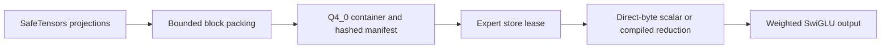

# Q4_0 Expert Bytes

This module implements Q4_0 expert packing and CPU execution. The format metadata reference is
[ggml-common.h](https://github.com/ggml-org/ggml/blob/master/src/ggml-common.h),
specifically QK4_0 and block_q4_0. No upstream quantizer or kernel source was
copied. Tests establish the described byte contract and numerical behavior;
they do not establish upstream execution or quantizer parity.

## Data Path



## Layout

An 18-byte little-endian block describes 32 weights: one IEEE binary16 delta
and 16 unsigned bytes. Low nibbles correspond to positions 0 through 15;
high nibbles correspond to positions 16 through 31. Weight = FP32(delta) *
FP32(nibble - 8). All 16 nibble values are legal, including code -8. Signed,
zero, negative-zero and subnormal finite deltas are accepted. NaN and infinite
deltas are rejected before arithmetic, including on zero-weight routes.

Experts concatenate row-major gate [i,h], up [i,h], down [h,i], with no headers,
padding or alignment. Both dimensions must be positive integer multiples of
32. Payload bytes = 3*h*i/32*18. Shape, model identity and integrity metadata
are external; this is not a GGUF parser.

## Public APIs

- `q4_0_expert.DTYPE = "q4_0"`, `BLOCK_WIDTH = 32`, `BLOCK_BYTES = 18`.
- `payload_size(hidden_size, intermediate_size)` returns the exact byte count.
- `pack_matrix(matrix, block_count=64)` and `pack_expert(gate, up, down, block_count=64)` return bytes.
- `decode_expert(payload, hidden_size, intermediate_size)` explicitly allocates full owned FP32 matrices.
- `Q4_0ExpertBackend(max_scratch_bytes=...)`, name `q4_0-reference`, is the scalar direct-byte baseline.
- `native_q4_0_expert.NativeQ4_0ExpertBackend(max_scratch_bytes=...)`, name `q4_0-numba`, requires active Numba.
- `native_q4_0_expert.scratch_bytes(h,i)` reports 4*i bytes of explicit activation scratch.
- `q4_0_conversion.convert_experts(experts, output, hidden_size=..., intermediate_size=..., block_count=64)` returns `Q4_0ConversionResult`.

The converter result has `path`, `hidden_size`, `intermediate_size`, `regions`,
`dtype` and `activation`. Regions are standard `ExpertRegion` objects with
relative filename, byte offset, size and exact SHA256. Publication uses an
exclusive same-directory hard link after successful packing and file fsync;
existing destinations are not overwritten. Filesystems without hard links
raise OSError. This does not promise crash-durable directory publication.

The independent quantizer uses positive max-abs/7 deltas rounded to binary16,
ties-to-even codes clipped to [-8,7], and zero deltas for zero blocks. A nonzero
delta rounding to zero is floored to 2^-24. Nonfinite input, FP32 overflow and
binary16 delta overflow are errors. This policy is not upstream byte parity.
Conversion scratch is bounded by `block_count*32`, apart from the caller's
matrices and returned packed bytes; expert conversion holds one packed expert
at a time. `pack_expert` also holds its projection byte results while joining.
Packing processes bounded groups of blocks with vectorized NumPy operations.
An independent scalar-policy test checks exact output bytes across chunk sizes,
including zero, subnormal and large finite weights. This establishes conversion
policy consistency, not equivalence to an upstream quantizer.

## Execution

Both backends implement the shared execute/execute_batch lease contract. They
process one token/expert lease at a time, do not retain payloads, and never
allocate decoded weight matrices. Explicit numerical scratch is one i-element
FP32 activation vector; inputs, outputs, routes, borrowed payload and compiler
workspace are excluded. Input normalization may allocate a contiguous FP32
batch. Scratch limits and route validation precede lease acquisition.

Native execution has no Python fallback: missing Numba or NUMBA_DISABLE_JIT=1
marks it unavailable and execution raises RuntimeError. The reference backend
is independently selectable and remains scalar even when Numba is installed.
Native compilation disables fastmath and disk cache. No SIMD or performance
claim is made. Chained execution exceptions drop borrowed frames before lease
release; malformed and nonfinite results fail without returning partial output.

## Engine Integration

The shared registry, manifest validation, SafeTensors packer, OLMoE decoder,
CLI and model gateway accept this format:

- `Q4_0ExpertBackend()` is registered by default for explicit `q4_0` payloads.
- Opt-in compiled execution uses `NativeQ4_0ExpertBackend()` and `q4_0-numba`.
- Manifest sizing uses `q4_0_expert.payload_size`; SafeTensors conversion uses `pack_matrix`.
- Standalone converter regions can be adapted into `ExpertLayer`/`SparseExpertManifest` with caller-supplied identity, layer and routing metadata.
- Q4 artifacts remain separate from Q8 and rowwise INT4; they are not interchangeable.

Gateway environment selection:

```text
OPENAGENT_OLMOE_MODEL_DIR=<checkpoint directory>
OPENAGENT_OLMOE_MANIFEST=<Q4_0 manifest path>
OPENAGENT_OLMOE_KERNEL=q4_0-numba
OPENAGENT_OLMOE_IO_MODE=mmap
OPENAGENT_OLMOE_CONTEXT=16
OPENAGENT_OLMOE_EXPERT_CACHE_GB=0.001
```

Use `q4_0-reference` for explicit scalar selection. Gateway tests create an
actual synthetic SafeTensors checkpoint, pack Q4 experts, call provider `_load`,
assert the exact native backend type and compiled capability, and compare
logits with a directly constructed model.

## Evidence And Limits

Run `.venv/Scripts/python.exe -W error -m unittest tests.test_q4_0_expert tests.test_native_q4_0_expert tests.test_q4_0_olmoe -v`.

Coverage includes hand-built split-nibble bytes, every binary16 pattern,
extreme finite scales, malformed sizes, noncontiguous views, invalid shapes,
nonfinite weights/inputs/deltas, arithmetic overflow, route and scratch limits,
conversion hashes and publication cleanup, actual buffered/mmap leases,
retained compiler exceptions, explicit disabled-JIT behavior, custom registry,
native nopython signatures and allocation inspection, and numerical model
logits against an independently scalar-decoded float32 test backend.

Scalar/native expert comparison uses rtol=5e-6, atol=1e-10 because Python math
and compiled sigmoid evaluation can round differently at FP32 boundaries.
Decoded NumPy expert comparisons use rtol=5e-5, atol=2e-7; model comparisons use
rtol=8e-5, atol=8e-6, allowing different FP32 reduction orders through multiple
layers. Matching identical compiled gateway configurations is tested exactly;
that does not imply bitwise scalar/native equivalence.

Not implemented by this module: Q4_1, Q5_0, Q5_1, Q8_1, K-quants (Q2_K through
Q6_K and Q8_K), IQ variants, ternary formats, MXFP4/NVFP4 and other FP4 variants,
FP8 E4M3/E5M2 and associated scale/container contracts, GPU Q4 kernels,
GGUF import, upstream quantizer comparison, public-checkpoint quality or
performance certification. Q8_0 has its own format and backend.
