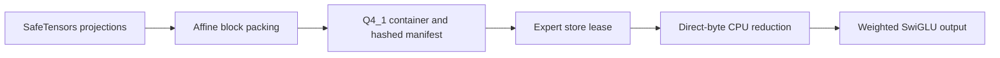

# Independent Q4_1

Layout metadata was verified against the official GGML header:
https://github.com/ggml-org/ggml/blob/master/src/ggml-common.h
(block_q4_1, checked 2026-10-02). No upstream quantizer or kernel
implementation was consulted or copied.

## Data Path



Each 32-value block occupies 20 bytes: little-endian signed IEEE binary16
delta d, binary16 offset m, then 16 bytes of unsigned four-bit codes.
Low nibbles are lanes 0..15; high nibbles are lanes 16..31.
Decode is d*q+m. Finite negative and zero deltas and signed offsets are
legal. NaN and infinity in either field are rejected, including when the
route weight is zero. There is no Q4_0 payload reinterpretation.

## API

- q4_1_expert: DTYPE="q4_1", BLOCK_WIDTH=32, BLOCK_BYTES=20,
  payload_size(hidden_size, intermediate_size), pack_matrix(matrix,
  block_count=64), pack_expert(gate, up, down, block_count=64),
  decode_expert(payload, hidden_size, intermediate_size), Q4_1ExpertBackend.
- q4_1_conversion: convert_experts(experts, output, hidden_size=...,
  intermediate_size=..., block_count=64), Q4_1ConversionResult.
- native_q4_1_expert: scratch_bytes(hidden_size, intermediate_size),
  NativeQ4_1ExpertBackend.

Keyword-only arguments match Q4_0 contracts. Both backend classes accept
max_scratch_bytes and expose info(), execute(), and execute_batch().
Scalar selection is explicitly q4_1-reference; compiled selection is
explicitly q4_1-numba. The compiled backend is unavailable without active
Numba JIT and never silently falls back. The default expert registry includes
the scalar backend; compiled execution uses explicit selection.

Q4_1 is supported by SparseExpertManifest, the SafeTensors expert packer,
and the full OLMoE runtime. Use pack_olmoe_experts(..., dtype="q4_1") or
the OLMoE CLI pack command with --dtype q4_1. CLI defaults are
openagent-experts.q41 and openagent-experts.q41.manifest.json, distinct from
the INT8, INT4, Q8_0, and Q4_0 artifacts. Runtime CLI --kernel accepts
q4_1-reference or q4_1-numba; the direct gateway accepts the same names
through OPENAGENT_OLMOE_KERNEL. Lazy package exports include Q4_1ExpertBackend,
NativeQ4_1ExpertBackend, and convert_q4_1_experts.

## Quantization Policy

The independent quantizer rounds the block minimum and range/15 to half,
floors nonzero underflow deltas to the smallest half subnormal, then assigns
ties-to-even codes relative to the stored metadata, clipped to [0,15].
Constant blocks use d=0. Input must be finite real matrices representable
as FP32; metadata outside binary16 range is rejected. This policy makes no
upstream byte-parity claim. block_count bounds conversion staging, not the
returned packed payload or full owned decode.

## Execution And Storage

The CPU kernels reduce packed bytes directly, never allocating decoded
weights or scale arrays. Projection loops read d/m once per block, then
visit lanes 0..31 in column order with explicit FP32 products and sums;
this is an allocation/arithmetic contract, not a timing guarantee.
Activation scratch is exactly 4*intermediate_size
bytes, checked before leasing; inputs and returned outputs are separate.
One expert lease is held at a time. Batch routing, finite inputs, exact
payload sizes, finite metadata, stable SwiGLU, and finite reductions are
validated. JIT is nogil, no fastmath, and no disk cache. Exceptions clear
borrowed-buffer traceback frames before lease release for mmap cleanup.

Conversion publishes consecutive gate/up/down experts with offsets,
lengths, and SHA-256 hashes through a same-directory temporary and exclusive
hard-link publication. Existing destinations are not overwritten; failed
conversion removes its temporary. Full expert packed bytes are held while
writing, not a decoded FP32 expert.

## Verification

Run with warnings treated as errors:

```powershell
.accelerator-venv/Scripts/python.exe -W error -m unittest tests.test_q4_1_expert tests.test_q4_1_native tests.test_q4_1_olmoe
```

Tests cover hand-built split nibbles, signed half boundaries, an exhaustive
half reader, independent quantizer policy, affine NumPy differentials,
bounded scratch, malformed metadata, zero-weight validation, overflow,
real buffered/mmap leases, retained chained exceptions, atomic conversion,
and a disabled-JIT subprocess. Integration tests exercise registered dtype
selection, real SafeTensors packing, full-model logits against independently
decoded weights, actual gateway loading with compiled execution, and CLI
artifact defaults with bidirectional preservation of other formats.
These synthetic fixtures verify execution contracts, not public-checkpoint
quality or upstream quantizer parity. Compiled tests require active Numba.
