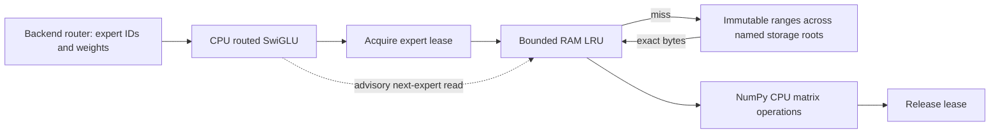
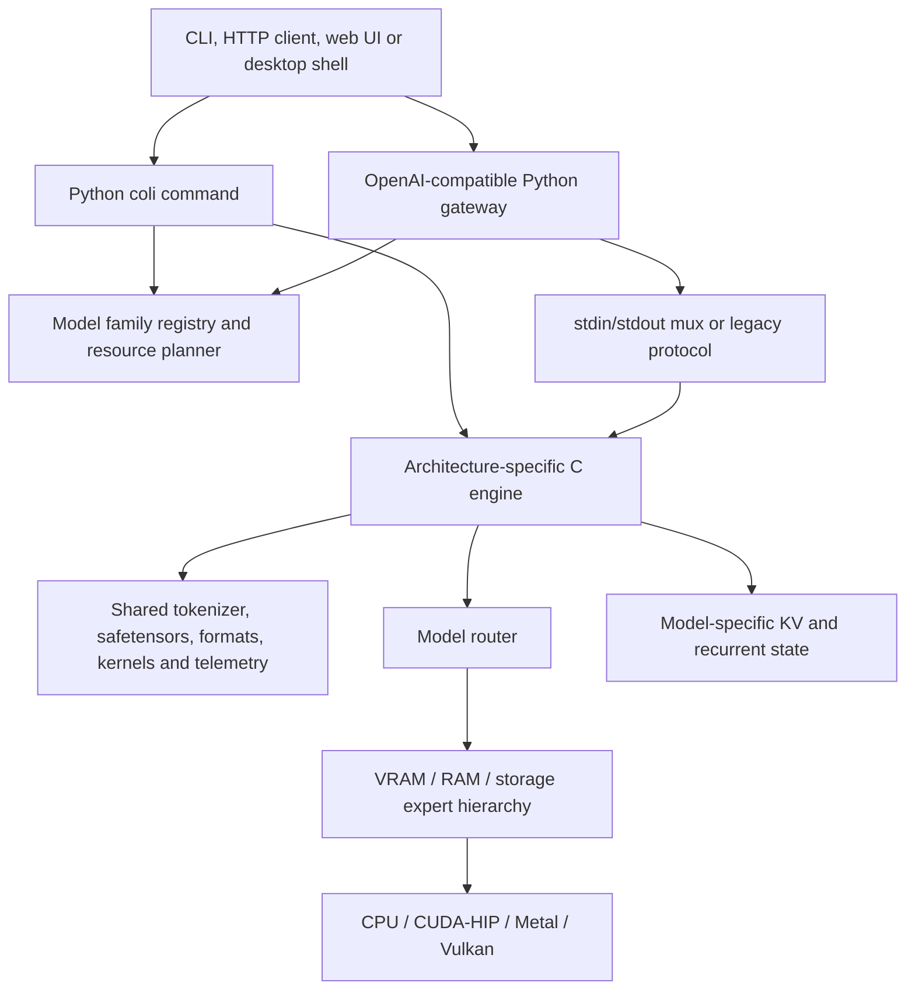
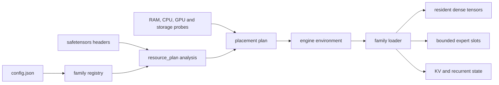
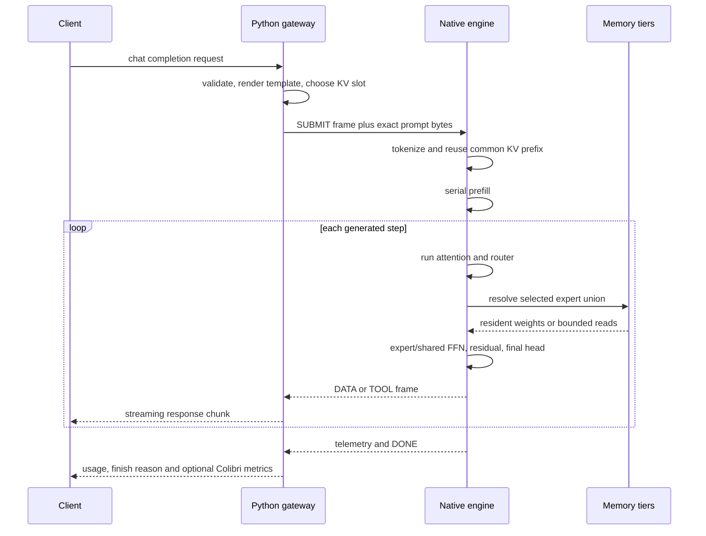
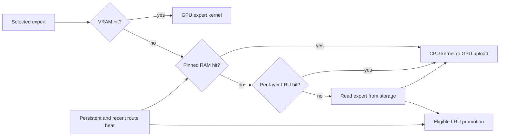

# Disk-backed expert execution

OpenAgent's adaptive engine includes a validated sparse-expert manifest,
SafeTensors packing, a bounded CPU expert store and routed SwiGLU execution.
They let a model adapter read selected expert weights from local storage instead
of retaining every expert in application RAM.

The expert store is a reusable component rather than a universal decoder.
OpenAgent includes an independent OLMoE decoder and optional local library
adapters described in [Model families](ENGINE_MODEL_FAMILIES.md). Other chat
providers still own their tokenizers, attention, routing and generation loops;
each additional family needs an exact adapter before it can use this store.

### Decoder And Native Execution Boundaries

The [independent decoder implementations](ENGINE_NATIVE_DECODERS.md) cover
Mixtral and the exact Qwen3.5 MoE text identity on small numerical fixtures.
The independent classes use NumPy for model arithmetic; the Qwen path can
explicitly select a compiled gated-delta primitive. The separate
[native Qwen3.5 text decoder](ENGINE_NATIVE_FAMILIES.md) performs transformer
arithmetic in C with resident FP32 weights and transactional hybrid caches.
It does not provide packed disk-streamed experts or a multimodal implementation.

The [native OLMoE range executor](ENGINE_NATIVE_SEGMENT_EXECUTION.md) performs
embedding, range and vocabulary-head math in compiled C. Its checkpoint loader
admits resident FP32 banks and decodes INT8 experts during loading. Native math
does not imply bounded disk-streamed expert residency: all selected experts
remain resident in that path. Session snapshots, cancellation and failure
handling have separate tests from numerical execution.

Packed execution includes independent [Q4_0](ENGINE_Q4_0.md) and
[Q4_1](ENGINE_Q4_1.md) and [Q5_0](ENGINE_Q5_0.md) converters, reference backends and explicitly selected
compiled CPU kernels alongside row INT4 and Q8_0. These formats do not establish
support for all GGUF formats, FP4/FP8 checkpoint layouts, or every model family.
The JSON conformance report distinguishes independent Python decoders, resident
native ranges and complete native streamed decoders rather than merging them
into one support flag.

## Architecture



`DiskExpertStore` validates file ranges under a selected model directory or a
declared named storage root and optionally verifies each payload's SHA-256
digest. Buffered mode reads into a preallocated byte buffer. Memory-mapped mode
creates read-only range views and releases every exported view before closing
its file mapping. An entry is published only after a complete read.
Active leases cannot be evicted. If no unleased entries can make room, demand
loading raises a capacity error rather than silently dropping an expert.

Read-ahead has configurable worker and queue limits. It reserves payload bytes
before work is submitted and preserves enough headroom for the next demand
read. It never evicts cached weights, so an incorrect prediction cannot replace
a useful demand entry. Speculative disk I/O runs outside the cache lock and has
an admission check to avoid reads that are already known not to fit. The
runtime supports buffered, mapped and aligned direct reads. Linux `uring` mode
uses a liburing bridge and fails explicitly when required dependencies or
kernel/filesystem support are unavailable. Native Linux execution is not
verified on this Windows workstation.

The higher-level runtime groups a token batch by expert. Each selected expert
is loaded once and its matrix operations run over every token routed to it.
Router weights and output order are preserved. A small transition model records
local route history, proposes advisory reads and can promote a byte-budgeted hot
set. Profiles are stored separately and are accepted only when their model ID
and fingerprint match the active manifest.

Expert computation is selected through `ExpertKernelRegistry`. The built-in
backend is a deterministic NumPy implementation with FP32 accumulation. An
optional provider can register a compiled implementation, but selection only
uses it when its dtype and batch capabilities match. A native-SIMD claim is
rejected unless the provider supplies verified binary evidence. Runtime status
reports the selected preference and every registered backend instead of
describing NumPy as a native kernel.

`ExpertTierManager` models storage, mapped host, hot host and accelerator
residency with separate byte budgets. Promotions are asynchronous, leases and
pins prevent eviction, and failed uploads preserve the expert identity while
falling back to the best available lower tier. The included in-memory adapter
is a deterministic test backend and explicitly reports that it does not execute
experts on a GPU.

The cache budget covers weight payloads, including a payload being read.
Interpreter overhead, matrix-operation temporaries, activations and the OS
page cache are additional memory. Source files must remain immutable while
the store is open, and consumers must not retain tensor views after releasing
their lease.

## Engine interface

```python
from openagent.adaptive_engine import ExpertRegion

# Each payload contains gate [I,H], up [I,H], down [H,I], row-major.
regions = {
    "layer0.expert0": ExpertRegion("experts.bin", offset=0, size=payload_bytes),
    "layer0.expert1": ExpertRegion("experts.bin", offset=payload_bytes, size=payload_bytes),
}
with engine.open_expert_store(model_directory, regions,
                              capacity_bytes=payload_bytes * 2) as weights:
    output = engine.execute_routed_experts(
        weights, hidden_vector,
        [("layer0.expert0", 0.7), ("layer0.expert1", 0.3)],
        hidden_size=hidden_size, intermediate_size=intermediate_size,
        dtype="float32",
    )
    measurements = weights.status()
```

`engine` is the existing `AdaptiveExecutionEngine` instance. The caller supplies
the actual dimensions, byte offsets and router output. The CPU primitive
supports little-endian FP32 and FP16 payloads plus OpenAgent's row-wise INT8
expert container. It accumulates into FP32 and does not change routing weights
or substitute other experts. Quantized GGUF blocks, Colibri containers, shared
experts and other activation functions need their own backend adapters; passing
those bytes to this primitive is not supported.

For a complete sparse layer description, create an `ExpertLayerBinding` from a
model-family adapter and call `pack_safetensors_experts`. The packer validates
the named gate, up and down tensors, preserves their FP16 or FP32 bytes, writes
aligned expert payloads atomically and returns a `SparseExpertManifest`.
`open_sparse_expert_runtime` accepts that manifest or its JSON path.

```python
from openagent.adaptive_engine import (
    ExpertLayerBinding,
    ExpertTensorBinding,
    pack_safetensors_experts,
)

binding = ExpertLayerBinding(
    id="block.0",
    hidden_size=hidden_size,
    intermediate_size=intermediate_size,
    experts_used=2,
    experts=(
        ExpertTensorBinding("0", "block.0.expert.0.gate", "block.0.expert.0.up", "block.0.expert.0.down"),
    ),
)
manifest = pack_safetensors_experts(
    "model.safetensors",
    "experts.bin",
    model_id="example",
    architecture="adapter-owned",
    fingerprint="sha256:...",
    layers=[binding],
)

with engine.open_sparse_expert_runtime(
    ".", manifest, capacity_bytes=512 * 1024 * 1024
) as sparse:
    output = sparse.execute("block.0", hidden, [("0", 1.0)])
```

Tensor names in this example are placeholders. An adapter must obtain exact
names and routing semantics from the target architecture; the packer does not
guess them.

### OLMoE adapter

Install the direct decoder dependencies with `pip install -e ".[engine]"` (or
use the `full` extra) before packing or running a checkpoint.

OpenAgent now has an independently implemented OLMoE path for the public
`allenai/OLMoE-1B-7B-0125-Instruct` geometry. `OlmoeConfig` validates the
checkpoint contract and creates explicit bindings for 16 layers, 64 experts
per layer and top-8 routing. `pack_olmoe_experts` reads sharded SafeTensors,
converts one BF16/F16/F32 projection at a time to deterministic row-wise INT8,
and emits aligned expert payloads. It can write one container or distribute
whole experts round-robin across named containers on separate storage roots.
Each quantized projection is written immediately; peak conversion memory is
bounded by one projection and its quantized copy rather than the full
checkpoint.

`OlmoeModel` implements embedding lookup, RMS normalization, whole-vector Q/K
normalization, split-half RoPE, causal KV caching, grouped-query attention,
router softmax, stable top-k selection, optional top-k probability
normalization, streamed expert execution, residual connections, final
normalization and the untied language head. It is exposed to the model gateway
as `olmoe-direct` when both `OPENAGENT_OLMOE_MODEL_DIR` and
`OPENAGENT_OLMOE_MANIFEST` point to complete local artifacts.

The operator command keeps setup and validation explicit:

```powershell
openagent-olmoe inspect D:\models\olmoe
openagent-olmoe pack D:\models\olmoe
openagent-olmoe pack D:\models\olmoe `
  --stripe ssd-b=E:\olmoe\experts-b.i8
openagent-olmoe verify D:\models\olmoe `
  D:\models\olmoe\openagent-experts.manifest.json oracle.json
openagent-olmoe generate D:\models\olmoe `
  D:\models\olmoe\openagent-experts.manifest.json "Explain sparse routing." `
  --storage-root ssd-b=E:\olmoe
openagent-olmoe benchmark D:\models\olmoe `
  D:\models\olmoe\openagent-experts.manifest.json "Explain sparse routing." `
  --warmup 1 --runs 3 --max-tokens 16 --kernel openvino-gpu
```

`inspect` parses every SafeTensors header and validates the expected tensor
count. `pack` writes through a temporary container, reports conversion progress
and publishes the manifest only after conversion succeeds. `verify` performs a
greedy token-ID comparison, which is stricter than comparing decoded prose.
`benchmark` records each run, median and p95 first-token latency, generation
throughput, model fingerprint, I/O mode, cache budget and final runtime
telemetry. It does not label a warm page-cache result as raw storage speed.

The decoder can stream target-model token IDs and save compact v2 session
snapshots containing only committed KV positions. Execution identity binds
loaded dense-weight bytes, expert content hashes and sizes, payload dtype and
selected backend names, in addition to checkpoint metadata. Every OLMoE expert
region must have a SHA-256 hash; custom unhashed manifests are rejected.
Restore rejects legacy v1 state, mismatched identity, geometry and nonfinite
values before changing active KV state. Hashes detect corruption, not publisher
authenticity.

`OlmoeService` adds a bounded persistent request queue, stable request IDs,
priority/deadline selection, cooperative cancellation, lifecycle/token events,
per-request failures and isolated resumable sessions. Its concrete
`OlmoeChatDecoder` stores one compact KV snapshot per session and appends only
the next user turn after restoring it. Session state has a separate byte budget
and least-recently-used eviction; message history remains available for a full
replay when an old KV snapshot is evicted. The current worker executes one
decoder request at a time; selecting a microbatch does not claim simultaneous
model math.

The service bounds session count, conversation characters and buffered events.
Slow consumers can lose the oldest buffered activity events. Cancellation is
cooperative: a decoder must check the cancellation callback between steps.
Completed request handles keep their results, while the service removes those
requests from its internal registry. History and snapshots are published
together only after successful generation.

`OpenVINOExpertBackend` sends only activation vectors and validated local file
ranges over the inherited worker pipe. The worker reads and checks the selected
expert, constructs a SwiGLU graph, compiles it for the requested OpenVINO
device, and budgets compiled expert FP32 constants in an LRU. Driver allocations,
compiler workspace and executable code add memory beyond that budget. Row-wise INT8 storage
is dequantized once while the graph constants are built; this is not a native
INT8 expert kernel. On this workstation, the hardware-gated differential test
compiled and ran the tiny expert on Intel Arc GPU and matched the NumPy result.
The installed Intel NPU plugin rejected this graph during compilation, so the
NPU expert path is not certified here.

Snapshot restoration validates every key and value array before replacing active
state. A malformed snapshot leaves the current conversation state intact.
Closing a sparse runtime releases its owned kernel registry and resident device
experts.

Set `OPENAGENT_OLMOE_KERNEL=openvino-gpu` to opt into this backend through the
model gateway. `OPENAGENT_OLMOE_ACCELERATOR_CACHE_GB` controls its compiled
expert residency budget. The CLI accepts the same backend with
`--kernel openvino-gpu`. Accelerator failures are surfaced; they are not
silently reported as hardware execution.

The complete path is tested with a generated tiny OLMoE checkpoint. Batched
prefill and incremental KV-cache execution produce matching final logits, and
the sharded BF16-to-INT8 expert path is compared with FP32 reference math. This
is component and tiny-model evidence. The narrow public-checkpoint INT8/INT4
smoke check documented below adds limited generation evidence, not production
equivalence or broad model-quality validation. Public Q8_0 conversion completed
through the CLI: 1,024 experts, 6,845,104,128 payload bytes, 116.823 seconds.
The `q8_0-numba` four-token oracle matched exactly on one prompt, as detailed
below. This narrow smoke check does not establish broad model quality or speed.

The compiler also preserves packed GGUF byte sizes under memory pressure. A
smaller precision estimate is not a conversion. KV memory is reserved before
weight placement, and storage-backed MoE plans explicitly require a backend
adapter instead of claiming that no repeated I/O is needed.

## Verification

Run from the repository root:

```powershell
.\.venv\Scripts\python.exe -m unittest tests.test_expert_store tests.test_adaptive_engine -q
```

Tests compare streamed FP32, FP16 and row-wise INT8 expert outputs with resident
NumPy references, exercise a one-expert cache, check exact reads and cache hits,
and cover leases, eviction, checksums, file boundaries, mapped-view shutdown,
parallel read reservations, named storage roots and planner accounting.
The generated tiny OLMoE fixture additionally exercises the complete decoder.
These tests are not full-model throughput measurements.

Before claiming an inference improvement, compare the same model, quantization,
prompts, router outputs and generation settings with and without streaming.
Record first-token latency, generation throughput, peak process memory, bytes
read, cache state and output agreement. Buffered reads may hit the OS cache;
they must not be presented as raw SSD bandwidth. Dense models still require
all their layers per token and do not gain sparse expert routing from this API.

## Colibri implementation and architecture

The separate local checkout is `reference/colibri`, pinned for this study at
`ce370e87d7b623d7759b52ec2007d75fc5b0e87e`. It is ignored by OpenAgent's Git
repository and is not imported or executed by OpenAgent. The checkout retains
its Apache-2.0 license, copyright notice and third-party notices.

### Read audit

The study covered the complete tracked tree at the pinned commit. Every tracked
file was opened; text files were iterated line by line and binary files were
hashed. The scan did not modify or execute the checkout.

| Measure | Result |
| --- | ---: |
| Tracked files opened | 857 |
| Bytes read | 20,367,005 |
| Text files read line by line | 833 |
| Binary files hashed | 24 |
| Text lines | 274,923 |
| Non-empty text lines | 253,681 |
| Read errors | 0 |

The line scan establishes coverage, not comprehension by itself. Architecture
was reconstructed separately by tracing build targets, command entry points,
family registration and planning, model loaders, forward passes, expert lookup
and eviction, native backends, server protocols, browser clients and test gates.

The tracked tree is concentrated in `c/` (667 files and about 11.9 MB), with 77
documentation files, a React web client, a Tauri desktop shell, Docker assets
and a small Python package that exposes the command-line entry point.

### Repository architecture



The PyPI package is intentionally thin. `colibri/cli.py` finds and executes
`c/coli`; that Python command is the product launcher. It detects the model
family from `config.json`, resolves the matching executable, calculates resource
settings, translates flags into environment variables, and starts chat, run,
serve, web, plan, doctor, tune, benchmark, conversion, mirror and cluster flows.

The HTTP path is a two-process design. `openai_server.py` owns request parsing,
chat templates, image and audio preprocessing, tool-call translation, API
compatibility, stop filtering, scheduling, connection limits and static web
hosting. It launches the selected native engine and exchanges framed messages
over pipes. The native engine owns model math and state. This separation keeps
HTTP concerns out of the forward pass and lets one gateway serve different
architecture binaries.

### Model-family boundary

The central registry is `c/family_registry.py`. A `FamilyDescriptor` records
the family identity, executable, model-type aliases, planner geometry,
capabilities, limits, display variants and tensor-accounting callbacks.
`resolve_model()` matches a checkpoint to one descriptor, while
`resource_plan.py` uses the descriptor to calculate resident tensors, expert
geometry, cache capacity and the environment passed to the executable.

Colibri does not lower every model into one generic graph. Each family keeps a
native forward implementation because attention, recurrent state, residual
topology, router semantics and tensor formats differ materially:

| Family | Principal engine | Important state or path |
| --- | --- | --- |
| GLM-5.2 | `c/colibri.c` | MLA, DSA indexer, streamed MoE, MTP |
| GLM-5.3 Flash | `c/glm53.c` | absorbed MLA, MoE, vision path |
| Inkling | `c/inkling.c` | global/sliding attention, convolution state, audio |
| Kimi K3 | `c/kimi_k3.c` | MLA/KDA and AttnRes state, tool sideband |
| Qwen3.6 | `c/qwen36.c` | attention plus DeltaNet and convolution state |
| Qwen3.8 Flash Next | `c/qwen38.c` | QSA/GDN, four-stream hyper residuals, vision |
| OLMoE | `c/olmoe.c` | conventional KV with MoE execution |
| DeepSeek V4 | `c/deepseek_v4.c` | mHC state and optional CUDA split build |
| DeepSeek V4.1 | `c/deepseek_v41.c` | compressed/window attention, indexer, vision |

Shared mechanics stay in headers or separately compiled backends. `st.h` owns
safetensors discovery and bounded range access; `quant.h`, `qgemv.h`, `idot.h`
and the format headers own quantized representation and CPU dot products;
`tok.h` and the Unicode tables own tokenization; `expert_ffn.h` provides a
common routed feed-forward runner; `route_trace.h` owns route history;
`telemetry.h` owns runtime statistics. `compat.h` keeps platform shims in one
place. This design shares mechanisms without pretending that model states are
interchangeable.

### Planning and model loading



The planner reads shard headers rather than tensor payloads. It distinguishes
dense bytes, routed-expert bytes, family-specific fixed allocations, trunk
offload bytes and per-layer maximum expert-slot sizes. Results are cached in a
sidecar keyed by shard/config sizes and modification times. Cache corruption or
a read-only model directory falls back to a fresh analysis.

Hardware discovery covers available memory, physical CPU cores and sockets,
Metal, NVIDIA and AMD devices. The plan subtracts fixed allocations, context
state and safety headroom before assigning expert capacity to VRAM and RAM.
`environment_for_plan()` converts this result into the controls understood by
the family engine. Planning remains a prediction; upstream separates it from
measured benchmark evidence.

Native loaders validate config geometry and safetensors offsets before exposing
weights. Dense tensors such as embeddings, attention projections, shared
experts and output heads are retained or mapped according to the family. Routed
experts are represented by file ranges and bounded slots. Several families use
converted containers with quantized payloads and separate scales; format stamps
prevent ambiguous decoders from accepting the wrong representation.

### Request and token lifecycle

The server renders the architecture-specific chat template before submitting a
request. In mux mode the request carries an ID, a KV slot, a byte-counted prompt,
generation limits and sampling controls. Image payloads use a separate framed
message. The engine rejects malformed frames and duplicate or busy slots.



Prefill is serial at the request level. Decode can continuously batch active KV
slots, one row per slot per forward step. A stop request follows the normal
completion path and persists usage and KV state; cancellation aborts the request
and acknowledges cancellation after safe state handling.

Within a sparse layer the exact math varies by family, but the shared execution
shape is consistent:

1. Normalize the current hidden state and execute the model's attention or
   recurrent block.
2. Compute router logits and select the model-configured experts and weights.
3. Form the unique expert union across the current token rows so one expert is
   loaded once for the batch.
4. Resolve each expert against GPU residency, pinned RAM and the per-layer LRU.
5. Start missing reads and compute resident experts while I/O is in flight.
6. Wait only when a selected miss is needed, run its feed-forward kernel, and
   accumulate the unchanged router-weighted result.
7. Run the shared expert when the architecture defines one, apply residual or
   hyper-residual updates, and promote eligible loaded experts into the cache.
8. Advance KV/recurrent state only through the family-owned commit path.

The placement policy is intended to alter latency and residency, not selected
expert IDs or weight precision. Experimental cache-aware routing options exist,
but they are opt-in because substituting experts changes model semantics.

### Expert storage and I/O

`c/expert_store.h` defines a lease-based interface: lookup, release, advisory
prefetch, statistics and destroy. A successful lookup keeps its views valid
until one matching release. Prefetch owns no lease and cannot evict an active
one. `expert_store_registry.c` selects a linked backend; the built-in `auto`
backend uses the existing disk/mmap implementation.

The primary expert path indexes tensor ranges in safetensors shards. Converted
experts place gate, up and down data contiguously so a miss can use one
coalesced positional read into a slot slab, with tensor views pointing into the
loaded bytes. The full-read loop handles interrupted and short reads explicitly.
Demand-read failure is fatal to correctness; speculative read failure is
discarded without publishing the slot.

Storage modes include buffered positioned reads, optional direct/unbuffered
I/O, memory mapping and mirrored model directories. Mirror files are checked
against the primary before use. Reads can be routed or striped across validated
copies, and a mirror failure falls back to the primary. Direct I/O and striping
are hardware-dependent policies, not unconditional defaults.

The storage layer is part of the performance model. Colibri's benchmark rules
require request size, alignment, queue depth, buffered/direct mode and cache
state because an OS page-cache measurement is not raw drive performance.

### Cache and placement policy



There are three complementary residency mechanisms:

- A pinned hot set is populated from persistent `.coli_usage` route counts.
- A bounded per-layer LRU captures the current working set.
- Optional GPU expert tiers mirror selected hot slots in device memory.

Runtime counters distinguish long-term usage, recent heat and last access.
Live repinning runs between turns, swaps sufficiently hotter candidates into
the pinned tier and decays recent heat. It does not mutate the persistent
history. Cache entries carry indexes so lookup is constant-time rather than a
linear scan, and reserved/loading sentinels prevent speculative workers from
publishing partial data or selecting an in-flight slot as a victim.

### Hiding storage latency

The demand pipeline uses a bounded worker pool. It submits missing expert reads,
executes resident experts first, and drains each required read before using or
recycling the slot. Batched expert unions remove duplicate reads across prompt
rows. Linux builds can use an io_uring path; other builds use worker threads.

There are two distinct prefetch classes:

- File readahead issues a non-owning hint for likely future ranges.
- Pilot loading can reserve a future-layer cache slot and perform a real read.

Pilot work is advisory: it rechecks residency, cannot evict active slots, and a
failed speculative read cannot terminate inference. Prediction can use stale
next-layer state, a two-step approximation or measured cross-layer coupling.
Each policy is gated and instrumented because inaccurate prefetch consumes disk
bandwidth and can be slower than demand loading.

### CPU and accelerator execution

CPU kernels operate directly on the supported quantized layouts. They combine
format-aware dot products, fused gate/up paths, SwiGLU activation, row tiling,
OpenMP scheduling and architecture-specific SIMD. The one-file family engines
choose kernels based on format, batch shape and phase; prefill matrix-matrix and
decode matrix-vector behavior are not treated as the same workload.

CUDA/HIP, Metal and Vulkan backends are optional compile/runtime tiers. Backend
interfaces cover tensor upload, quantized projections, grouped expert kernels,
attention operations, device-resident residual pipelines and memory statistics.
Dynamic loader code on Windows validates runtime locations and file identities
before binding exported functions. A missing or unsupported backend falls back
to an available path where the family permits it; capability flags and telemetry
must reflect the path that actually ran.

Multi-GPU support partitions resident expert work by device. Some pipelines keep
the residual stream on device across layers to avoid repeated host transfers.
The profitable split depends on residency, bandwidth and workload; it is not
equivalent to placing arbitrary graph nodes on every discovered accelerator.

### KV, recurrent state and speculation

State storage is model-specific. The tree includes conventional KV, compressed
MLA state, quantized KV variants, prefix matching, persisted warm conversations,
sliding windows, convolution rings, DeltaNet/KDA recurrence, DSA/QSA index state
and hyper-residual streams. KV slots are isolated by conversation and reuse the
longest matching prompt prefix before truncating and extending.

Speculative decoding is an acceptance-and-verification path, not unverified
draft output. Native MTP and constrained grammar/corpus drafts are measured
against the target forward pass. Draft state is rolled back when verification
rejects tokens. Exact verification options trade speed for reproducibility on
near-tie paths; unsupported quantized-state combinations remain on their stated
floating-point path.

### Serving, API and user interfaces

The mux wire protocol supports request submission, image frames, stopping and
cancellation, plus streamed text/tool frames and terminal status. Telemetry
frames report hardware, memory tiers, expert maps, routed hits, phase timings,
entropy, GPU residency and live repinning. Unknown telemetry is explicitly
skippable for forward compatibility.

`openai_server.py` exposes OpenAI-compatible chat completions, an Anthropic
messages adapter, model metadata, expert state, metrics and the web bundle. It
owns family-specific prompt rendering and tool syntax so the native engine sees
the exact text and sideband data expected by that checkpoint. Host-header,
body-size, timeout, connection and API-key controls live at this boundary.

The browser client is React/TypeScript with Vite. Its primary workspaces are
chat, Brio closed-set scoring, expert/route visualization and profiling. It is
an API client rather than a second inference implementation. The Tauri v2
desktop project is a small native shell around the built web application.

### Distributed seams

The local cluster controller registers workers and expires stale registrations;
worker discovery alone is not distributed inference. Expert workers serve a
separate compute protocol when explicitly configured.

Two local C ABIs provide stronger distribution boundaries:

- The Segment runtime executes a contiguous half-open layer range, owns its
  weights and session state, and streams snapshots through callbacks.
- The Edge runtime owns tokenization, embeddings, final transforms, logits and
  token selection around a chain of Segment engines.

Both expose structure sizes, model state schemas, numeric compatibility classes
and lifecycle rules. Callers remain responsible for transport, identity,
leases, retries and placement. The normal CLI does not link these adapters;
consumers opt in through dedicated library targets and explicit registration.

### Correctness and evidence model

The repository separates several evidence levels:

- Dependency-free unit tests cover parsers, formats, kernels, protocols, cache
  invariants, lifecycle behavior and platform shims.
- Generated tiny checkpoints compare complete family forwards against reference
  outputs and teacher-forced tokens.
- Segment and Edge conformance tests cover registration, session isolation,
  snapshot/restore and capability identity, while real-adapter gates execute
  model math.
- Sanitizer, fuzz and failure-injection targets exercise bounds and corrupted
  input paths.
- Benchmarks require exact model/container identity, hardware, cache state,
  commands, prompt corpus, request geometry, throughput, TTFT, bytes read,
  quality checks and raw logs.

The repository contains 197 C, 20 CUDA, 2 Objective-C++ and 151 Python files in
`c/tests`, plus test and benchmark targets throughout the Makefile. Their
presence is not evidence that they passed on this OpenAgent workstation. This
study read the code and documentation; it did not build Colibri, download its
models or reproduce upstream performance numbers.

### What the method does and does not solve

The central memory result comes from sparse MoE structure. A model may contain
hundreds of billions of total parameters while activating a much smaller expert
subset per token. Dense/shared tensors still need an appropriate resident or
mapped path, and every selected expert still has to reach a compute kernel.
Disk-backed experts trade capacity for I/O latency; they do not turn storage
into RAM or make a dense 200B model fast on an ordinary CPU.

The architecture succeeds by combining model-specific correctness with systems
work: exact tensor geometry, bounded residency, learned placement, coalesced
reads, overlap, native quantized kernels, compact state, continuous batching and
measurement. Copying only the LRU policy cannot reproduce the whole engine.

### OpenAgent boundary after this study

Colibri combines architecture-specific forward passes with expert storage,
cache policies and native compute backends. OpenAgent's implementation here is
independently written Python using the general bounded-cache, lease and
read-ahead techniques; it does not copy Colibri's C kernels or provide equivalent
model coverage. Neither a universal laptop speedup nor large-model performance
on this machine has been established.

The reusable component corresponds to the sparse FFN data path. The OLMoE
adapter adds a complete decoder for that one checkpoint family:

| Colibri capability | OpenAgent state |
| --- | --- |
| Validated byte ranges and bounded expert residency | Implemented in `DiskExpertStore` |
| Lease-protected eviction | Implemented |
| Pinned hot set and pressure-safe eviction | Implemented |
| Bounded parallel read-ahead outside the cache lock | Implemented with byte reservations and demand headroom |
| FP32/FP16/row-wise-INT8 CPU routed SwiGLU primitive | Implemented and reference-tested |
| Expert-centric batch execution | Implemented and differential-tested |
| Model-specific router and forward pass | Independent OLMoE decoder plus optional library adapters; exact family inventory and remaining architecture differences are documented separately |
| Explicit SafeTensors expert packer | Implemented with shape, dtype and range validation |
| Automatic architecture/tensor-name inference | Not implemented; family adapter required |
| Row-wise INT8 expert container path | Implemented; NumPy uses row scales directly and OpenVINO dequantizes graph constants at load time |
| Row-wise packed INT4 expert container | Implemented with manifest, packer, CLI and OLMoE integration; reference and compiled direct-nibble CPU execution tested |
| Q8_0 expert container | Explicit matrix/SafeTensors packing, hashed sparse manifests and OLMoE full-model/CLI integration; NumPy and optional raw-byte Numba execution. Public conversion and one four-token oracle passed; no broad quality or performance certification |
| Q4_0 and Q4_1 expert containers | Independent block packing, direct-byte scalar and optional compiled CPU reductions, sparse manifests, OLMoE conversion, CLI and gateway selection; format-specific numerical and failure-path tests |
| Evidence-gated expert kernel registry | Implemented with deterministic NumPy fallback |
| Demand I/O overlapped with compute | Python worker overlap is implemented; no native asynchronous queue |
| Memory-mapped expert ranges | Implemented with lease-safe view release |
| Named multi-storage expert striping | Implemented in the INT8 packer, manifest, CLI and runtime |
| Direct/unbuffered I/O | Implemented; real Windows aligned reads tested, Linux O_DIRECT path not exercised on this workstation |
| io_uring | Linux liburing bridge connected to store and CLI; native Linux execution unverified on this workstation |
| Compiled CPU expert kernels | Optional Numba/LLVM scalar and grouped-batch SwiGLU; INT8 weights retain row scales without full weight dequantization; differential tests pass |
| Persistent route history and budgeted hot-set promotion | Implemented |
| OLMoE config and exact expert-name adapter | Implemented |
| Sharded BF16/F16/F32 to row-wise INT8 conversion | Implemented and tiny-fixture tested |
| Complete OLMoE NumPy decoder and KV cache | Implemented and tiny-model tested |
| OpenAgent model-gateway provider | Implemented; available only with complete local artifacts |
| Persistent serving, cancellation and streamed lifecycle events | Implemented with one decoder worker |
| Fingerprint-bound per-session KV snapshots | Implemented, byte-budgeted and tiny-model tested |
| Byte-budgeted accelerator residency contract | Implemented with a real OpenVINO expert adapter |
| Intel Arc expert execution | Hardware differential test passed on this workstation |
| Intel NPU expert execution | Tiny FP32, FP16 and INT8-row payload graphs passed hardware differential checks with the bundled PLUGIN compiler; full-model NPU performance is unverified |
| Public OLMoE checkpoint differential generation | One four-token BF16-oracle smoke check passed with INT8 and INT4; broader quality validation remains outstanding |
| Segment/Edge C interface | OpenAgent lifecycle/transfer ABI compiled and tested on Windows; model math remains Python/NumPy, not upstream ABI compatibility |
| Callback-free C OLMoE range math | Native FP32 attention, routing, experts, KV and embedding/head execution tested with MSVC; resident expert banks, not disk-streamed packed execution or upstream ABI compatibility |
| CUDA/HIP and Metal expert execution | Optional PyTorch backend is connected; scalar/grouped CPU differential tests passed, accelerator execution not tested on this workstation |
| Vulkan expert execution | Two-pass WGSL compute via wgpu-native; scalar/grouped differential tests passed on Intel Arc 140T |
| Full-model correctness oracle and performance A/B | Not yet established |

### Additional local model adapters

Install `.[engine-hf-moe]` for the supported Transformers families.
`openagent-hf-moe MODEL_DIRECTORY "PROMPT" --offload-directory OFFLOAD_DIRECTORY`
runs a local checkpoint with individual experts on disk and dense tensors
resident on CPU. `--resident-device cuda:N` requires an actual CUDA device.
No hub download or remote model code is permitted. These adapters reuse the
library's attention, router and generation logic; they do not provide Colibri's
family-specific native kernels or packed checkpoint formats.

Models are initialized on the meta device, then validated and loaded
shard-by-shard with temporary state-dict offload. Dense tensors and shard
working data still require RAM; an unsharded checkpoint is not guaranteed to
load within a small memory budget. Tiny tests cover the documented families,
sharding, tied weights, cached decoding and rejection of inconsistent tensors.

Set `OPENAGENT_HF_MOE_MODEL_DIR`, optionally `OPENAGENT_HF_MOE_OFFLOAD_DIR`,
`OPENAGENT_HF_MOE_DEVICE` and `OPENAGENT_HF_MOE_MAX_TOKENS` to register
`hf-moe-direct` in the chat gateway at startup. Generation is buffered;
inherited chat chunks are not token-level streaming. Checkpoint availability
is checked before loading; detailed shape/placement validation occurs during
loading. The configured checkpoint cannot be replaced by an unrelated name.

### Vulkan and Linux storage

Install `.[engine-vulkan]` and select `--kernel vulkan-wgpu`. The adapter requires
a Vulkan hardware GPU and checks adapter identity. Two WGSL passes compute
gate/up activation and the down projection. Multiple token rows share each
expert dispatch. Weights are uploaded per expert, not held in an accelerator
cache. Arithmetic is FP32, including row-scaled INT8 payloads. This path was
tested on Intel Arc 140T with driver 101.8132; it is not a hand-tuned INT8 or
cooperative-matrix kernel.

`--io-mode uring` requires Linux, a C compiler and system liburing development
files. The C bridge is compiled lazily into a per-user cache. Reads use aligned
O_DIRECT buffers and real ring submissions/completions. One read_region call
completes synchronously; the expert store's worker pool provides overlap
between separate regions. A persistent multi-file native queue is not provided.
The dedicated Linux CI workflow requires both a ring probe and native read
tests; that workflow has not been run remotely here.

### Checkpoint recovery

`openagent-checkpoint-recovery SPECIFICATION.json --allow-download` performs an
explicit external transfer. Each entry supplies a filename, pinned HTTPS URL,
exact size and SHA-256 digest. Bounded parallel range reads are committed in
order to a separate recovery file. Range identity, response length and final
checksum must match before replacing the local checkpoint. Interrupted prefixes
can be resumed; unidentified loose fragments are not joined. This command is
separate from inference and is never called automatically by local adapters.
HTTPS redirects cannot downgrade to plaintext. A failed full-size recovery
file is quarantined before a fresh retry; a corrupt prefix is not repeatedly
reused or published as a checkpoint.

### Compiled CPU and local serving

Install `.[engine-torch]` and select `--kernel torch-expert` for an available
PyTorch CUDA/HIP or MPS/Metal device. Install the appropriate vendor PyTorch
distribution for your hardware. Device discovery performs a real allocation
and matrix-operation probe. With no usable accelerator the backend is
unavailable, not a disguised CPU fallback. Experts are transferred individually
and not cached by this backend. Computation is FP32 with row scales, including
INT8-row payloads; this is not a native INT8 accelerator kernel. CPU test mode
exists only for explicit differential tests and cannot be selected by the CLI.

The OpenVINO NPU expert path selects `NPU_COMPILER_TYPE=PLUGIN`. On this
workstation, the default driver compiler failed even for individual supported
operations. The bundled compiler executed the complete expert graph. Selection
is scoped to expert loads and does not silently fall back to CPU. INT8-row
weights are expanded to FP32 graph constants, not computed as native INT8.

Run the opt-in device test in an OpenVINO environment with
`OPENAGENT_TEST_EXPERT_DEVICES=CPU,GPU,NPU` and
`python -m unittest tests.test_expert_hardware -v`. It checks each selected
device's reported execution placement and compares three payload formats with
NumPy. Missing or failing selected devices fail the test.

The tiny OLMoE independent-library test compares logits and greedy token IDs
against Transformers, with explicit quantization tolerances. It passed on the
local CPU runtime and does not certify the downloaded public checkpoint.

`olmoe_validation.validate_olmoe` compares every teacher-forced token's logits
against an injected reference. Reports include errors, argmax agreement,
timings and supplied identities. Reference independence remains the caller's
responsibility. A tiny fixture pass is not public-checkpoint certification.

Install the optional compiled CPU dependencies with
`python -m pip install -e ".[engine-native]"`. Select
`--kernel native-cpu-numba` to use the compiled expert loops. Compilation occurs
on first use and uses Numba's disk cache thereafter. This is not a claim of
hand-tuned SIMD performance or a measured full-model speedup.

`openagent-olmoe-serve` accepts a model directory, manifest, kernel and I/O mode.
It starts a local JSONL process, not a network listener. It accepts submit,
cancel, session, clear, status and shutdown commands while emitting
request-scoped lifecycle events. Serial decoding is the default. With
`--continuous --batch-size 4 --active-kv-mb 2048`, independent sessions share
dense and expert operations at token boundaries. Each session retains its own
attention state. Admission is bounded by both batch size and active KV memory;
the KV budget excludes model weights, expert caches and transient workspace.
Committed snapshots use a separate LRU budget. Cancellation does not publish
partially generated conversation history.

Direct reads bypass buffered file I/O and fail explicitly when the filesystem
does not support the required alignment or flags. The store still checks exact
range lengths and checksums. Buffered and memory-mapped modes remain available.

The local public OLMoE checkpoint has been recovered at revision
`b89a7c4bc24fb9e55ce2543c9458ce0ca5c4650e`. All three shards passed their
pinned SHA-256 digests. The 1,024 routed experts were packed into a
6,459,228,160-byte row-INT8 container. A 21-token prompt and four-token greedy
continuation matched an independent Transformers 4.57.6 BF16 run on both
NumPy CPU and Intel Arc Vulkan. This is one generation smoke check, not a
general quality benchmark or proof for other architectures.

The CPU verification took 81.589 seconds with the default BLAS configuration
and 21.066 seconds in a subsequent one-thread run. Vulkan with one BLAS thread
took 34.493 seconds. These include model loading and are sequential runs with
uncontrolled OS cache state; they are not a controlled speedup benchmark.
Operator commands accept `--blas-threads 1` to reproduce the thread limit.
The limit affects the entire dedicated operator process and is restored when
the command exits. It is not applied to unrelated application threads.

Repeated operator measurements used this same prompt, four output tokens,
one warmup, two measured runs, a 1 GiB expert cache and one BLAS thread:

| Expert backend | Median first token | Median output tokens/sec |
| --- | ---: | ---: |
| NumPy reference | 9.134 s | 0.271 |
| Intel Arc Vulkan | 18.329 s | 0.128 |
| Vectorized Numba CPU | 2.659 s | 1.186 |

These are short, single-machine observations, not a hardware certification.
Output throughput includes prompt processing; it is not steady-state decode
throughput. The vectorized first-token samples ranged from 1.761 to 3.557
seconds. Model loading and initial JIT compilation were outside the measured
runs. The reference library's BF16 run and these FP32/INT8 runs differ in
precision and placement, so their times do not establish an equivalent-runtime
speed comparison.

`--kernel vectorized-cpu-numba` selects compiler-reassociated and contracted
FP32 reductions. It preserves finite checks but is not bit-exact with serial
accumulation. It matched the public smoke continuation above and differential
expert fixtures. Applications can select it with
`OPENAGENT_OLMOE_KERNEL=vectorized-cpu-numba`. It remains opt-in; those checks
do not prove unchanged output on every prompt.

### CPU thread profiles

`openagent-olmoe tune MODEL MANIFEST PROMPT PROFILE.json` evaluates thread
candidates using real generation. A candidate is eligible only when its token
IDs match the baseline across warmup and measured runs. The profile records
timings and recommends the best measured candidate for that workload, not a
universally optimal configuration. Profiles use validated JSON and atomic
replacement. Only tune a dedicated, idle model process: BLAS controls are
process-wide. Session KV is reset before and after measurements.
Profile identity includes the workload, library and BLAS versions, CPU details,
storage mode, cache and prefetch settings, and selected expert backends. Loading
a profile requires an exact identity match; changing the runtime requires a new
measurement.

Any next implementation should preserve this boundary until a model adapter has
an exact tensor map, unchanged router semantics, a complete attention/state path
and differential output evidence. An interface becoming available is not the
same as a chat provider using it.

### OLMoE layer segments

`OlmoeEdge` owns embeddings, final normalization and the vocabulary head.
`OlmoeSegmentEngine` loads dense weights and expert regions only for its
half-open layer range. Each segment session has independent KV state.

```text
token IDs -> edge embeddings -> segment [0, k) -> segment [k, n)
                                                        |
                                          edge final head -> logits
```

Create each engine with the same checkpoint and manifest, then create one
session per segment for each conversation. Pass the hidden array from one
session's `forward()` into the next. Call `edge.final_head()` on the last
output. Close sessions before closing their engines.

Segment state v2 binds the checkpoint metadata fingerprint, loaded dense values,
selected expert content hashes and sizes, range, context capacity and numeric class. Restore
validates the complete snapshot before changing KV. Legacy v1 state and portable
snapshot files are rejected because they lack expert-content identity.
Full-model state v2 also binds loaded dense values, expert hashes and sizes,
payload dtype and selected backend names. Both paths require SHA-256
hashes for every expert region; custom unhashed manifests are rejected.
The generic store still permits optional checksums; these stricter requirements
apply to the OLMoE model and segment constructors.
Errors and cooperative cancellation leave session state unchanged. This path
uses NumPy FP32 dense operations and row-INT8 experts; alternate expert kernels
are rejected because their snapshot numerical compatibility is untested.
It is a Python API, not an implementation of the upstream C ABI or a network
transport. Callers serialize session mutations. The session snapshot API returns
in-memory arrays. Differential fixture tests cover composed
ranges, continuation, isolation, restore, cancellation and range-only loading.

`write_segment_snapshot(session, stream)` and
`restore_segment_snapshot(session, stream, max_bytes=...)` provide a portable
binary form without pickle. A bounded JSON header describes little-endian FP32
KV arrays; chunked writes avoid copying the whole active state. Restore checks
identity, dimensions, allocation bounds, finite values, exact stream length
and SHA-256 before mutating the session. The checksum detects corruption but
does not authenticate the sender. Use a trusted transport or separate signature
when snapshots cross a trust boundary.

### Native interface and platform validation

The [Segment/Edge ABI](ENGINE_SEGMENT_ABI.md) exposes versioned C handles,
bounded byte transfers and callback lifecycle around the existing OLMoE range
implementation. The C bridge compiled with MSVC on this machine. It does not
replace attention or expert math with native C kernels and does not claim
upstream ABI compatibility. Its lifecycle ABI remains version 1, independently
of snapshot format v2.

`oa_segment_rmsnorm_f32`, exposed through `NativeSegmentMath.rmsnorm`, is a
standalone native FP32 RMSNorm primitive with double-precision squared-value
accumulation, bounded non-overlapping buffers and explicit errors without
NumPy fallback. Compiled Windows checks cover numerical agreement and unchanged
output on invalid calls. It is not a native full-model decoder and provides no
attention, routing, KV state, SIMD or performance guarantee. Non-Windows
execution remains unverified.

[Packed quantization](ENGINE_PACKED_QUANTIZATION.md) describes the INT4 layout,
conversion, direct-nibble CPU kernel and narrow public checkpoint evidence.
[Q8_0 integration](ENGINE_Q8_0.md) provides explicit caller-owned matrix
conversion and BF16/F16/F32 SafeTensors expert packing, SHA-256 regions,
`q8_0-numpy` execution and independent OLMoE full-model support. Select the
payload explicitly; INT8 remains the packer's default and Q8_0 does not replace
other registry dtypes. Both dimensions must be divisible by 32.

```sh
openagent-olmoe pack MODEL --dtype q8_0 --output experts.q8 --manifest experts.q8.json
openagent-olmoe generate MODEL MODEL/experts.q8.json "Hello" --kernel q8_0-numpy
```

The CLI also accepts the backend for verification and benchmarking. The default
Q8_0 backend uses bounded block decoding and NumPy FP32 math. The optional
[native Q8_0 CPU backend](ENGINE_Q8_0_NATIVE.md), `q8_0-numba`, instead performs
compiled raw-byte reductions without decoded matrices, using one FP32
intermediate activation vector. It uses Numba, not a C library, and makes no
SIMD or measured-speedup claim. Exhaustive binary16 decoding and actual compiled
numerical/storage tests passed locally; broader engine checks also passed, according to the
recorded integration results. The default registry remains `q8_0-numpy`; the native
backend requires explicit registration/selection.

The `olmoe-direct` model-gateway provider now registers
`NativeQ8_0ExpertBackend` when `OPENAGENT_OLMOE_KERNEL=q8_0-numba` is selected.
Set `OPENAGENT_OLMOE_MODEL_DIR` to the complete local checkpoint and
`OPENAGENT_OLMOE_MANIFEST` to its Q8_0 manifest file. This is an explicit
provider configuration, not a change to the default INT8 packing or default
registry. The actual-provider regression selected the compiled backend and
matched direct-engine forward logits on the nontrivial local fixture. The CLI
oracle below remains separate public-checkpoint smoke evidence.

SafeTensors ingestion is not a GGUF importer or upstream quantizer-parity claim.
Actual CLI conversion of `allenai/OLMoE-1B-7B-0125-Instruct` at revision
`b89a7c4bc24fb9e55ce2543c9458ce0ca5c4650e` completed with 1,024 experts and
6,845,104,128 payload bytes in 116.823 seconds. These are conversion
measurements, not generation throughput.

The public-checkpoint oracle passed with `q8_0-numba`, a 1 GiB expert cache and
one BLAS thread: 21 prompt tokens, four output tokens, expected and actual token
IDs both `[19, 5043, 374, 18207]`. Elapsed time was 25.291 seconds including
loading and JIT compilation, not steady-state decoding time or a controlled
performance comparison. This validates only that prompt and four-token result;
it establishes neither broad quantized quality nor a throughput improvement.

Finite-source validation was also integrated for all three packer dtypes
(`int8-row`, `int4-row`, `q8_0`). All six targeted NaN regression cases passed,
according to recorded integration results. This is focused packer evidence, not a new full-suite
result.
Q8_0 is not supported by OLMoE segments or their snapshot ABI. It adds no model
families beyond the existing independent OLMoE path; the seven library families
remain separate, unquantized library integrations.
Hardware-specific procedures are documented for
[Linux storage](ENGINE_LINUX_VALIDATION.md),
[CUDA/HIP](ENGINE_CUDA_HIP_VALIDATION.md) and
[Metal](ENGINE_METAL_VALIDATION.md). Enabling certification requires actual
hardware and fails instead of skipping unavailable selected devices. The
manual accelerator workflow requires pre-provisioned, appropriately labelled
self-hosted runners; no remote run has been performed here.
Linux, CUDA, HIP and Metal target machines were unavailable for the recorded
validation assessment. All four
targets remain explicitly **unverified**. Strict local attempts failed before
hardware execution. Module certification entry points reject skips and empty
suites; ordinary discovery skips and CPU results are not certification.

### Remaining parity work

The current code-first decoder work is documented in
[Decoder execution workstreams](ENGINE_EXECUTION_IMPLEMENTATION.md). It adds
explicit K3 and V4.1 composition packages, publisher checkpoint admission,
durable cache infrastructure, whole-model comparison adapters, and platform
runners. These additions have not been compiled or executed during this implementation update and
do not change the certification boundaries below.

The implementation is not a replacement for every upstream execution path.
The [exact family inventory](ENGINE_MODEL_FAMILIES.md) still excludes GLM
(`glm5_next`, `glm5_next_text`, `glm5_moe`, registry `glm`),
Inkling (`inkling_mm_model`, `inkling`), Kimi (`kimi_k3`, `kimi_linear`),
Qwen multimodal and full hybrid coverage (`qwen3_5_moe`, `qwen4_exp` and the
remaining `qwen4_exp_text` configurations)
and DeepSeek (`deepseek_v4`, `deepseek_v41`, `deepseek_v41_text`). They require
exact tensor contracts, attention/recurrent-state implementations and independent
numerical oracles. The older dense Transformers `glm` is a name collision,
not support; Qwen3Next, GLM4-MoE and DeepSeek-V3 do not substitute for these
families. Exact resident C implementations now exist for `glm_moe_dsa` and
`qwen3_5_moe_text`; they do not provide packed streaming or multimodal support.
The Qwen4 text path has a separately bounded all-linear subset, not complete
native family coverage. Seven supported library families do not establish
native family parity. See [native family execution](ENGINE_NATIVE_FAMILIES.md),
[GLM-DSA](ENGINE_NATIVE_GLM_DSA.md) and [implementation boundaries](ENGINE_PARITY.md).

Remaining kernel work includes additional checkpoint quantization formats,
controlled native Q8_0 performance measurements and family-specific fused attention,
recurrent and expert kernels. A native RMSNorm primitive does not close those
gaps. The separate [native OLMoE execution](ENGINE_NATIVE_SEGMENT_EXECUTION.md)
path now performs dense transformer and selected leased INT8-row expert
arithmetic in C, coordinated by Python storage and transactions. The
[operator command](ENGINE_NATIVE_OPERATOR.md) exposes that path explicitly.
Upstream-style Segment/Edge transport and ABI conformance remain
unimplemented; OpenAgent's lifecycle ABI and snapshot format do not establish
compatibility. Linux io_uring is
implemented but its native path still needs execution on a Linux host. Vulkan
expert execution has been tested on Intel Arc; other Vulkan devices remain
unverified. Continuous OLMoE serving is available through the JSONL command,
not automatically selected by every application provider. PyTorch execution does
not provide the upstream hand-tuned CUDA/HIP or Metal kernels.

Broader public-checkpoint differential generation and controlled performance
A/B measurements remain outstanding beyond the narrow smoke check above.
CUDA/HIP, Metal and Linux
storage paths need tests on their actual platforms. Passing CPU fixtures does
not certify those paths or demonstrate large-model laptop throughput.

The full Python checkpoint run on 2026-10-02 completed 1,003 tests with 51
explicit skips. It ran before the subsequent Q5_0 integration and atomic
decoder additions were finalized; their focused results are separate. A
separate optional-dependency run completed 28 library-adapter tests without
skips. Ten Mixtral/conformance checks and five exact Qwen3.5/compiled-delta
checks also passed in their documented oracle environments. The strict packed
Q4_0/Q4_1/Q8_0 run passed 52 tests, and Q5_0 passed 17 further tests with no
skips. The native range/ABI/snapshot rerun passed 62 tests after atomic decode
was added. None of these counts implies coverage for missing model families
or unavailable hardware.
Focused checks also cover snapshot precision and dense/expert-content isolation,
restore staging bounds, finite scaled INT4/Q8_0 reductions, failed-JIT mmap
cleanup and the compiled C bridge/RMSNorm primitive.
The additional
continuous-serving tests passed through both package and discovery invocation.
Seven library model families passed actual tiny-model adapter tests on CPU.
The Vulkan tests passed on Intel Arc without accelerator skips;
the separate opt-in OpenVINO test passed on CPU, GPU and NPU for FP32, FP16 and
INT8-row payloads. Source and wheel builds also completed. These results cover
the exercised paths, not the remaining parity work above.

- [Upstream source at the reviewed commit](https://github.com/JustVugg/colibri/tree/ce370e87d7b623d7759b52ec2007d75fc5b0e87e)
- [Family registry](https://github.com/JustVugg/colibri/blob/ce370e87d7b623d7759b52ec2007d75fc5b0e87e/c/family_registry.py)
- [Resource planner](https://github.com/JustVugg/colibri/blob/ce370e87d7b623d7759b52ec2007d75fc5b0e87e/c/resource_plan.py)
- [Serve protocol](https://github.com/JustVugg/colibri/blob/ce370e87d7b623d7759b52ec2007d75fc5b0e87e/docs/serve_protocol.md)
- [Expert-store contract](https://github.com/JustVugg/colibri/blob/ce370e87d7b623d7759b52ec2007d75fc5b0e87e/c/expert_store.h)
- [Segment runtime](https://github.com/JustVugg/colibri/blob/ce370e87d7b623d7759b52ec2007d75fc5b0e87e/docs/segment-runtime.md)
- [Edge runtime](https://github.com/JustVugg/colibri/blob/ce370e87d7b623d7759b52ec2007d75fc5b0e87e/docs/edge-runtime.md)
- [Benchmark protocol](https://github.com/JustVugg/colibri/blob/ce370e87d7b623d7759b52ec2007d75fc5b0e87e/docs/benchmarking.md)
