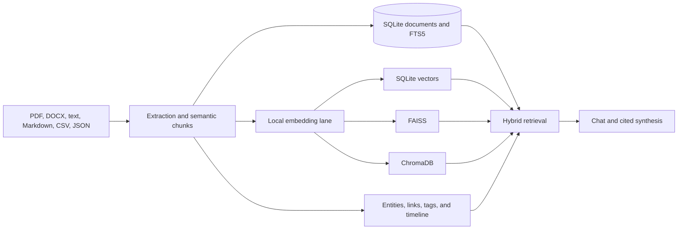

# Knowledge Engine

The knowledge engine keeps uploaded and pasted sources inside the selected
project, then makes them available to chat, search, synthesis, timelines, and
the relationship graph.



## Implemented Features

- Document and text ingestion
- Semantic chunking
- SQLite FTS search with fallback search
- Local deterministic embeddings with an optional FastEmbed lane
- SQLite vectors with optional FAISS and ChromaDB acceleration
- Source attribution on chunks
- Entity extraction
- Relationship graph extraction with stable nodes, connected edges, degree counts, and source lineage
- Automatic document tags
- Timeline generation
- Hybrid lexical/vector retrieval
- Source-attributed local synthesis
- Memory compression summaries
- Context replay snapshots

## APIs

Ingest text:

```bash
POST /api/knowledge/ingest
{
  "title": "Project notes",
  "content": "OpenAgent stores private knowledge locally.",
  "project": "default"
}
```

Search:

```bash
GET /api/knowledge/search?project=default&q=private
```

Semantic search:

```bash
POST /api/knowledge/semantic-search
{
  "project": "default",
  "query": "private memory"
}
```

Hybrid search:

```bash
POST /api/knowledge/hybrid-search
{
  "project": "default",
  "query": "private memory"
}
```

Tags and timeline:

```bash
GET /api/knowledge/tags?project=default
GET /api/knowledge/timeline?project=default
```

Synthesize:

```bash
POST /api/knowledge/synthesize
{
  "project": "default",
  "query": "private memory"
}
```

Graph:

```bash
GET /api/knowledge/graph?project=default
```

The graph response keeps the original `entities` and `relationships` records
for existing clients. The workbench uses the normalized `nodes`, `edges`, and
`stats` fields. Every edge references a node ID, duplicate links are removed,
and relationship endpoints remain visible even when they were not present in
the first entity query page.

Compress memory:

```bash
POST /api/knowledge/compress
{
  "project": "default"
}
```

Create replay:

```bash
POST /api/knowledge/replay
{
  "project": "default",
  "label": "Planning replay",
  "query": "roadmap"
}
```

## Local embedding lanes

`local-hash` is always available and never downloads a model. `fastembed`
uses a local ONNX embedding model when the optional dependency and model cache
are present. The selected provider is recorded with each vector, so switching
lanes causes a deliberate index refresh rather than mixing incompatible
vectors. FAISS and ChromaDB receive embeddings from this local provider
boundary; neither backend is allowed to choose a hosted embedding service.
