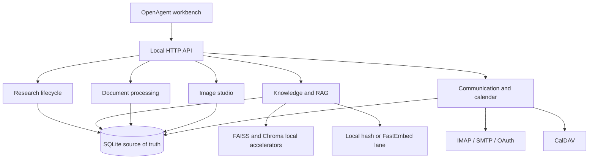

# Local Intelligence Services

OpenAgent keeps research, source retrieval, document work, media work, and
personal communication in the same local runtime. The services share the
SQLite store, project boundary, audit trail, and approval rules, but they do
not need to be enabled as one large external stack.

## How the pieces fit together



Every service records its durable state locally. FAISS, ChromaDB, generated
artifacts, image files, and communication attachments are secondary local
stores or mirrors; the SQLite records retain the lineage needed to rebuild or
inspect them.

## Research service

The research service uses `ResearchLifecycle` for sessions that survive a
browser refresh or process restart. A session has a query, provider choice,
attempt count, status, checkpoints, sources, report text, and result payload.

The normal flow is:

1. Create a session with `POST /api/research/sessions`.
2. Follow durable progress with `GET /api/research/sessions/{id}/stream`.
3. Open the stored report with `GET /api/research/sessions/{id}/report`.
4. Cancel, retry, branch, archive, or delete the session through the matching
   action route.

The worker writes checkpoints as it moves from planning to source collection,
synthesis, and completion. Cancellation is recorded in SQLite and the worker
checks the flag before committing a result. Retry is limited by the session's
`max_attempts` value.

This service does not promise that a local-only run can discover current public
papers. A current web search needs an approved external route and a configured
provider. When that boundary is not available, the report can only use local
knowledge and the response should say so.

## Knowledge, ingestion, and retrieval

Text, Markdown, CSV, JSON, PDF, and supported office files can enter the local
knowledge library. PDF text is extracted with `pypdf` when installed. DOCX
files use `python-docx` when available, with a conservative XML fallback for
basic extraction. Imported documents are stored in the editor library and are
also indexed as knowledge sources, so a later chat or RAG query can use them.

The retrieval path has separate lanes:

- FTS5/BM25 for exact words and names.
- Local deterministic hash embeddings for an offline, dependency-free
  fallback.
- FastEmbed for a higher-quality local ONNX embedding model when the optional
  dependency and model files are installed.
- FAISS for fast in-process vector search when `faiss-cpu` is installed.
- ChromaDB as a persistent local vector mirror when `chromadb` is installed.

The RAG service supplies its own embeddings to FAISS and ChromaDB. Those
backends do not download a model or send text to a hosted embedding service.
The UI exposes the embedding lane and disables FastEmbed until the local
dependency is available.

Install the optional local lanes with:

```powershell
python -m pip install -e ".[rag]"
```

To select the ONNX lane after installation:

```powershell
$env:OPENAGENT_EMBEDDING_PROVIDER = "fastembed"
```

The first use of FastEmbed may need to obtain its model files. For an air-gapped
machine, cache the model first or use `local-hash`. The embedding provider is
stored with each vector, which makes a provider change explicit and causes the
index to be rebuilt for that lane.

Useful routes:

```text
GET  /api/knowledge/status
POST /api/knowledge/upload
POST /api/knowledge/ingest
POST /api/knowledge/hybrid-search
POST /api/rag/query
POST /api/rag/sync
GET  /api/rag/status
```

## Documents and generated files

`DocumentProcessing` sits beside the editor document store. It supports:

- PDF and office/text import.
- Local text extraction and previews.
- PDF page rendering when `pypdfium2` is installed.
- Page annotations and OCR overlay records.
- Versioned text redaction.
- Deterministic PDF export with an optional local HMAC signature.
- DOCX, PPTX, and XLSX exports when the office extra is installed.
- Text comparison and ZIP export of selected documents.

Imports return both the editor document and the knowledge record. This avoids
the old split where an uploaded document existed in one screen but could not
be found by retrieval. Generated files are written under the configured local
artifact directory and registered with the originating document.

Install the document tools with:

```powershell
python -m pip install -e ".[media,office]"
```

The export routes return an artifact record and its local path. They do not
pretend to be a cloud file service or a typesetting system; the generated
layout is deterministic and intentionally conservative.

## Image studio

The image studio stores original files, metadata, albums, operation records,
and version snapshots under the local `image_studio` directory. Its current
local operations are rotate, upscale, inpaint with a supplied mask,
background removal, restoration, style adjustment, sharpening, denoising,
replacement, metadata editing, favorites, batch tagging, deduplication, and
undo.

Operations create a new version before the current asset pointer is advanced.
Undo therefore restores a previous local version rather than trying to reverse
an image mathematically. Gallery endpoints cover upload, library, albums,
metadata, operations, versions, transforms, and deduplication.

The built-in transformations are deterministic Pillow operations. They are not
a generative image model and should not be described as photorealistic
inpainting or learned background segmentation. A future vision backend can be
attached through the same transform boundary without changing the gallery
records.

Install the local image tools with:

```powershell
python -m pip install -e ".[media]"
```

## Email, calendar, and contacts

The communication hub keeps connector configuration, imported messages,
attachments, drafts, approvals, scheduled sends, sync runs, dead letters, and
OAuth account records in SQLite.

- IMAP fetch and SMTP send are implemented behind the email connector and are
  still gated by connector configuration and the external approval policy.
- Attachments are kept in the local data directory and can be indexed into the
  knowledge library.
- Draft sending requires an approval record unless the caller has explicitly
  selected an allowed policy.
- Scheduled messages are persisted and can be processed by the worker.
- Provider OAuth records include authorization URL, callback, and refresh
  routes, but real provider onboarding still needs the provider's client
  registration, redirect URI, scopes, and credentials.

The calendar service provides local calendars, events, reminders, free-slot
search, iCalendar import/export, and schedule helpers. The CalDAV adapter
stores provider state, sync tokens, ETags, remote hrefs, deletes, and conflict
records. It uses ordinary HTTP CalDAV methods when a real provider is
configured; provider-specific authentication and recurring-event edge cases
remain dependent on the server being connected.

Contacts are a separate local manager with project and owner filtering, search,
import, export, update, and delete operations. Communication contacts remain
available for mailbox context without requiring an external address book.

Useful routes include:

```text
GET  /api/communication/inbox
POST /api/communication/drafts
GET  /api/calendar/events
POST /api/calendar/events
GET  /api/contacts
POST /api/contacts
```

## Boundaries that matter

The local runtime can store, index, transform, schedule, and audit these
records without a cloud account. It cannot manufacture IMAP passwords,
OAuth client registrations, CalDAV permissions, a missing optional Python
package, or a current internet result. Those inputs remain explicit setup
steps and are reflected in status responses instead of being presented as
ready when they are not.
