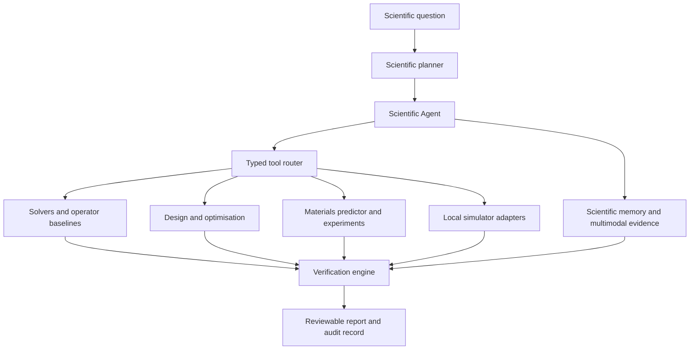
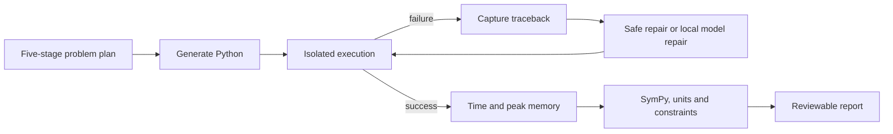

# Scientific AI

Scientific AI is a local capability layer for OpenAgent. It uses the existing
agent registry, context search, audit path, model gateway, and adaptive engine;
it does not introduce a second runtime or a second storage system.

## Architecture



Every workflow keeps its assumptions, inputs, checks, and limitations visible.
The module is intended to support research and engineering decisions, not to
replace domain review or claim experimental validity by itself.

## Scientific Agents

`ScientificAgent` turns a question into a typed plan, executes the matching
local workflow, runs verification checks, and returns a report with the
assumptions and next actions. The current planner covers:

- scientific review planning
- heat-equation computation
- engineering beam optimisation
- materials discovery
- multimodal evidence fusion

The agent can be extended with a paper-search tool through the existing
research boundary. Network research remains a separately approved action; the
deterministic scientific workflows do not browse or upload evidence.

`PaperSearch` provides a local paper-record index and accepts an explicitly
approved fetch callback when a project chooses to use external research. The
callback is supplied by the caller, so this package never quietly opens a
network connection.

## Scientific Tool Calling

The tool layer has stable adapters for local numerical packages and simulators:

- NumPy, SciPy, SymPy, pandas, and Matplotlib capability discovery
- FEniCS, OpenFOAM, COMSOL, and LAMMPS adapter interfaces
- bounded executable calls with captured output and return codes
- explicit local-only privacy boundaries

Adapters do not silently install software or contact a provider. A simulator
is marked unavailable until the user configures its local executable. This keeps
the interface useful on a clean CPU-only installation while making richer
environments easy to connect.

The workflow shape is:

```text
Question -> Scientific Agent -> Tool adapter -> Result -> Verification -> Report
```

## Scientific Computing

The built-in computing path includes a stable one-dimensional heat-equation
solver and a transparent surrogate baseline. Operator-learning interfaces are
available for:

- FNO
- DeepONet
- PINN
- general operator-learning backends

The dependency-light baseline is deterministic and testable. Projects can add
NumPy, SciPy, PyTorch, or another approved backend behind the same `fit` and
`predict` contract without changing the agent or route API.

## Engineering Optimisation

`DesignProblem` describes variables, bounds, objectives, and constraints.
`EngineeringOptimizer` evaluates candidates, ranks feasible designs, and
returns the physical metrics used to make the decision. The bundled example is
a low-mass beam with stress and deflection limits.

```text
Requirement -> Variables and bounds -> Physics evaluator
           -> Constraint checks -> Ranked candidates -> Report
```

## Multimodal Science

`MultimodalScientificContext` accepts typed local evidence from:

- paper or note text
- equations and assumptions
- sensor CSV data
- numerical image samples
- simulation JSON output

The context summary records each source and the numeric values it contributed.
It is then passed through the same verification layer as a single-source
calculation.

## Scientific Memory

`ScientificMemory` stores reviewable records for:

- equations
- units
- datasets
- assumptions
- material properties
- boundary conditions
- temperatures, pressures, density, and Young's modulus
- previous experiments

Each record carries a category, name, value, unit, source, and timestamp. The
memory object can be connected to the existing OpenAgent store by the caller,
so normal project ownership and retention rules remain in force.

## Verification and Safety

The verification path is deliberately separate from the agent response:

```text
Agent output
    -> finite-value checks
    -> residual and equation checks
    -> unit checks
    -> engineering constraint checks
    -> consistency findings
    -> PASS or needs review
```

The code runner records stdout, stderr, exit status, elapsed time, peak process
memory, source hashes, attempt history, and a public lifecycle transcript. On
failure it captures the traceback, applies a bounded deterministic repair when
possible, and may ask the configured local model gateway for revised Python.
The revised source must compile before it is accepted. Execution is isolated,
local, time-limited, and never invokes a shell or an external provider.



Scientific memory is loaded before engineering execution. Recognised project
records such as density, Young's modulus, span, load, stress limit, and
deflection limit replace labelled defaults and are listed in the final report.

The safety helpers also provide citation presence checks, numeric consistency
checks, and a conservative evidence-overlap check for unsupported claims.

## Experiment Planner

`ExperimentPlanner` turns a goal and candidate table into ranked, reviewable
proposals. Each proposal contains variables, a rationale, and a priority. A
project can supply its own scoring function for cost, uncertainty, strength,
density, or another measurable objective.

```text
Goal -> Candidate pool -> Scoring function -> Ranked experiments -> Human review
```

Engineering goals use five visible stages: gather parameters, generate the
model, run the optimisation, evaluate equations and constraints, and produce a
profiled report. This is an operational plan and audit trail, not hidden model
reasoning.

## Routes and UI

- `GET /api/science/status` reports workflows and local optional backends.
- `GET /api/science/tools` reports discovered numerical and simulator tools.
- `GET /api/science/memory` lists project-scoped scientific memory.
- `GET /api/science/materials/datasets` lists stored materials datasets.
- `POST /api/science/run` runs a typed workflow from a natural-language goal.
- `POST /api/science/multimodal` combines local evidence sources.
- `POST /api/science/experiments` ranks proposed experiments.
- `POST /api/science/execute` runs approved, bounded Python with profiling and retries.
- `POST /api/science/memory` stores an equation, unit, assumption, dataset, or experiment record.
- `POST /api/science/materials/datasets` validates and stores a local materials table.
- `POST /api/science/materials/analyse` ranks materials and proposes next experiments.
- `POST /api/science/verify` runs the independent scientific safety checks.
- `POST /api/science/simulate` runs an approved configured simulator or a clearly labelled deterministic demonstration.

The workbench exposes Scientific AI as its own collapsible navigation group,
directly below Intelligence. Its six entries open separate working views for
Scientific Agents, Scientific Computing, Engineering Optimisation, Multimodal
Science, Scientific Verification, and Materials Discovery. Long-running steps
are shown as a progress timeline, followed by structured findings, tables,
charts, execution output, and profiling data.

## Module guides

- [Scientific Agents](science/SCIENTIFIC_AGENTS.md)
- [Scientific Computing](science/SCIENTIFIC_COMPUTING.md)
- [Engineering Optimisation](science/ENGINEERING_OPTIMISATION.md)
- [Multimodal Science](science/MULTIMODAL_SCIENCE.md)
- [Scientific Verification](science/SCIENTIFIC_VERIFICATION.md)
- [Materials Discovery](science/MATERIALS_DISCOVERY.md)

## Privacy boundary

Scientific calculations, uploaded evidence passed to this module, intermediate
results, and reports stay local by default. The scientific runtime does not
browse, download a model, call an external provider, or send telemetry. A
separate approved connector or research action is required for external data.

## Extension rules

1. Add a typed implementation under the relevant `science` subpackage.
2. Keep serializable inputs and outputs.
3. Add a verifier for every numerical claim that affects a decision.
4. Route tools through `ScientificPlanner` and `ScientificToolRouter`.
5. Add deterministic tests and document optional dependencies and privacy.
