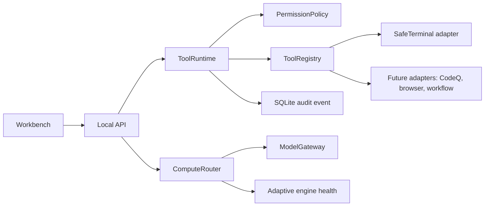
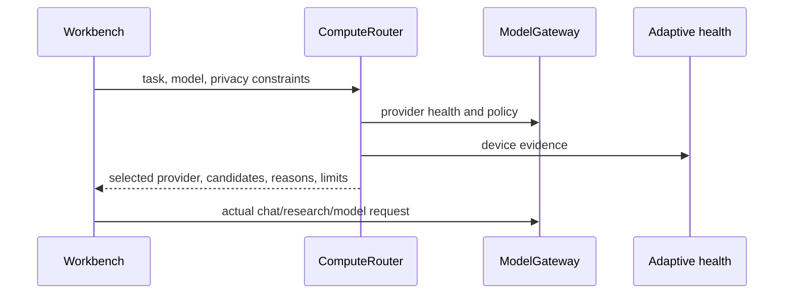

# Unified Runtime and Capability Routing

OpenAgent now has a common execution boundary for local tools and a separate
decision layer for choosing a model provider. These layers sit beside the
existing services; they do not replace CodeQ, SafeTerminal, MCP persistence,
or the adaptive engine.

## Why this exists

Several parts of the application need to run work: CodeQ edits repositories,
SafeTerminal runs bounded commands, MCP describes external tools, and the
model gateway chooses providers. Keeping those operations in separate shapes
makes it difficult to show a reliable trace or apply the same approval rule.

The shared runtime gives orchestration code one request and result format,
while the original service remains responsible for the actual operation.



## Tool contract

`ToolSpec` describes the name, input schema, risk level, network boundary,
and capabilities. `ToolRequest` carries project, owner, approval, timeout,
and trace information. `ToolResult` reports success, status, output, timing,
and trace identifiers.

The current registry includes `terminal.run`. It delegates to
`openagent.safe_terminal.SafeTerminal`, so the existing command allowlist,
workspace boundary, SQLite run records, and terminal audit records remain in
force. More services can be registered without creating a second policy
implementation.

Policy outcomes are explicit:

| Outcome | Meaning |
| --- | --- |
| `allowed` | The request met the registered tool policy. |
| `needs_approval` | An approval id is required before execution. |
| `denied` | The operation is outside the autonomous boundary. |
| `failed`, `timeout`, `cancelled` | Execution started but did not complete successfully. |

The runtime bounds serialized results and records a sanitized audit event. A
timeout prevents the caller from waiting indefinitely; it is not a claim that
every third-party process can be force-killed safely.

## MCP invocation

MCP server registration remains a local configuration operation. A registered
tool can now be invoked through:

```text
POST /api/mcp/tools/{tool_id}/invoke
```

The request must include the project and, when the tool requires it, an
`approval_id`. Stdio servers are launched for one bounded JSON-RPC exchange.
HTTP-based transports use a bounded local request and are never treated as
approved merely because they are registered. The response is size-limited and
connection events plus an audit event are written locally.

This is intentionally a small, testable client boundary. Long-lived sessions,
SSE reconnect policies, and provider-specific MCP authentication remain
separate work because they need deployment credentials and protocol fixtures.

## Compute plans

`ComputeRouter` reads live `ModelGateway.specs()` and adaptive-engine health.
It scores available providers against local-first policy, requested model,
task fit, and the external-network flag. It returns a plan, not a benchmark
and not a model load command.



The operator view in Developer shows provider count, registered shared tools,
hardware evidence, and an execution-plan form. This keeps a useful control
surface without duplicating the full model-management screens.

General module health uses the adaptive engine's bounded readiness check and
does not force a driver or device probe for every dashboard refresh. The
dedicated compute status route remains the place to request detailed hardware
evidence, so a slow or unavailable accelerator probe cannot hold up the rest of
the workbench health view.

## API examples

Inspect the runtime:

```bash
curl http://127.0.0.1:8765/api/tools/runtime
curl http://127.0.0.1:8765/api/compute/status
```

Create a local-only plan:

```bash
curl -X POST http://127.0.0.1:8765/api/compute/plan \
  -H "Content-Type: application/json" \
  -d '{"task":"code review","allow_external":false,"require_streaming":true}'
```

Run the built-in safe version check through the shared runtime:

```bash
curl -X POST http://127.0.0.1:8765/api/tools/runtime/execute \
  -H "Content-Type: application/json" \
  -d '{"tool":"terminal.run","arguments":{"command":["python","--version"]}}'
```

## Testing boundary

The focused tests cover local tool tracing, approval decisions, compute
privacy filtering, and a fake stdio MCP server. The full test suite still
depends on optional extras such as Pillow, Playwright, voice engines, and
vector backends when those paths are exercised. Results from a machine without
those extras must be reported as setup gaps rather than presented as a clean
production certification.
