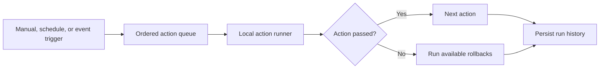

# Workflow Engine

OpenAgent includes a local workflow automation engine for repeatable work inside a project. Workflows can be created, edited, enabled, disabled, run, and deleted from the Automation workspace. Each execution is stored with the status and output of every action.



The embedded scheduler checks due workflows every five seconds while the local server is running. It stops when the server closes. Scheduled network actions do not receive standing approval: they fail at the network boundary unless an explicitly authorized run is made.

## Current Step Actions

- `add_event` - write a local context event
- `run_agent` - run a built-in agent
- `search_context` - search local memory
- `chat` - send a chat message through the model gateway
- `condition` - evaluate workflow state
- `file_read` - read a file inside the workflow file root
- `file_write` - write a file inside the workflow file root
- `file_list` - list files inside the workflow file root
- `spreadsheet_read` - read a CSV file inside the workflow file root
- `spreadsheet_write` - write CSV rows inside the workflow file root
- `database_query` - run a read-only `SELECT` against SQLite
- `report_generate` - create a local Markdown report
- `monitor_check` - evaluate a monitoring condition
- `alert` - write an auditable alert event
- `browser_fetch` - fetch a web page when `allow_network=true`
- `api_request` - call an HTTP API when `allow_network=true`
- `audit` - write an audit event

## Triggers

- `manual` - run only when requested
- `scheduled` - run through the due-schedule runner
- `event` - run when a matching event is submitted

## Example

```json
{
  "name": "Daily local memory review",
  "project": "default",
  "trigger_type": "scheduled",
  "trigger": { "interval_seconds": 86400 },
  "steps": [
    { "action": "search_context", "query": "OpenAgent roadmap" },
    { "action": "run_agent", "agent": "planning", "goal": "Plan the next milestone" },
    { "action": "file_write", "path": "reports/daily.txt", "content": "Daily review complete" },
    { "action": "audit", "audit_action": "workflow.reviewed", "resource": "daily-review" }
  ]
}
```

Create:

```bash
POST /api/workflows
```

Update a definition or change its enabled state:

```bash
PUT /api/workflows/{id}
{
  "name": "Daily local memory review",
  "enabled": false,
  "steps": [
    { "action": "search_context", "query": "OpenAgent roadmap" }
  ]
}
```

Delete the workflow and its stored runs:

```bash
DELETE /api/workflows/{id}
```

Run:

```bash
POST /api/workflows/run
{
  "workflow_id": "..."
}
```

Run due scheduled workflows:

```bash
POST /api/workflows/run-due
{}
```

Trigger an event workflow:

```bash
POST /api/workflows/event
{
  "project": "default",
  "event_name": "note.created",
  "payload": { "name": "note.created" }
}
```

Visual builder schema:

```bash
GET /api/workflows/builder
GET /api/workflows/visual?workflow_id=...
GET /api/workflows/layout?workflow_id=...
POST /api/workflows/layout
```

The Automation workspace has a multi-step editor, trigger configuration, workflow filtering, enable and disable controls, due-schedule execution, and a run inspector. The run inspector keeps successful and failed action output separate so a failed workflow can be diagnosed without reading a complete API response.

## Safety

File, spreadsheet, and report actions are restricted to the workflow file root under the OpenAgent data directory. Database actions are read-only and only accept `SELECT` queries. Browser and API actions require explicit `allow_network=true`. File writes create rollback records, and failed workflows execute available rollback hooks.

The visual layout API remains available for clients that want to store node positions. Layout changes write a `workflow.layout.save` audit event and do not execute the workflow.
