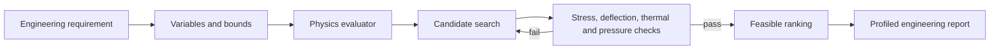

# Engineering Optimisation

Engineering Optimisation turns requirements into variables, objectives,
constraints, candidate evaluations, and a verified result.

## Architecture

## How it works

The bundled beam example uses a five-stage plan and minimises mass while
checking stress and deflection. The bridge workflow performs an equivalent-
girder screening optimisation and labels the checks that still require a
code-certified structural model.
The heat-exchanger workflow writes and executes a reproducible Python search,
records runtime and memory use, checks effectiveness and pressure-drop limits,
and reports the selected candidate. Bridge requests run the screening workflow
and use project scientific memory for density, Young's modulus, span, load,
stress limit, and deflection limit when those records are available. Missing
values use visible screening defaults; the report does not present the result
as a certified bridge design.
