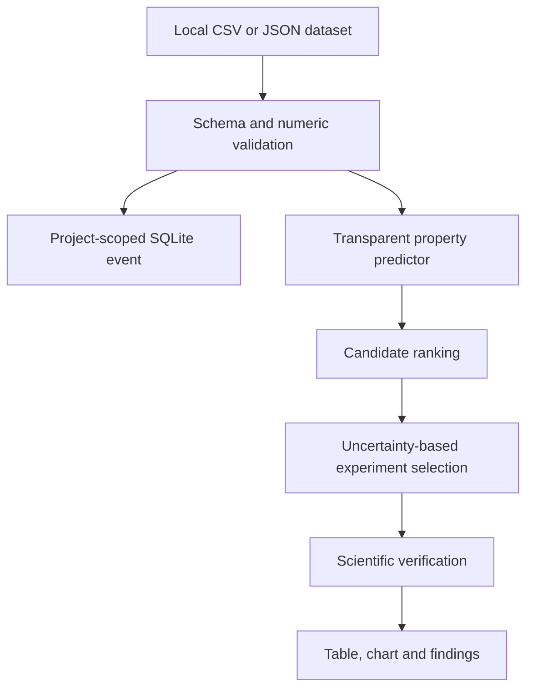

# Materials Discovery

Materials Discovery accepts a local CSV or JSON property table, validates its
numeric fields, fits a transparent predictor, ranks candidate materials, and
selects up to five next experiments by uncertainty.

## Architecture

## How it works

The dataset route records its name, target, numeric columns, source, and row
count in the existing OpenAgent store. Analysis returns ranked candidates,
predicted values, uncertainty, proposed experiments, chart data, and a
verification record. The browser renders the same response as a table and
canvas chart rather than exposing raw JSON as the primary view.
