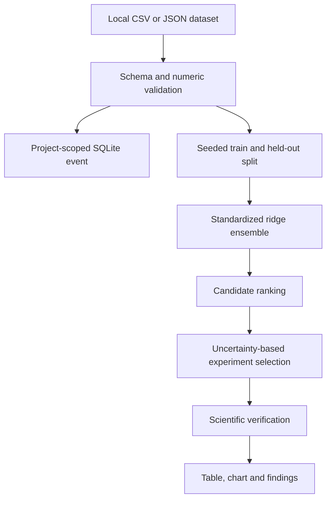
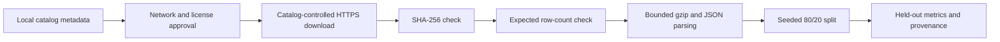

# Materials Discovery

Materials Discovery accepts a local CSV or JSON property table, validates its
numeric fields, fits a transparent predictor, ranks candidate materials, and
selects up to five next experiments by uncertainty.

## Architecture

## How it works

The dataset route accepts CSV, JSON, or JSONL and records its name, target,
numeric columns, source, and row count in the existing OpenAgent store. The
analysis uses standardized features, seeded bootstrap regressors, and distance
to the nearest standardized training point. Its uncertainty is a ranking
signal, not a calibrated probability.

The generated report includes held-out MAE, RMSE, R-squared, training and test
counts, ranked candidates, proposed experiments, chart data, and hashed JSON
and Markdown artifacts. The browser renders progress, findings, a table, and a
chart rather than presenting raw JSON as the main result. Small datasets remain
useful for smoke tests; evidence intended for scientific comparison should use
a documented public dataset and a held-out split, typically hundreds or
thousands of records.

## Public dataset catalog

The public catalog contains metadata, not copied material records. Each entry
names the original source, citation, row count, target field, license, download
address, and upstream SHA-256 checksum. The initial entries contain between
1,056 and 1,276 records and come from published Scientific Data collections.

`GET /api/science/materials/catalog` lists metadata without network access.
`POST /api/science/materials/catalog/import` retrieves verified records, while
`POST /api/science/materials/catalog/analyse` performs the same import followed
by the deterministic held-out analysis. Both POST routes require
`allow_external: true` and `license_accepted: true`. A missing approval stops
before a network client is called.

A successful import is stored as a project-scoped materials dataset. Import
and analysis each create an audit event containing the catalog identifier,
verified checksum, row count, license identifier, and network-approval state.
Dataset content is never written to the audit log.

Downloads are accepted only from the HTTPS address stored in the catalog. The
runtime limits compressed and decompressed size, checks the content hash before
parsing, and rejects a changed row count. The report preserves the source URL,
license, citation, expected and verified checksum, retrieved byte count, and
split seed. A failed integrity check produces no analysis.

The regression model expects numeric feature columns. Records such as crystal
structures or chemical formulae remain in the imported data for provenance but
are not silently converted into descriptors. Composition or structure models
need an explicit featurization stage before they can use those fields.
