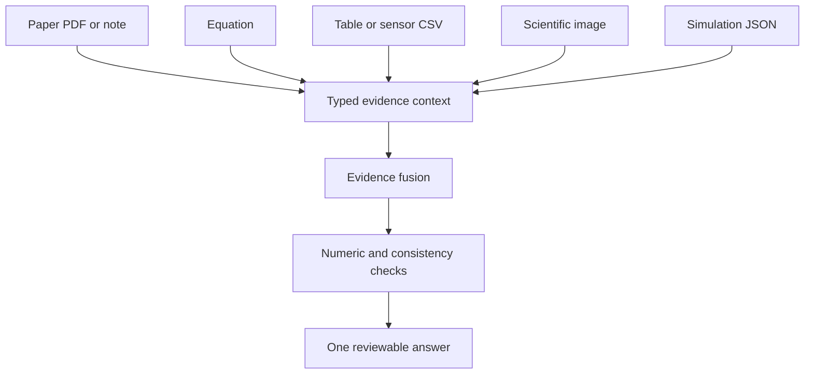

# Multimodal Science

Multimodal Science combines typed local evidence before a scientific answer is
prepared.

## Architecture

## How it works

PDF text is extracted locally when `pypdf` is installed; otherwise the file is
kept as metadata-only evidence. CSV files are parsed into typed sensor rows,
images are sampled into numerical intensity summaries, simulation JSON is
reduced to numeric outputs, and text remains attributable to its source file.
No uploaded evidence leaves the local process.
