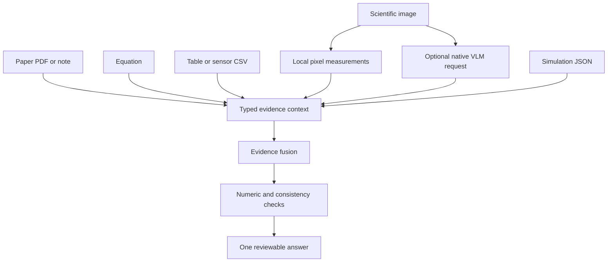

# Multimodal Science

Multimodal Science combines typed local evidence before a scientific answer is
prepared.

## Architecture

## How it works

PDF text is extracted locally when `pypdf` is installed; otherwise the file is
kept as metadata-only evidence. CSV files are parsed into typed sensor rows,
images are decoded locally into channel, brightness, entropy, edge, and region
measurements, simulation JSON is reduced to numeric outputs, and text remains
attributable to its source file. These local image measurements do not assign
semantic labels.

Semantic image observations are optional. Ollama receives the image through
its native `message.images` protocol; configured OpenAI-compatible endpoints
receive `image_url` content only after explicit external approval. Text-only
providers are rejected rather than silently discarding the image. Evidence
stays local unless that external boundary is approved.
