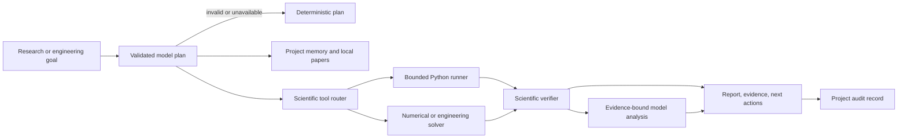

# Scientific Agents

The Scientific Agent uses the normal OpenAgent registry, project context, model
gateway, audit log, and local tool boundary. It plans first, chooses a typed
workflow, executes local work, verifies the output, and returns a reviewable
report.

## Architecture

## How it works

1. A configured local model can propose a typed JSON plan. Schema validation
   rejects unknown workflows, extra fields, oversized steps, and malformed
   assumptions; the deterministic planner remains the fallback.
2. Local project context and paper records are searched for relevant evidence.
3. The tool router runs a deterministic solver or a policy-checked, bounded
   Python subprocess in a temporary workspace. The runner enforces its timeout,
   a configurable 32 MB to 16 GB memory ceiling, and a conservative AST policy
   before each original or repaired attempt.
4. Failed scripts expose the traceback to deterministic repair and, when a
   configured local model is available, a local model repair pass.
5. Numerical values, units, residuals, and constraints are checked.
6. A local model may interpret the completed calculation, but every accepted
   claim must cite an evidence ID produced by the run. Ungrounded output is
   discarded.
7. The report keeps the numbered plan, attempts, repairs, execution time, peak
   memory, evidence, limitations, and next actions visible.

The lifecycle transcript shows tool actions and evidence. It does not expose
private chain-of-thought. Timeout and memory termination are recorded as
resource-limit events. The subprocess policy blocks dangerous imports and
calls, but it is defense in depth rather than an operating-system security
sandbox.

External paper retrieval is never automatic. A caller must provide an approved
research callback before the local paper index accepts remote results.
