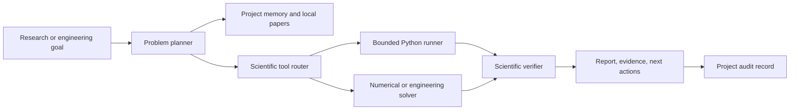

# Scientific Agents

The Scientific Agent uses the normal OpenAgent registry, project context, model
gateway, audit log, and local tool boundary. It plans first, chooses a typed
workflow, executes local work, verifies the output, and returns a reviewable
report.

## Architecture

## How it works

1. The planner classifies the goal and records its assumptions.
2. Local project context and paper records are searched for relevant evidence.
3. The tool router runs a deterministic solver or a bounded Python workflow.
4. Failed scripts expose the traceback to deterministic repair and, when a
   configured local model is available, a local model repair pass.
5. Numerical values, units, residuals, and constraints are checked.
6. The report keeps the numbered plan, attempts, repairs, execution time, peak
   memory, evidence, limitations, and next actions visible.

The lifecycle transcript shows tool actions and evidence. It does not expose
private chain-of-thought.

External paper retrieval is never automatic. A caller must provide an approved
research callback before the local paper index accepts remote results.
