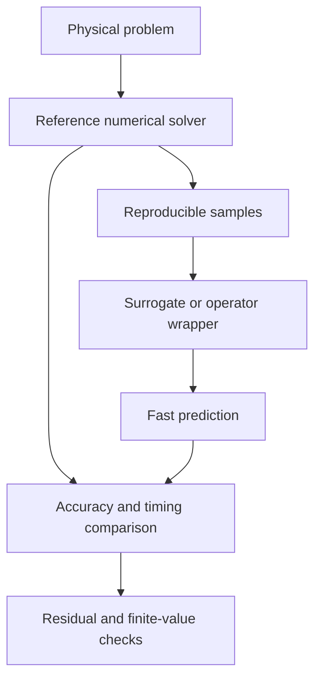

# Scientific Computing

Scientific Computing provides dependency-light solvers and stable interfaces
for richer local numerical backends.

## Architecture

## How it works

- `HeatEquation1D` provides a stable finite-difference reference problem.
- `ScientificSurrogate` provides a transparent Fourier-feature ridge baseline.
- FNO, DeepONet, and PINN wrappers expose consistent `fit` and `predict`
  contracts without presenting the baseline as a full research implementation.
- NumPy, SciPy, SymPy, pandas, Matplotlib, and FEniCS are discovered locally.
- Execution records include elapsed time, attempts, tracebacks, code hashes,
  and peak process memory.

Optional backends can replace the baseline behind the same contract while the
agent, routes, tests, and privacy boundary remain unchanged.
