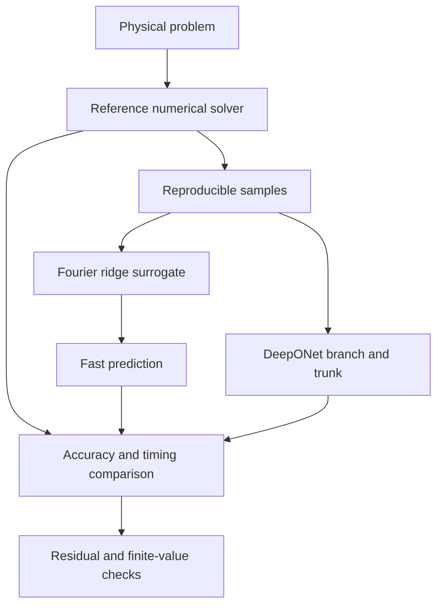

# Scientific Computing

Scientific Computing provides dependency-light solvers and stable interfaces
for richer local numerical backends.

## Architecture

## How it works

- `HeatEquation1D` provides a stable finite-difference reference problem.
- `ScientificSurrogate` provides a transparent Fourier-feature ridge baseline.
- `DeepONet` is an input-dependent branch/trunk operator. It has a canonical
  optional PyTorch network and a deterministic NumPy random-feature backend.
  Both are evaluated on held-out heat-equation solutions.
- `FNO` and `PINN` retain the same `fit` and `predict` interfaces, but currently
  report themselves as constant-output baselines. They are not described as
  full FNO or PINN implementations.
- NumPy, SciPy, SymPy, pandas, Matplotlib, and FEniCS are discovered locally.
- Execution records include elapsed time, attempts, tracebacks, code hashes,
  and peak process memory.

Benchmarks report RMSE, MAE, relative RMSE, R-squared, maximum error, solver
time, and surrogate inference time. Tests enforce held-out accuracy instead of
checking only that a metric key exists.
