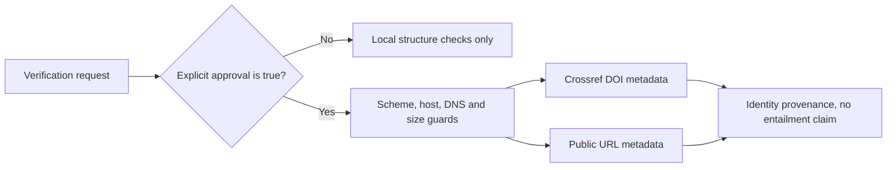

# Scientific Verification

Verification is independent of model wording. A fluent answer does not pass
unless its supplied evidence and numerical checks pass.

## Architecture


## How it works

The verifier checks finite numerical values, caller-supplied residuals,
restricted symbolic equations through SymPy, engineering dimensions through
Pint, and explicit constraints. A restricted standard-library algebra
evaluator and known-unit fallback remain available for minimal installations.

Claims use explicit `evidence_ids`; word overlap is not treated as proof.
Citation records are checked locally for matching IDs and DOI/URL structure.
Every finding keeps its status, severity, and evidence record visible in the
UI and audit history.

## Approved citation resolution

`POST /api/science/verify` can resolve citation identity when the request sets
`external_citation_lookup_approved` to the boolean value `true`. Omitting the
field, setting it to `false`, or supplying a non-boolean value does not grant
network access. Approval applies to that request only and is recorded in the
verification result and audit event.

DOIs are looked up through the Crossref REST API. Ordinary HTTP and HTTPS URLs
are fetched only far enough to collect bounded response metadata and, for HTML,
the page title. The resolver uses a short timeout, limits bytes read, refuses
credentials and non-HTTP schemes, does not follow redirects, and rejects
localhost, private, link-local, reserved, multicast, and otherwise non-public
IP addresses before opening a connection. Each result retains the supplied
citation fields, check time, provider, request URL, HTTP status, and bytes read.

Resolution answers one narrow question: whether the supplied DOI or public URL
returned matching source identity metadata. It does **not** determine whether
the source supports, contradicts, or entails a claim. Claim support remains a
separate evidence-linking and scientific review step.

Example request:

```json
{
  "project": "default",
  "result": {"stress": 125000000},
  "citations": [
    {"id": "paper:stress", "doi": "10.1000/example"}
  ],
  "external_citation_lookup_approved": true
}
```

Privacy boundary:


